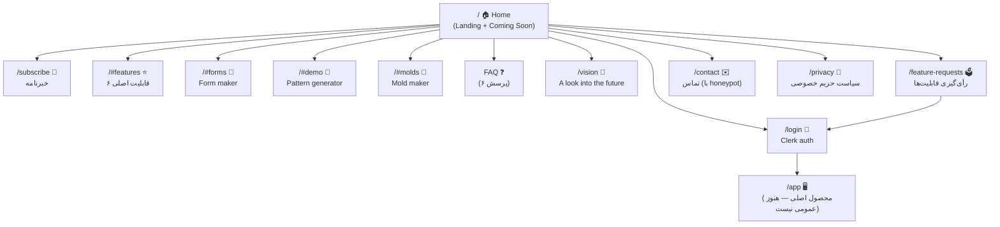
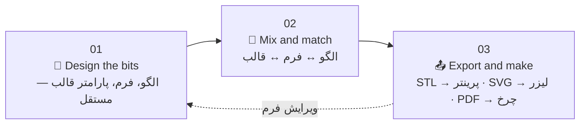

# 🔍 فایل ۰۰ — تحلیل کامل سایت و محصول Patturn Studio

> **آدرس:** `https://patturn.studio` · **سازنده:** Sinsi Labs · **وضعیت:** Pre-launch (Coming soon + Closed Beta)
> **تاریخ تحلیل:** ۲۰۲۶-۱۱-۲۰ · **روش:** استخراج محتوای کامل صفحات عمومی + تحلیل رفتاری/فنی

---

## ۱. 🧭 شناسنامهٔ محصول

| مورد | مقدار |
|------|-------|
| 🏷️ نام محصول | **Patturn Studio** (با لوگوی wordmark اختصاصی) |
| 🏢 شرکت | Sinsi Labs |
| 🎯 دسته | SaaS طراحی پارامتریک / CAD سبک / ابزار ساخت دیجیتال |
| 👥 مخاطب اصلی | سفالگران، سرامیک‌کاران، سازندگان (makers) |
| 👥 مخاطب ثانویه | برش لیزری، نساجی، چاپ دستی، چوب، تولیدکنندگان اسباب‌بازی |
| 🧠 پیش‌نیاز مهارتی | **صفر** — «بدون نیاز به تجربهٔ ۳بعدی یا طراحی» |
| 🏺 تمرکز اولیه | Ceramics-first |
| 💰 مدل درآمدی اعلام‌شده | Free tier محدود + پلن‌های پولی + پلن سازمانی/کلاس درس |
| 📅 زمان عرضه | «قبل از پایان سال» — در حالت بتای بسته |
| 🔐 احراز هویت | Clerk (Google OAuth + ایمیل) |
| 📧 ایمیل مارکتینگ | Kit (ConvertKit) |
| ☁️ میزبانی | Vercel + Vercel Analytics |

### پیام برند
> **«Design tools for potters»** — *«Reshaping the way you create.»*
> شعار مفهومی: «یک اندازه برای همه نیست» (One size does not fit all)

**لحن برند:** صمیمی، خودی، بی‌تکلف، با کمی شوخ‌طبعی صنعتی («Lego blocks for pottery nerds»، «wah-lah»، «without being a rocket scientist»). ترجمهٔ فارسی پیشنهادی: خودمانی اما حرفه‌ای، پرهیز از اصطلاحات ترسناک فنی.

---

## ۲. 🗺️ نقشهٔ کامل صفحات (Information Architecture)

| صفحه | هدف | اجزای کلیدی |
|------|------|-------------|
| `/` | بازاریابی + پیش‌ثبت‌نام + آموزش قابلیت | Banner، Hero، ۶ کارت قابلیت، ۳ مرحلهٔ گردش‌کار، ۵ دموی تعاملی با پارامتر، Testimonial، Vision grid، FAQ، CTA پایانی |
| `/subscribe` | جمع‌آوری ایمیل | فرم تک‌فیلد + لینک privacy |
| `/login` | ورود/ثبت‌نام | «Continue with Google» + ایمیل + redirect_url |
| `/feature-requests` | اولویت‌سنجی جامعه | لیست رأی‌گیری (Top/New)، فیلتر، فرم درخواست، شمارش رأی، زمان نسبی |
| `/contact` | پشتیبانی | نام، ایمیل، موضوع، پیام، فیلد تلهٔ اسپم |
| `/privacy` | انطباق GDPR/UK | مؤثر از ۳۰ اکتبر ۲۰۲۶، فهرست زیرپردازنده‌ها |

**نکات UX قابل‌توجه:**
- 🎯 CTA دوگانه در Hero: «Subscribe for updates» (شکار سرنخ) + «Explore features» (آموزش).
- 🖼️ دموهای زندهٔ پارامتری داخل صفحهٔ بازاریابی — هر بخش یک «مینی-ادیتور» با اسلایدر نشان می‌دهد (مثلاً `Rim 32 · Belly 64 · Foot 46 · Height 78`، `Grid size 11 · Grid spacing 14 · Scale ratio 1.50 · Cell rotation 0°`).
- 🧾 اعداد واقعی در دموها (۱۱.۰ mm، Ø۱۶.۰ mm، Capacity 1131 ml، Shrink 12%) → اعتماد فنی می‌سازد.
- 📱 طراحی ریسپانسیو با تصاویر `_next/image`.
- 🔒 هیچ کوکی تبلیغاتی/ردیاب ندارد؛ آنالیتیکس بدون کوکی و بدون IP.

---

## ۳. ⭐ شش قابلیت اصلی (Pillars)

| # | قابلیت | پیام کلیدی | قابلیت‌های ریز اعلام‌شده |
|---|--------|-------------|--------------------------|
| 1 | 🏺 **Pottery Forms** | «Design & Plan in 3D» | طراحی و اسکچ زنده، ابعاد واقعی، محاسبهٔ خودکار شیرینک (shrink) و حجم |
| 2 | 🔷 **Pattern Design** | «Build your own patterns» | کتابخانهٔ الگوهای پایه + ده‌ها پارامتر + طراحی از صفر |
| 3 | 🗺️ **Stencil Making** | «Map designs to 3D Forms» | اتصال الگو به فرم و تولید استنسیل |
| 4 | 🧱 **Mold Making** | «Auto generate mold systems» | قالب تک‌تکه/چندتکه، مادرقالب، موانع ریختن (barriers)، محاسبهٔ مواد |
| 5 | ⚙️ **Parametric Design** | «Design with parameters» | همه‌چیز از مقادیر ساخته می‌شود؛ اسلایدر → آپدیت آنی |
| 6 | 📤 **Exporting** | «Production ready exports» | تک‌کلیک برای پرینت ۳بعدی، برش، فرزکاری (milling) |

### ۳.۱ گردش‌کار هستهٔ محصول

> **Form ↔ Mold ↔ Pattern — «As easy as 1…2…3»**

سه قطعه (Primitive) که «قطعه‌های قابل تبادل» هستند و با هم ترکیب می‌شوند — این **هستهٔ معماری محصول** است: یک گراف وابستگی (DAG) که در آن تغییر فرم، الگو و قالب را به‌صورت Real-time بازمحاسبه می‌کند.

---

## ۴. 🧪 تحلیل دقیق هر ماژول (آنچه در دموها دیده می‌شود)

### ۴.۱ 🏺 Form Maker
| مورد | جزئیات استخراج‌شده |
|------|---------------------|
| روش ساخت | ویرایش **نود**های پروفیل جانبی (side profile) + **Revolve** به فرم سه‌بعدی |
| فوت‌رینگ | افزودن زیر هر فرم؛ پارامترها: **عرض (width)**، **عمق (depth)**، **سبک لبه (edge style)** |
| ماشین‌حساب حجم | ظرفیت با احتساب **ضخامت دیوار**، **سطح پرشدگی (fill level)**، **نرخ شیرینک بدنهٔ رسی** |
| داده‌های نمونه | wet: `w 145 mm, h 148 mm` · `Fill 80%` · `Rim 25 mm` · `Capacity 1131 ml` · `Filled to 80% → 958 ml` · `Shrink rate 12%` · `Wall 4 mm` |
| کنترل‌های گرید | `Grid 3` ، `Mirror X` ، `Mirror Y` (کمک به تقارن در ویرایش) |
| حالت‌های سلولی الگو | `Circular` · `Elliptical` · `Square` · `Disc` |

> 🔎 **استنباط فنی:** پروفیل با نودهای Bezier/Catmull-Rom و قیدهای تقارن؛ فرم = سطح دوار (Surface of Revolution). ظرفیت = انتگرال عددی π∫r²dy روی پروفیل داخلی، قطع‌شده در ارتفاع پرشدگی، سپس تصحیح شیرینک.

### ۴.۲ 🔷 Pattern Generator
| ویژگی | توضیح |
|-------|-------|
| کنترل پارامتریک | هر الگو از یک «خط پایه» (baseline) شروع می‌شود که کاملاً قابل شخصی‌سازی است |
| کاشی‌بندی بی‌درز | تکرار در هر جهت بدون درز |
| بُردن روی فرم ۳بعدی | پیش‌نمایش نشستن الگو روی انحنا **قبل از** برش/حکاکی/مهر/لعاب |
| ابعاد واقعی | بوم با واحد واقعی (mm) تا طراحی برای قطعهٔ واقعی باشد نه صفحه‌نمایش |
| خروجی وکتور | **SVG** و **DXF** برای لیزر، پلاتر، CNC |
| پارامترهای نمونه در UI | `Roundness 100%` · `11.0 mm` · `Ø 16.0 mm` · `Grid 3` · `Mirror X/Y` · `Grid size 11` · `Grid spacing 14` · `Scale ratio 1.50` · `Cell rotation 0°` |

### ۴.۳ 🧱 Mold Maker — غنی‌ترین ماژول
| بخش | زیربخش‌های UI | عملکرد |
|-----|----------------|---------|
| Auto mold creation | `Overview` · `1 part molds` · `Multi part molds` · `Wall thickness` | برش فرم از یک بلوک جامد؛ قالب drop-out تک‌تکه برای فرم بدون undercut؛ تقسیم بلوک به ۲+ قسمت برای undercut و فرم‌های بلند؛ تنظیم ضخامت گچ |
| Key registration | `Overview` · `Key types` · `Size` · `Position` · `Tolerance` | کلیدهای **استوانهٔ مخروطی** یا **نیم‌کره**؛ مقیاس‌پذیر با اندازهٔ قالب؛ سُر دادن از دیوارها به موقعیت بهینه؛ تنظیم لقی (clearance) بر اساس دقت ساخت |
| Mother mold generation | `Overview` · `3D printed molds` · `Silicone mother molds` | تولید مدل‌های دارای **casting barrier** برای قالب‌سازی تولیدی مکرر؛ مدل نهایی قطعات قالب گچی + مانع ریختن سیلیکون |
| Exportable Parts | `Overview` · `Manifold exports` · `Shrink rate` | STL واترتایت (بدون سوراخ/فلیپ)؛ اعمال شیرینک روی خروجی، محاسبهٔ حجم و ابعاد |
| Mixing Calculations | — | حجم هر قطعه → مقدار **گچ** و **آب** لازم برای هر ریختن |
| دادهٔ نمونه | — | `Volume 1.84 L` · `Plaster 1.72 kg` · `Water 1.20 kg` |

> 🔎 **استنباط فنی (بسیار مهم):** با دادهٔ نمونه، مدل ریاضی دقیقاً بازسازی می‌شود:
> `V = m_p/ρ_p + m_w/ρ_w` با `ρ_p ≈ 2.75 kg/L` و نسبت آب:گچ `0.70`
> → `V = P(1/2.75 + 0.70) = 1.84 L` ⟹ `P = 1.73 kg`, `W = 1.21 kg` ✔️ (تطابق کامل با اعداد سایت)
> چگالی مخلوط ≈ `(1.72+1.20)/1.84 = 1.59 kg/L`.

### ۴.۴ 🍪 Cookie Cutters
| قابلیت | جزئیات |
|--------|---------|
| Blade height & sharpness | ارتفاع و تیزی تیغه متناسب با ضخامت اسلب (slab) تا برش کامل انجام شود |
| Import vector graphics | دراپ SVG → تبدیل خودکار به مدل ۳بعدی کاتر |
| Freeform canvas drawings | ابزار ترسیم داخلی برای ساخت طرح از اشکال ساده |
| Auto traced images | دراپ تصویر/عکس/اسکچ → ردیابی خودکار به کانتور وکتور |

### ۴.۵ 🌅 Vision / Roadmap عمومی («A look into the future»)
> «اکوسیستمی از ابزارها که با پروژه، فرآیند و سبک ساخت شما سازگار می‌شود.»

| # | ابزار آینده | شرح |
|---|-------------|------|
| 1 | 🫖 **Handle maker** | Sweep پروفیل دسته روی هر مسیر ترسیمی + تولید خودکار قالب سیلیپ |
| 2 | 📐 **Rib maker** | تبدیل هر پروفیل به ریب شکل‌دهندهٔ همان انحنا + پیش‌نمایش فرم دوار با هر لبه |
| 3 | 🔖 **Stamp maker** | مهر امضای سازنده یا مهر بافت رسی از هر طرح (Extrude) |
| 4 | ⭕ **Rim rounders** | پلاگ مخروطی متناسب با رینگ برای خشک‌شدن بدون تاب‌برداشتن |
| 5 | 🔩 **Chuck maker** | تولید chuck اندازهٔ فرم برای تریم وارونه |
| 6 | 🌀 **Curvature mapping** | نگاشت الگو روی انحنای دو‌جهته (شکم و شانه) |
| 7 | 🎛️ **Extruder dies** | دای پرینتی/لیزری برای برندهای رایج اکسترودر و سایز لوله |
| 8 | 📦 **Extruded & lofted forms** | Sweep پروفیل روی مسیر یا Loft بین دو شکل |
| 9 | ✂️ **Horizontal mold divisions** | تقسیم افقی قالب برای کاهش تعداد قطعات یا قرار دادن درز روی خط بدنه |
| 10 | 👥 **Community projects** | اشتراک پروژه و مرور ساخته‌های دیگران |
| 11 | 🧩 **More pattern generators** | افزودن الگوهای پایهٔ جدید به‌صورت دوره‌ای |
| 12 | 🏭 **On-demand manufacturing** | ارسال طرح برای ساخت و تحویل درِ خانه |

### ۴.۶ ❓ FAQ (۶ پرسش — باید در بازسازی حفظ شود)
| پرسش | پاسخ خلاصه |
|------|-------------|
| تجربهٔ ۳بعدی لازم است؟ | نه؛ همه‌چیز با اسلایدر و تاگل |
| فقط سرامیک است؟ | سرامیک اولویت دارد، اما ابزار الگو/خروجی برای لیزر، نساجی، چاپ، چوب هم کار می‌کند |
| مالکیت خروجی؟ | کاملاً متعلق به کاربر — استفاده، فروش، اشتراک |
| Free tier؟ | بله؛ مجموعهٔ سبکی از ابزارها رایگان |
| کلاس درس؟ | قیمت‌گذاری سازمانی پس از عرضهٔ اولیه |
| زمان عرضه / بتا؟ | در حال نهایی‌سازی دیتابیس، سپس بتای بسته، هدف: پیش از پایان سال |

---

## ۵. 🗳️ سیگنال‌های جامعه (Feature Requests) — چه چیزی کم است؟

| رأی | درخواست | درس برای بازسازی |
|-----|----------|-------------------|
| 16 | 🧩 **Puzzle Designs** (الگوی پازل جیگ‌ساw) | نیاز به الگوی «تفکیک‌پذیر با قفل» — در فاز الگوها به‌عنوان تمپلیت اضافه شود |
| 11 | **Pattern Generator** (درخواست کلی) | تقاضای زیاد برای تنوع الگو → سیستم پلاگین الگو |
| 6 | 🤖 **Art Toy design** (قالب قطعات نامتقارن) | قالب‌سازی چند‌تکه باید فرم‌های غیردوّار را هم بپذیرد |
| 5 | 📄 **3D → 2D slab template** | خروجی «الگوی تخت اسلب» از فرم سه‌بعدی (unroll) — در نقشه راه اضافه شد |
| 2 | **SVG design** | ویرایشگر وکتور داخلی کامل‌تر |
| 1 | ⚙️ **Jigger/Jolly molds + blade design** | قالب چرخ‌کاری (jigger/jolly) و طراحی تیغه |

> 📌 این‌ها دقیقاً همان «چیزهای ناقص» هستند که در فایل `13-GAP-ANALYSIS.md` به‌عنوان قابلیت‌های الزامی تکمیلی گنجانده شده‌اند.

---

## ۶. 🎨 تحلیل بصری و برند

| عنصر | مشاهده |
|------|--------|
| 🖼️ تصاویر کلیدی | `patturn-wordmark.svg` (لوگوتایپ)، `hero-laptop.jpg` (استنسیل‌میکر روی لپ‌تاپ)، `patturn-studio-design-ui.jpg` (UI ادیتور)، سه تصویر **vessel-left/center/right** (فرم‌های چرخشی روی پس‌زمینهٔ روشن) |
| 🎨 پالت | روشن/کرم-خنثی با تأکید تیره؛ حس «استودیوی سفال» (خاک، گچ، کاغذ) — نه SaaS آبی |
| ✍️ تایپوگرافی | Sans-serif هندسی با وزن‌های بالا برای تیتر؛ فاصلهٔ حروف باز در wordmark |
| 🧱 کارت‌ها | کارت‌های قابلیت با برچسب کوچک (eyebrow) + تیتر + متن + لینک «Learn more about …» |
| 🔢 شماره‌گذاری | «01/02/03» بزرگ در بخش workflow |
| 🎞️ حرکت | احتمال اسکرول-ریویل، پارالاکس سبک روی تصاویر فرم‌ها، انیمیشن پارامترها در دمو |
| ♿ دسترس‌پذیری | skip-to-content، ساختار هدینگ منطقی، alt برای تصاویر → باید حفظ شود |

> ⚠️ **هشدار حقوقی:** تصاویر، لوگو، متن‌ها و نام برند متعلق به Sinsi Labs است. در بازسازی، **همان تجربه و عملکرد** را بسازید با دارایی‌های خودتان (نام، لوگو، تصاویر و متن‌های تازه).

---

## ۷. 🏗️ استک فنی سایت (استنباط از آثار فنی)

| لایه | شواهد | نتیجه |
|------|--------|-------|
| فریم‌ورک | مسیرهای `/_next/static/immutable/media/*`، `/_next/image?url=…&w=…&q=75` | **Next.js (App Router)** با Turbopack |
| میزبانی | هدرها/الگوی تصویر، ذکر در privacy | **Vercel** |
| احراز هویت | «Continue with Google»، ذکر Clerk در privacy | **Clerk** |
| ایمیل | ذکر Kit | **Kit (ConvertKit) API** |
| آنالیتیکس | ذکر Vercel Analytics (بدون کوکی) | **@vercel/analytics** |
| فرم‌ها | فیلد پنهان «Leave this empty» در contact | honeypot ضد‌اسپم + rate limit |
| سئو | `sitemap.xml`، `opengraph-image` داینامیک per-route | metadata API + OG image generation |
| محتوا | متن‌های کامل Server-rendered | RSC |

### دامنه‌های احتمالی محصول (از مسیرها و CTAها)
`/app` (ادیتور) · `/projects` · `/library` (الگوها) · `/community` · `/account` · `/billing` · `/downloads`

---

## ۸. 🧠 تحلیل مالکیت فکری و تمایز

**آنچه Patturn را متفاوت می‌کند (USP):**

| USP | چرا مهم است |
|-----|--------------|
| 🔗 **زنجیرهٔ کامل فرم→الگو→قالب** | ابزارهای موجود (Rhino، Fusion، Illustrator) هر کدام یک حلقه‌اند؛ Patturn حلقه‌ها را به هم می‌چسباند |
| 🧱 **تولید خودکار قالب با کلید ثبت** | دانش تخصصی قالب‌سازی را به پارامتر تبدیل می‌کند — بزرگ‌ترین ارزش |
| 📏 **آگاهی از شیرینک در همهٔ لایه‌ها** | خطای رایج سفالگران (قطعهٔ کوچک‌تر از طرح) حذف می‌شود |
| 🧮 **محاسبهٔ گچ/آب هر قطعه** | صرفه‌جویی مواد + کاهش خطا |
| 🪄 **صفــر دانش فنی** | بازار Addressable را از «متخصص» به «همهٔ سفالگران» گسترش می‌دهد |
| 🧩 **معماری قطعه‌های قابل ترکیب** | اثر شبکه‌ای: هر ابزار جدید ارزش کل پلتفرم را بالا می‌برد |

**ریسک‌ها:** دقت هندسی CSG (manifold)، عملکرد WASM روی دستگاه‌های ضعیف، پیچیدگی UX بدون غرق‌کردن کاربر، اعتبارسنجی «قابل ساخت بودن» قالب، و رقابت با ابزارهای رایگان مثل Planter.Studio.

---

## ۹. 📊 ماتریس بلوغ قابلیت‌ها (چه هست / چه باید باشد)

| حوزه | اعلام‌شده | باید ساخته شود | وضعیت هدف |
|------|-----------|-----------------|------------|
| فرم چرخشی | ✅ | ویرایش نود + revolve + فوت‌رینگ | MVP |
| حجم/ظرفیت | ✅ | انتگرال + fill level + shrink | MVP |
| الگوی پارامتریک | ✅ | ≥۱۲ الگوی پایه + پارامتر | MVP |
| کاشی بی‌درز | ✅ | تایلینگ + clip | MVP |
| بُردن روی فرم | ✅ | نگاشت استوانه‌ای/انحنا | MVP |
| استنسیل | ✅ | unwrap + bridge | MVP |
| قالب تک‌تکه | ✅ | CSG + draft + undercut check | MVP |
| قالب چندتکه | ✅ | parting plane + keys | فاز ۲ |
| مادرقالب | ✅ | shell + flange + barrier | فاز ۳ |
| گچ/آب | ✅ | فرمول حجمی | MVP |
| STL/SVG/DXF | ✅ | manifold export | MVP |
| کاتر کوکی | ✅ | offset + extrude + trace | فاز ۲ |
| PDF برگهٔ ابعاد | ضمنی | layout + اندازه‌ها | فاز ۲ |
| دسته/ریب/مهر/چاک/رینگ | Vision | sweep/loft/revolve | فاز ۴ |
| جامعه | Vision | gallery + share + license | فاز ۵ |
| ساخت سفارشی | Vision | order flow + pricing | فاز ۶ |
| پازل، اسلب‌تپلیت، jigger | درخواست کاربر | الگو/قالب تخصصی | فاز ۵+ |

---

## ۱۰. 🧾 جمع‌بندی

Patturn یک **پلتفرم طراحی پارامتریک دامنه‌محور (Domain-Specific CAD)** است که سختیِ هندسهٔ قالب‌سازی سرامیک را پشت اسلایدرها پنهان می‌کند. ارزش اصلی در **زنجیرهٔ یکپارچهٔ فرم→الگو→قالب→خروجی** و **محاسبات دامنه‌ای** (شیرینک، ظرفیت، گچ، کلید ثبت) است، نه در ابزار رسم.

> **برای بازسازی موفق:** ۷۰٪ تلاش روی **موتور هندسی درست و قابل‌اعتماد**، ۲۰٪ روی **UX بدون‌ترس**، ۱۰٪ روی **بازاریابی و جامعه** بگذارید.

➡️ ادامه در [`01-ROADMAP.md`](./01-ROADMAP.md)
