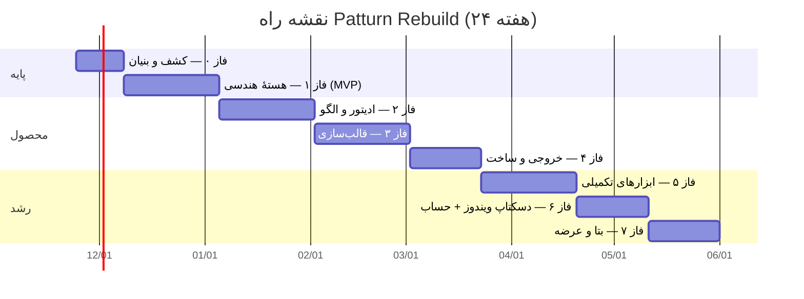
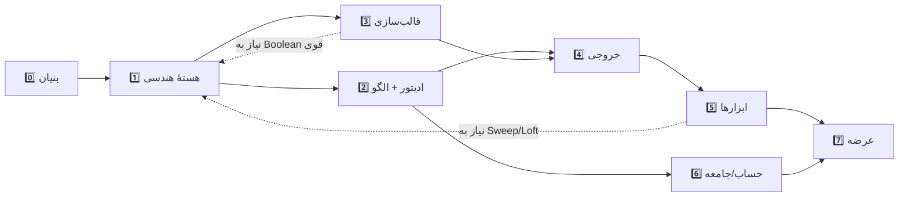

# 🗺️ فایل ۰۱ — نقشه راه کامل و دقیق پروژه (Patturn Rebuild)

> **افق زمانی:** ۲۴ هفته (۶ ماه) برای نسخهٔ ۱.۰ قابل عرضه
> **تیم فرضی:** ۱ طراح محصول (PT) · ۲ مهندس فرانت‌اند (FE) · ۱ مهندس هندسه/گرافیک (GE) · ۱ مهندس بک‌اند (BE) · ۱ QA (پاره‌وقت)
> **شعار نقشه راه:** *«اول درست، بعد سریع، بعد زیبا»* — موتور هندسی قبل از پیکسل.

---

## 📊 نمای کلی فازها



| فاز | عنوان | مدت | تمرکز اصلی | خروجی قابل نمایش |
|-----|-------|-----|-------------|-------------------|
| 0 | 🔍 کشف و بنیان | ۲ هفته | تصمیم‌های فنی، اسکلت پروژه | مونوریپوی خالی + CI + Design Token |
| 1 | 🧊 هستهٔ هندسی | ۴ هفته | موتور پارامتریک + revolve + CSG | «فرم را ببین و STL بگیر» |
| 2 | 🔷 ادیتور و الگو | ۴ هفته | UI ادیتور، کاشی بی‌درز، بُردن روی فرم | «الگو روی فرم» |
| 3 | 🧱 قالب‌سازی | ۴ هفته | قالب تک/چندتکه، کلید، مادرقالب، گچ | «قالب کامل + محاسبهٔ مواد» |
| 4 | 📤 خروجی و ساخت | ۳ هفته | STL/SVG/DXF/PDF، manifold، برگهٔ ابعاد | «آمادهٔ ساخت» |
| 5 | 🛠️ ابزارهای تکمیلی | ۴ هفته | کاتر، دسته، ریب، مهر، چاک، رینگ، اسلب | «کتابخانهٔ ۱۲ ابزار» |
| 6 | 🪟 دسکتاپ ویندوز + حساب | ۳ هفته | Tauri، نصب‌کننده، SQLite، آفلاین، لایسنس، (سرویس اختیاری) | «نصب روی ویندوز، کار بدون اینترنت» |
| 7 | 🚀 بتا و عرضه | ۳ هفته | تست میدانی، عملکرد، امنیت، انتشار نصب‌کننده | «v1.0 عمومی» |

---

# 🔍 فاز ۰ — کشف و بنیان (۲ هفته)

### اهداف
- قطعی‌کردن معماری و انتخاب **هستهٔ هندسی**
- راه‌اندازی مونوریپو، CI/CD، لینت، تست، و استقرار پیش‌نمایش
- تثبیت «زبان طراحی» (Design Token) از روی تحلیل سایت

### پیش‌نیازها
- ✅ دسترسی به تحلیل (`00-ANALYSIS.md`)
- ✅ تصمیم پلتفرم: **دسکتاپ ویندوز با Tauri 2 (اصلی، آفلاین)** — وب اختیاری (ADR-009)
- ✅ تصمیم ذخیره: **SQLite محلی = منبع حقیقت**؛ Postgres فقط sync اختیاری (ADR-004)
- ✅ خواندن `15-RULES.md` و پایبندی به R-001/R-002 (گردش نسخه) و R-014 (آفلاین)
- ✅ تصمیم دربارهٔ لایسنس کتابخانه‌ها (همه باید MIT/Apache باشند)

### فعالیت‌ها
| # | فعالیت | مسئول | خروجی |
|---|--------|-------|-------|
| 0.1 | ADR-001: انتخاب هستهٔ هندسی (opencascade.js vs Manifold vs three-bvh-csg) | GE | سند ADR + نمونهٔ کد مقایسه‌ای |
| 0.2 | ADR-002: انتخاب وضعیت (Zustand + Immer + Undo/Redo خودساخته) | FE | ADR |
| 0.3 | راه‌اندازی مونوریپو با pnpm workspaces + Turborepo | FE | `pnpm dev` کار می‌کند |
| 0.4 | اسکلت Next.js + Tailwind + shadcn/ui + next-intl (fa/en) | FE | صفحهٔ خالی با لایه‌بندی RTL/LTR |
| 0.5 | Design Token ها (رنگ، فاصله، شعاع، تایپ، سایه، حرکت) | PT | `design-tokens.json` + مستندات |
| 0.6 | لایهٔ Web Worker برای محاسبات سنگین + پروتکل پیام | GE | worker echo تست موفق |
| 0.7 | CI: lint + typecheck + unit test + preview deploy | BE | PR چک‌ها فعال |
| 0.8 | تعریف «Golden Tests» برای هندسه (فیکسچرهای عددی) | QA/GE | ۵ تست پایه |

### ⚠️ ریسک‌های فاز ۰
| ریسک | احتمال | اثر | کاهش |
|------|--------|-----|------|
| هستهٔ هندسی کند روی مرورگر | متوسط | بالا | Manifold-WASM (سریع، manifold-native) + پیش‌محاسبه در worker |
| نبود منحنی‌های B-Rep دقیق در کتابخانه | متوسط | متوسط | برای فرم‌های چرخشی، mesh مستقیم کافی است؛ NURBS فقط برای پروفیل |
| RTL و عدد/واحد فارسی | بالا | پایین | `next-intl` + `Intl.NumberFormat('fa')` از روز اول |

### ✅ معیار خروج (Exit Criteria)
- [ ] ADR-001 و ADR-002 تأیید شده‌اند
- [ ] `pnpm build` روی CI سبز و پیش‌نمایش مستقر شده است
- [ ] یک cube از پارامتر ساخته و به STL صادر می‌شود (اسمال‌ترین end-to-end)
- [ ] صفحهٔ خالی در دو زبان (fa RTL / en LTR) بدون شکست بصری رندر می‌شود

---

# 🧊 فاز ۱ — هستهٔ هندسی و فرم‌میکر (۴ هفته) — *قلب محصول*

### اهداف
- **سیستم پارامتر (Param Graph)** به‌عنوان تنها منبع حقیقت
- **پروفیل نودی** + تقارن + قیدها
- **Revolve** به مش واترتایت
- **ماشین‌حساب حجم/ظرفیت** با wall thickness، fill level، shrink
- **فوت‌رینگ** پارامتریک
- خروجی STL از فرم خام

### فعالیت‌ها
| # | فعالیت | جزئیات فنی | خروجی |
|---|--------|-------------|-------|
| 1.1 | تعریف `ParamGraph` | نود = `{id, type, inputs, value, unit, constraints}`؛ DAG با topological sort و memo | تست واحد |
| 1.2 | ویرایشگر پروفیل | نود Bézier، افزودن/حذف/کشیدن، قید تقارن Mirror X/Y، گرید با snap | فرم دلخواه ساختنی |
| 1.3 | اعتبارسنجی پروفیل | ممنوعیت خودتقاطعی، جهت‌گیری (clockwise)، حداقل/حداکثر شعاع | پیام خطای انسانی |
| 1.4 | Revolve | تقسیم ۳۶۰° به N سگمنت (پیش‌فرض ۹۶)، بستن کف/دهانه، محاسبهٔ نرمال | مش بسته |
| 1.5 | ضخامت دیوار (offset) | offset منحنی ۲بعدی پروفیل به‌داخل + محدودکردن در گلوگاه | جداره سالم |
| 1.6 | محاسبهٔ حجم دقیق | `V = π∫ r(y)² dy` روی پروفیل داخلی + cut در `fillLevel` | دقت ±۰.۵٪ |
| 1.7 | شیرینک | `dim_dry = dim_wet × (1 - shrink)` در نمایش و خروجی | اعمال در پارامتر |
| 1.8 | فوت‌رینگ | پارامتر عرض/عمق/سبک لبه (راست/گرد/پخ)؛ ادغام با بدنه (union) | فرم با پایه |
| 1.9 | Viewport سه‌بعدی | three.js + orbit controls + گرید mm + gizmo + نمای ۲بعدی پروفیل موازی | ادیتور بصری |
| 1.10 | ذخیره/بارگذاری JSON | schemaVersion + migration stub | پروژه قابل reload |
| 1.11 | Export STL | binary STL + بررسی manifold (euler characteristic) | فایل سالم |

### 📐 فرمول‌های مرجع (باید دقیقاً همین‌ها پیاده شوند)
```
حجم کل (داخلی، تا لبه):
  V_rim = π · Σ_i  h_i · ( r_i² + r_i·r_{i+1} + r_{i+1}² ) / 3      ← مخروط ناقص
  (h_i = Δy بین دو نمونه، r_i = شعاع داخلی)

سطوح پرشدگی:
  y_fill = y_bottom_inner + fillLevel·( y_rim - y_bottom_inner )
  V_filled = انتگرال تا y_fill (با درون‌یابی خطی r)

شیرینک:
  dim_dry = dim_wet · (1 − s)        s ∈ [0, 0.20]  پیش‌فرض 0.12
  V_dry  = V_wet · (1 − s)³

ظرفیت اسمی (ml) = V_rim / 1000  (mm³ → ml)
```

### 🎯 معیار خروج فاز ۱
- [ ] فرم نمونهٔ سایت بازتولید شود: `w145 h148 wall4 rim25 fill80% shrink12%` → **Capacity ≈ 1131 ml** و **Filled(80%) ≈ 958 ml** (±۱٪)
- [ ] سه فرم مختلف (کاسه، گلدان بلند، فنجان) ساخته و بدون خطا صادر شوند
- [ ] خروجی STL در Cura/PrusaSlicer بدون پیام «not manifold» باز شود
- [ ] Undo/Redo برای ۵۰ عملیات پروفیل کار کند
- [ ] reload صفحه، پروژه را عیناً بازگرداند

---

# 🔷 فاز ۲ — ادیتور کامل و موتور الگو (۴ هفته)

### اهداف
- شِل ادیتور حرفه‌ای (پنل چپ/وسط/راست، تب‌ها، هدر، ذخیره‌خودکار)
- **موتور الگوی پارامتریک** با ≥۱۲ الگوی پایه
- **کاشی بی‌درز** و بوم با واحد واقعی
- **نگاشت الگو روی فرم ۳بعدی** (cylindrical + curvature-aware)
- خروجی SVG/DXF الگوی تخت

### فعالیت‌ها
| # | فعالیت | جزئیات |
|---|--------|--------|
| 2.1 | Shell ادیتور | ۳ ستون، پنلهای جمع‌شو، تب قطعات، نوار وضعیت با ابعاد و حجم |
| 2.2 | هستهٔ الگو | `PatternDef = { params, build(ctx) → Paths[] }`؛ ctx = ابعاد بوم، واحد، seed |
| 2.3 | ۱۲ الگوی پایه | Dot grid، Chevron، Herringbone، Wave، Hex، Diamond، Spiral، Stripe، Scale، Grid، Kumiko، Seigaiha |
| 2.4 | پرایمیتیوها | Circle، Rect(round)، Polygon، Line، Arc، Bezier، Text (فونت وکتور) |
| 2.5 | کاشی بی‌درز | تکرار با `tileW/tileH` + `clipPath` به بوم + بررسی درز با مقایسهٔ لبه‌ها |
| 2.6 | پارامترهای سراسری | `gridSize`, `gridSpacing`, `scaleRatio`, `cellRotation`, `roundness`, `mirrorX/Y`, شکل سلول |
| 2.7 | Canvas 2D | SVG-based (برای خروجی دقیق) با رندر preview روی canvas برای سرعت |
| 2.8 | نگاشت ۳بعدی | استوانه‌ای با `u = θ/2π`، مقیاس بر اساس طول قوس؛ گزینهٔ `curvature-aware` برای شکم/شانه (اصلاح `v` با مشتق شعاع) |
| 2.9 | پیش‌نمایش استنسیل | extrude مسیرها روی سطح فرم (offset از سطح) |
| 2.10 | Export SVG/DXF | واحد mm، بدون تبدیل واحد، لایه‌بندی، `stroke` vs `fill` |
| 2.11 | کتابخانهٔ الگو | پیش‌نمایش تصویری هر الگو + ذخیرهٔ الگوی سفارشی کاربر |

### 🎯 معیار خروج فاز ۲
- [ ] تغییر هر پارامتر در < ۱۰۰ms رندر شود (بوم ۳۰۰×۳۰۰ mm)
- [ ] SVG خروجی در Inkscape/LightBurn با ابعاد واقعی mm باز شود
- [ ] یک الگو روی فرم بچرخد و درز پشت فرم دیده نشود (تایلینگ صحیح)
- [ ] ۱۲ الگو همه در کتابخانه با پیش‌نمایش موجود باشند

---

# 🧱 فاز ۳ — قالب‌سازی (۴ هفته) — *بزرگ‌ترین تمایز*

### اهداف
- قالب **تک‌تکه (drop-out)** با بررسی undercut
- قالب **چندتکه** با صفحهٔ جداایش خودکار و دستی
- **کلیدهای ثبت** (مخروطی/نیم‌کره) با موقعیت و تلورانس
- **مادرقالب** (۳D-print + سیلیکون) با casting barrier
- **محاسبهٔ گچ/آب** هر قطعه
- خروجی STL manifold هر قطعه

### فعالیت‌ها
| # | فعالیت | جزئیات فنی |
|---|--------|-------------|
| 3.1 | ساخت بلوک قالب | bounding box فرم + wallThickness در ۶ جهت + نرمال‌سازی |
| 3.2 | Boolean تفریق | `mold = block − form`؛ نیاز به هستهٔ manifold؛ بررسی نتیجه |
| 3.3 | تحلیل undercut | برای هر ردیف ارتفاع، بررسی اینکه `dr/dy > 0` (گشادشدن) → drop-out ممکن |
| 3.4 | انتخاب خودکار تقسیم | تقسیم عمودی در صفحاتی که undercut را حذف کند (min parts) |
| 3.5 | صفحهٔ جداایش (parting surface) | planar → منحنی: انطباق با پروفیل برای مخفی‌کردن درز |
| 3.6 | کلیدها | استوانه مخروطی (taper °) یا نیم‌کره؛ قرارگیری روی سطح برش؛ `clearance` بین نر/ماده |
| 3.7 | Draft angle | ۱–۳° اضافه به دیواره‌های گچ برای خروج راحت |
| 3.8 | مادرقالب | `mother = block(block(form))` با flange و barrier؛ حالت سیلیکون با دیوارهٔ نازک |
| 3.9 | شیرینک در قالب | `form_scaled = form × 1/(1−s)` تا قطعهٔ خام به اندازهٔ نهایی برسد |
| 3.10 | حجم و گچ | حجم هر قطعه → `plaster = V / (1/ρ_p + r_w)`، `water = r_w · plaster` |
| 3.11 | خروجی قطعات | هر قطعه STL جدا + نام‌گذاری + فهرست BOM |

### 📐 فرمول‌های مرجع
```
گچ/آب (r_w = نسبت آب به گچ، پیش‌فرض 0.70):
  ρ_plaster = 2.75 kg/L ,  ρ_water = 1.0 kg/L
  V_mix(L) = P/ρ_p + W/ρ_w = P · (1/2.75 + r_w)
  P (kg) = V_mix / (1/2.75 + r_w)
  W (kg) = r_w · P
  چگالی مخلوط ≈ (P + W) / V_mix ≈ 1.59 kg/L

کلید مخروطی:
  r_top = r_base + h · tan(taper)
  gap   = clearance (0.1–0.5 mm بسته به روش ساخت)

Undercut criterion (پروفیل دوّار):
  برای drop-out یک‌تکه لازم است: d r(y)/dy ≥ 0 برای همهٔ y از پایین به بالا
```

### 🎯 معیار خروج فاز ۳
- [ ] فرم ساده (بدون undercut) → قالب تک‌تکه با ۴ کلید تولید شود
- [ ] فرم گلدانی (با شکم) → خودکار به ۲ قطعه تقسیم شود و درز در بدنه بیفتد
- [ ] هر قطعه STL در slicer باز شود و حجم آن با محاسبهٔ داخلی ±۰.۵٪ بخواند
- [ ] محاسبهٔ گچ/آب با نمونهٔ سایت مطابق باشد: `1.84 L → 1.72 kg plaster, 1.20 kg water`
- [ ] مادرقالب با casting barrier تولید شود

---

# 📤 فاز ۴ — خروجی، استنسیل و برگهٔ ساخت (۳ هفته)

### اهداف
- خط لولهٔ خروجی یکپارچه (STL / 3MF / OBJ / SVG / DXF / PDF)
- **استنسیل واقعی**: unwrap سطح فرم به تخت + bridge برای نگه‌داشتن جزیره‌ها
- **برگهٔ ابعاد PDF** برای بردن سر چرخ
- **الگوی اسلب تخت** (3D → 2D template) — از درخواست‌های جامعه

### فعالیت‌ها
| # | فعالیت | جزئیات |
|---|--------|--------|
| 4.1 | Export Service در worker | صف + پیشرفت + لغو + نام‌گذاری خودکار |
| 4.2 | STL | binary، واحد mm، watertight، اعمال شیرینک |
| 4.3 | 3MF | با رنگ/اسم قطعه (اختیاری) |
| 4.4 | Unwrap استوانه‌ای | `(θ, y) → (x, y)` با اصلاح طول قوس؛ seam + bleed |
| 4.5 | Bridge/Stencil | تشخیص جزیرههای جدا و افزودن پلهای نگهدارنده با عرض قابل‌تنظیم |
| 4.6 | PDF برگهٔ ابعاد | ابعاد کلیدی، پروفیل با خطکش، جدول پارامترها، QR پروژه |
| 4.7 | Slab template | flatten نیم‌سطح فرم به قطعهٔ تخت با خطوط تا زدن |
| 4.8 | دانلود ZIP | همهٔ قطعات + README.txt با دستور ساخت |

### 🎯 معیار خروج فاز ۴
- [ ] یک پروژهٔ کامل → ZIP شامل ۴ STL + ۱ SVG + ۱ PDF
- [ ] استنسیل برش‌خورده روی فرم فیزیکی بچسبد (تست دستی با کاغذ)
- [ ] PDF در A4 با مقیاس ۱:۱ بدون تغییر اندازه چاپ شود

---

# 🛠️ فاز ۵ — ابزارهای تکمیلی (۴ هفته)

| ابزار | رویکرد هندسی | اولویت |
|-------|---------------|--------|
| 🍪 کاتر کوکی | کانتور → offset بیرونی + extrude با تیغهٔ مخروطی (sharpness) | P0 |
| 🖼️ ردیابی تصویر | پتانسیل-تریسینگ/مارچینگ اسکوئر روی ماسک + ساده‌سازی RDP | P0 |
| ✏️ ویرایشگر وکتور آزاد | پن، نود، boolean 2D، آفست، متن | P0 |
| 🫖 دسته‌ساز | sweep پروفیل روی مسیر ۳بعدی + قالب خودکار | P1 |
| 📐 ریب‌ساز | پروفیل → نوار با ضخامت/لبه + پیش‌نمایش revolve | P1 |
| 🔖 مهرساز | extrude طرح + پایهٔ دسته + آینه‌سازی | P1 |
| 🔩 چاک‌ساز | revolve پروفیل معکوس فرم + تحمل | P2 |
| ⭕ رینگ‌روندر | مخروط ناقص بر اساس قطر دهانه | P2 |
| 🎛️ دای اکسترودر | طرح ۲بعدی → دای با flange برندهای رایج | P2 |
| 📦 Loft / Sweep فرم | loft بین دو پروفیل + sweep روی مسیر | P2 |
| ✂️ تقسیم افقی قالب | صفحهٔ برش افقی در ارتفاع انتخابی | P2 |
| 🧩 الگوی پازل | تولید قفل jigsaw روی شبکه | P3 |
| ⚙️ Jigger/Jolly | قالب چرخ + تیغه متناسب | P3 |

### 🎯 معیار خروج فاز ۵
- [ ] ۱۲ ابزار در کتابخانه، هرکدام با پیش‌نمایش و پارامتر
- [ ] ابزار جدید فقط با افزودن یک فایل `ToolDefinition` اضافه شود (بدون دست‌زدن به هسته)

---

# 🪟 فاز ۶ — دسکتاپ ویندوز، آفلاین و حساب (۳ هفته)

> 🔴 **الزام اصلی:** نرم‌افزار باید روی ویندوز نصب و **کاملاً آفلاین** اجرا شود (R-014). بخش‌های ابری/جامعه فقط در صورت اتصال و کاملاً اختیاری‌اند.

| # | فعالیت | جزئیات |
|---|--------|--------|
| 6.1 | 🪟 پوستهٔ Tauri 2 | پروژهٔ desktop با React+Vite همان؛ WebView2 ویندوز ۱۰/۱۱ |
| 6.2 | 💽 SQLite محلی | Drizzle روی `patturn.db`؛ مهاجرت اسکیمای پروژه/نسخه‌ها؛ autosave هر ۲s |
| 6.3 | 📂 دیالوگ فایل | ذخیره/باز کردن STL/SVG/DXF/PDF با دیالوگ ویندوز؛ Export/Import `.patturn` |
| 6.4 | 🗜️ بکاپ محلی | پوشهٔ `backups/` با چرخش ۱۰ نسخه + دکمهٔ بازیابی یک‌کلیککی |
| 6.5 | 📦 نصب‌کننده | NSIS/MSI، آیکون، uninstall تمیز، ارتقا روی نسخهٔ قبلی |
| 6.6 | 👤 پروفایل محلی | نام/ایمیل/تنظیمات بدون سرور؛ صفحات «درباره ما / پشتیبانی» با اطلاعات R-013 |
| 6.7 | 🔑 لایسنس + حمایت | فعال‌سازی کلید پلن؛ بخش حمایت با کارت `6219 8619 1893 4679` |
| 6.8 | ☁️ sync اختیاری | همگام‌سازی به Postgres فقط با اجازهٔ کاربر و هنگام اتصال |
| 6.9 | 🔐 Auth ابری (اختیاری) | ورود گوگل/ایمیل فقط در وب؛ بدون بلوکه کردن آفلاین |
| 6.10 | جامعه/ایمیل/ادمین (اختیاری) | feature-requests، گالری، ایمیل — فاز بعد از عرضهٔ دسکتاپ |

### 🎯 معیار خروج فاز ۶
- [ ] نصب روی ویندوز ۱۰ و ۱۱ بدون مرورگر و بدون اینترنت
- [ ] قطع کامل اترنت/Wi-Fi → ساخت فرم، الگو، قالب و خروجی STL همچنان کار کند
- [ ] ذخیرهٔ خودکار + بستن اجباری برنامه → باز شدن، پروژه عیناً برگردد
- [ ] نصب، ارتقا و حذف تمیز (بدون فایل باقی‌مانده)
- [ ] صفحات «درباره ما / پشتیبانی / حمایت» با اطلاعات کامل نویسنده

---

# 🚀 فاز ۷ — بتا و عرضه (۳ هفته)

| # | فعالیت | معیار |
|---|--------|-------|
| 7.1 | تست میدانی با ۱۰ سفالگر | ≥۸ نفر پروژه را بدون راهنما کامل کنند |
| 7.2 | بهینه‌سازی عملکرد | استارت اپ < ۲.۵s، پارامتر < ۱۰۰ms، revolve ۹۶ سگمنت < ۳۰۰ms |
| 7.3 | تست آفلاین و نصب | قطع اینترنت → همهٔ مسیرها؛ نصب/ارتقا/حذف تمیز روی ویندوز ۱۰ و ۱۱ |
| 7.4 | دسترس‌پذیری | WCAG 2.2 AA، کیبورد کامل، کنتراست |
| 7.5 | i18n | fa/en کامل، اعداد و واحدها، RTL بی‌نقص |
| 7.6 | مستندات و آموزش | ۵ ویدیوی ۲دقیقه‌ای + مستند قالب‌سازی + FAQ + راهنمای نصب |
| 7.7 | پشتیبانی | ایمیل `Pranses2011@GMail.com` و موبایل `09144220430` تست‌شده |
| 7.8 | انتشار | نصب‌کنندهٔ امضاشده + سایت معرفی (`EA-Fixer.ir`) + CHANGELOG فارسی |

### ✅ Definition of Done نهایی v1.0
- [ ] نصب‌کنندهٔ ویندوز روی ۳ دستگاه تمیز نصب و آفلاین اجرا شده است
- [ ] همهٔ تست‌های `11-QA-ACCEPTANCE.md` + بخش ۱۲ `14-CHECKLIST.md` سبز
- [ ] خروجی STL در ۳ slicer و ۲ نرم‌افزار CAD معتبر باز می‌شود
- [ ] محاسبات با نمونه‌های مرجع ±۱٪ منطبق‌اند
- [ ] صفحات «درباره ما / پشتیبانی / حمایت» با اطلاعات R-013 کامل است

---

# 🧯 ریسک‌های کلان و برنامهٔ کاهش

| # | ریسک | احتمال | اثر | کاهش |
|---|------|--------|-----|------|
| R1 | Boolean ناموفق/مش غیر‌manifold | بالا | بحرانی | Manifold-WASM + تست‌های golden + fallback voxel remesh |
| R2 | کندی روی لپ‌تاپ ضعیف | متوسط | بالا | کاهش سگمنت خودکار، LOD، worker، کش نتیجه |
| R3 | پیچیدگی UX (غرق‌شدن کاربر) | بالا | بالا | Progressive disclosure، حالت «Simple/Pro»، پریست‌ها |
| R4 | قالب تولیدشده در عمل کار نکند | متوسط | بحرانی | تست فیزیکی هر فاز، draft، کلید، تلورانس محافظه‌کارانه |
| R5 | برداشت حقوقی از برند | متوسط | بالا | برند/دارایی مستقل، عدم کپی متن/تصویر |
| R6 | هزینهٔ محاسبات ابری | پایین | متوسط | همه‌چیز کلاینت‌ساید (WASM) |
| R7 | از دست رفتن کار کاربر | متوسط | بالا | ذخیرهٔ خودکار SQLite محلی + بکاپ خودکار + تاریخچهٔ نسخه |
| R8 | نصب‌نشدن/کرش روی ویندوز قدیمی | متوسط | بالا | تست روی Win10/11، WebView2 اجباری در نصب‌کننده، لاگ قابل گزارش |

---

# 📈 شاخص‌های موفقیت (KPI)

| KPI | هدف v1.0 | هدف ۶ ماه بعد |
|-----|-----------|----------------|
| ⏱️ زمان تا اولین خروجی (TTFV) | < ۱۰ دقیقه | < ۵ دقیقه |
| 🎯 نرخ تکمیل قیف (فرم→خروجی) | > ۴۵٪ | > ۶۵٪ |
| 🔁 بازگشت هفتگی | > ۲۵٪ | > ۴۰٪ |
| 💳 تبدیل به پلن پولی | > ۴٪ | > ۸٪ |
| 🐞 خطای هندسی گزارش‌شده | < ۲٪ پروژه‌ها | < ۰.۵٪ |
| 😊 NPS | > ۳۰ | > ۵۰ |

---

# 🧾 وابستگی‌های بین فازها



➡️ ادامه در [`02-MASTER-PROMPT.md`](./02-MASTER-PROMPT.md)
