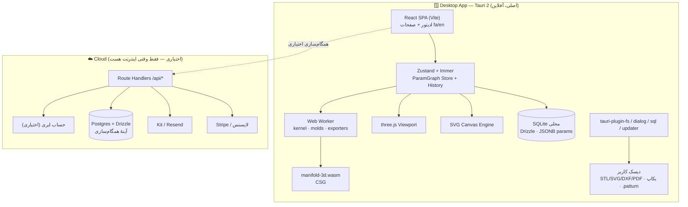
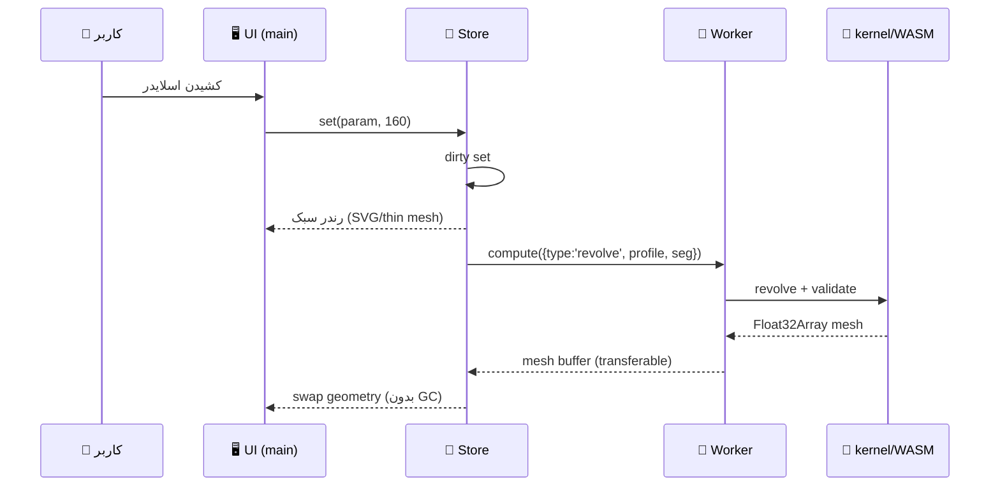
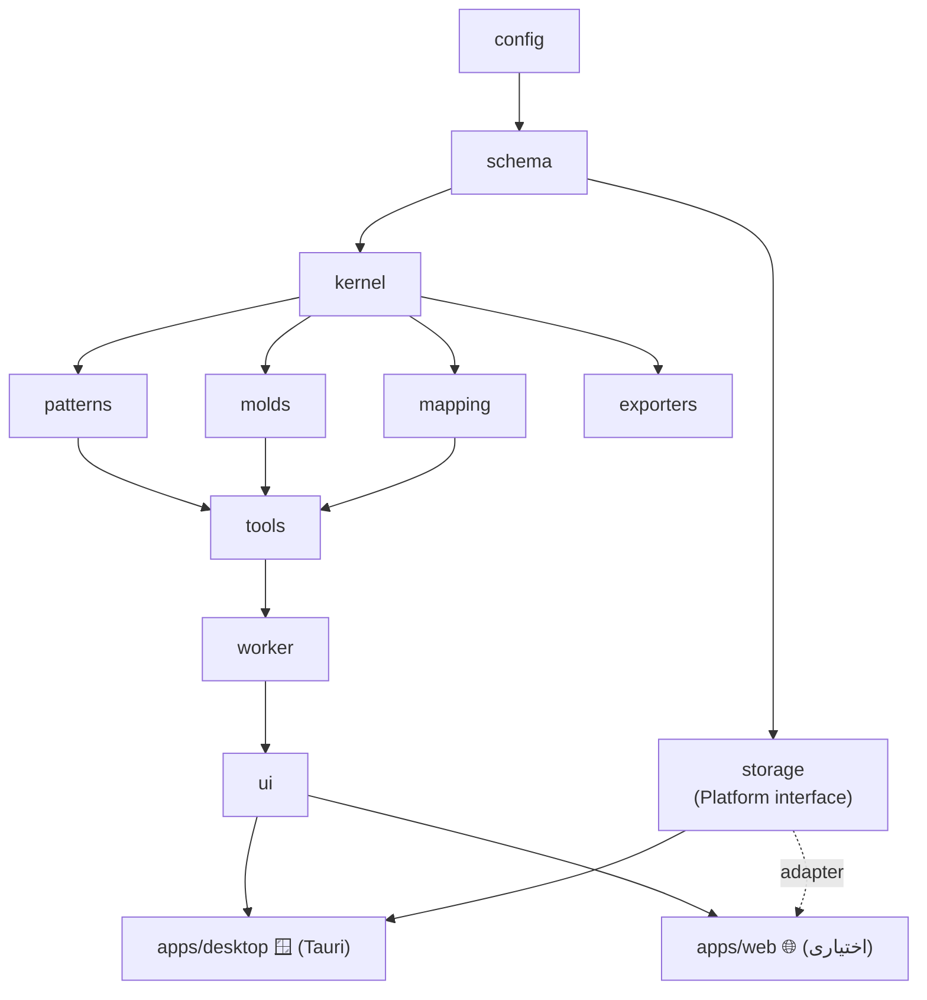

# 🏗️ فایل ۰۳ — معماری فنی (Architecture Decision Document)

> نقش این فایل: **قرارداد فنی** پروژه. اگر پرامپت را به AI می‌دهید، این فایل را ضمیمه کنید تا از پراکندگی جلوگیری شود.

---

## ۱. 🧭 نمای کلان سیستم



### اصل حاکم: **«محاسبات و داده لوکال، ابر فقط اختیاری»** (قانون R-014)
- 🪟 نسخهٔ اصلی: **اپ نصب‌شدهٔ ویندوز با Tauri 2** — بدون مرورگر، بدون سرور، با قطع کامل اینترنت کامل کار میکند.
- 🧮 همهٔ هندسه داخل خود اپ (WASM + Worker) → هزینهٔ سرور ≈ صفر، حریم خصوصی حداکثری.
- 🗄️ **SQLite محلی منبع حقیقت** است؛ Postgres فقط آینهٔ همگام‌سازی در نسخهٔ وب/ابریِ اختیاری.
- 📤 خروجی‌ها مستقیم روی دیسک با دیالوگ فایل ویندوز ذخیره میشوند — نه از طریق دانلود مرورگر.
- 🌐 نسخهٔ وب همان SPA با adapter ذخیرهٔ متفاوت است؛ **هیچ وابستگی هسته‌ای به وب وجود ندارد.**

### 🔌 لایهٔ پلتفرم (Platform Adapter)
```ts
// packages/storage/src/port.ts — تنها مرز بین هسته و پلتفرم
interface Platform {
  db: ProjectRepo;              // SQLite (desktop) | IndexedDB (web)
  fs: { save(path, bytes); open(): Promise<{path,bytes}> };  // Tauri dialog | download
  network?: SyncClient;         // تعریف‌نشده در آفلاین = بدون sync
  license?: LicenseClient;      // فعال‌سازی کلید
  updater?: UpdateClient;       // بررسی نسخهٔ جدید (اختیاری)
}
```
> ⛔ `kernel`، `patterns`، `molds`، `exporters` هرگز `Platform` را مستقیم صدا نمیزنند — فقط از طریق interface بالا.

---

## ۲. 🧮 انتخاب هستهٔ هندسی — مقایسه و تصمیم

| گزینه | مزیت | عیب | تناسب |
|-------|------|-----|-------|
| **manifold-3d** (WASM) | تضمین manifold، CSG سریع و پایدار، MIT | فقط مش (بدون NURBS)، نیاز به پیاده‌سازی revolve خودمان | ⭐ **انتخاب اصلی برای CSG** |
| opencascade.js | B-Rep کامل، فیلت، offset دقیق | حجم ~۴۰MB WASM، کند روی موبایل، API پیچیده | فقط اگر فیلت پیچیده لازم شد |
| three-bvh-csg | سبک، روی three.js | گاهی مش غیر‌manifold تولید می‌کند | **fallback** |
| CGAL-WASM | قوی | حجم/پیچیدگی/لایسنس | ❌ |
| voxel remesh (three-mesh-bvh + marching cubes) | مقاوم برای فرم‌های بد | کیفیت سطح پایین‌تر، کند برای دقت بالا | **ترمیم نهایی** |

### 🎯 تصمیم (ADR-001)
```
منحنی‌ها:  خودمان (Catmull-Rom → Bézier، offset تحلیلی) در TypeScript
مش:        revolve/sweep/loft دستی → Float32Array (positions, indices)
CSG:       manifold-3d (WASM) — منبع حقیقت
ترمیم:     اگر خروجی غیر‌manifold شد → voxel repair (۱ بار) + هشدار کاربر
اعتبارسنجی: mesh-validate.ts قبل از هر export
```

---

## ۳. ⚙️ موتور پارامتریک (ParamGraph)

### ساختار
```ts
type ParamValue = number | boolean | string | Vec2 | Vec3 | Curve;

type Node<T extends ParamValue = ParamValue> = {
  id: string;
  type: 'input' | 'derive' | 'curve' | 'pattern' | 'form' | 'mold';
  value?: T;
  derive?: (inputs: Record<string, ParamValue>) => T;
  inputs: string[];          // وابستگی‌ها
  unit?: 'mm' | 'deg' | '%' | 'ml' | 'kg';
  constraint?: { min?: number; max?: number; step?: number; choices?: string[] };
  meta: { label: { fa: string; en: string }; group: string; advanced?: boolean; help?: string };
};

class ParamGraph {
  add(node: Node): void;
  set(id: string, v: ParamValue): void;
  evaluate(id: string): ParamValue;   // memoized
  topoOrder(): string[];
  dirty(id: string): Set<string>;      // نودهای تحت‌تأثیر
  serialize(): GraphSnapshot;
  static hydrate(s: GraphSnapshot): ParamGraph;
}
```

### قواعد
| قاعده | دلیل |
|-------|------|
| 🔁 DAG بدون چرخه | جلوگیری از حلقهٔ بی‌پایان؛ تشخیص چرخه با DFS |
| 🧠 Memoization کلید = `id@hash(inputs)` | آپدیت آنی |
| 🎯 Dirty propagation | فقط بخش وابسته بازمحاسبه شود |
| 📸 Snapshot سبک برای Undo | ذخیرهٔ مقادیر نودهای `input` (نه مش) |
| 🚫 بدون تابع سریالی‌شدنی | `derive` از یک رجیستری `type → function` انتخاب می‌شود تا JSON قابل ذخیره بماند |

### لایه‌های وابستگی
```
FORM  ──►  (scale by shrink)  ──►  MOLD
  │                                ▲
  └──► surface mapping ──► PATTERN ┘
                 │
                 └──► STENCIL / SVG / DXF
```

---

## ۴. 🧵 مدل اجرا و Worker



**پروتکل پیام (نسخه‌دار):**
```ts
type Req =
 | { id:string; kind:'revolve';    payload: RevolveArgs }
 | { id:string; kind:'csg';        payload: CsgArgs }
 | { id:string; kind:'mold';       payload: MoldArgs }
 | { id:string; kind:'export';     payload: ExportArgs }
 | { id:string; kind:'cancel';     targetId:string };
type Res =
 | { id:string; ok:true;  mesh?:ArrayBuffer; paths?:string; blob?:Blob; stats:Stats }
 | { id:string; ok:false; error:{ code:string; message:string; hint?:string } };
```

---

## ۵. 📦 مرز پکیج‌ها (قاعدهٔ وابستگی)


> ⛔ `kernel` نباید به `ui`، `web`، React یا DOM وابسته باشد. این تضمین تست‌پذیری است.
> 📏 قانون: هر پکیج فقط از لایه‌های پایین‌تر خود import کند (بدون چرخه). با ESLint `import/no-restricted-paths` اعمال شود.

---

## ۶. 🧊 قرارداد مش (Mesh Contract)

```ts
type Mesh = {
  positions: Float32Array;   // xyz, mm
  indices: Uint32Array;      // مثلث‌ها، CCW
  normals?: Float32Array;    // اختیاری، اگر نبود محاسبه شود
  units: 'mm';
  name: string;
  meta?: { volumeMm3?: number; bbox?: [Vec3, Vec3]; partIndex?: number };
};
```

### اعتبارسنجی (`mesh-validate.ts`)
| بررسی | روش | خطای رایج |
|-------|-----|-----------|
| 🔓 لبهٔ باز | شمارش یال‌های تک‌عضوی | سوراخ در مش |
| ↔️ جهت نرمال | حجم علامت‌دار > 0 | نرمال معکوس |
| 🔀 خودتقاطع | BVH خودبرخورد | Boolean ناقص |
| 📐 مثلث منحط | مساحت < 1e-9 | نرمال‌سازی |
| 🧩 Euler | `V − E + F = 2` برای genus 0 | چندبدنه‌ای |
| 🔁 مثلث تکراری | set روی `sorted(i,j,k)` | Boolean ضعیف |

---

## ۷. 🚀 عملکرد (Performance Budget)

| عملیات | بودجه | تکنیک |
|--------|-------|-------|
| تغییر پارامتر ساده | < ۵۰ms | memo + رندر SVG مجدد |
| Revolve (۹۶ سگمنت) | < ۳۰۰ms | typed arrays، بدون allocation در حلقه |
| Boolean قالب | < ۱.۵s | manifold + کاهش سگمنت در حین کشیدن، کیفیت بالا در رهاکردن |
| کاشی الگو (۳۰۰×۳۰۰mm) | < ۱۰۰ms | کش مسیر + `Path2D` |
| بارگذاری اولیه ادیتور | < ۲.۵s | dynamic import three/manifold، پیش‌بارگذاری WASM |
| حجم JS ادیتور | < ۶۰۰KB gzip | code-split، بدون lodash |

**تکنیک‌های کلیدی:** LOD (درگ = ۳۲ سگمنت، رها = ۹۶)، debounce هوشمند، transferable ArrayBuffer، `OffscreenCanvas` برای SVG preview، virtualize لیست پروژه‌ها.

---

## ۸. 🔐 امنیت و حریم خصوصی

| حوزه | اقدام |
|------|-------|
| 🔑 Auth | مسئولیت به Clerk/Auth.js؛ کوکی `httpOnly`، `sameSite=lax` |
| 🧱 مجوز | هر پروژه با `ownerId`؛ بررسی در هر route (نه فقط UI) |
| 🚦 Rate limit | Upstash Redis / Vercel KV روی subscribe، contact، feature-requests، exports |
| 🕵️ Spam | honeypot + time-to-submit + تحلیل الگو |
| 🧼 ورودی | zod در همهٔ route handlers؛ محدودیت طول؛ sanitize خروجی SVG (XSS) |
| 📤 آپلود | فقط SVG/PNG/JPG، سقف ۵MB، بازرسی mime، پارس در sandbox |
| 🧾 لاگ | بدون PII در لاگ؛ شناسه‌های hash‌شده |
| 🔒 هدرها | CSP، HSTS، `X-Frame-Options`، `Referrer-Policy` |
| 📊 آنالیتیکس | Vercel Analytics بدون کوکی یا Plausible |

---

## ۹. 🌐 i18n و RTL

- `next-intl` با مسیر `/(fa|en)` و locale پیش‌فرض fa.
- همهٔ متن‌ها در `messages/fa.json`, `en.json` — **هیچ رشتهٔ سخت‌کد در کامپوننت**.
- جهت با `dir` روی `<html>`؛ استفاده از CSS logical properties (`ms-`, `me-`, `ps-`, `pe-`).
- اعداد: `Intl.NumberFormat(locale)`؛ واحدها به‌صورت SI نمایش داده شوند (`۱۱۳۱ میلی‌لیتر` / `1131 ml`).
- آیکون‌های جهت‌دار (فلش، شیب) باید با `rtl:rotate-180` آینه شوند.

---

## ۱۰. 🧾 ADR های الزامی (سند تصمیم‌های معماری)

| # | عنوان | وضعیت | تصمیم |
|---|-------|-------|-------|
| ADR-001 | هستهٔ هندسی | Proposed | manifold-3d + revolve دستی |
| ADR-002 | State | Proposed | Zustand + Immer + history stack |
| ADR-003 | رندر دو‌بعدی | Proposed | SVG منبع حقیقت، Canvas پیش‌نمایش |
| ADR-004 | ذخیره‌سازی | **Accepted** | **SQLite محلی = منبع حقیقت**؛ Postgres فقط آینهٔ اختیاری |
| ADR-005 | واحد | Accepted | mm در همه‌جا |
| ADR-006 | i18n | Accepted | i18n خودساخته (یا next-intl در وب)، fa پیش‌فرض |
| ADR-007 | پرداخت | **Accepted** | **کلید لایسنس + کارت حمایت** پیش‌فرض؛ Stripe فقط در وب |
| ADR-008 | Excel/PDF | Proposed | pdf-lib + font subsetting |
| **ADR-009** | **پلتفرم اصلی** | **Accepted** | **Tauri 2 برای ویندوز (آفلاین)؛ وب اختیاری؛ هسته پلتفرم‌بی‌طرف** |
| **ADR-010** | **بدون حساب برای کار اصلی** | **Accepted** | پروفایل محلی؛ ورود ابری فقط برای همگام‌سازی/جامعه |

---

## ۱۱. 🧨 حالت‌های خطا و بازیابی

| خطا | رفتار |
|-----|-------|
| 🧊 مش غیر‌manifold | ترمیم خودکار + پیام «مش ترمیم شد؛ اگر باز هم مشکل بود، کاهش پیچیدگی پیشنهاد می‌شود» |
| 🚫 تحت برش / undercut | پیشنهاد تقسیم خودکار با پیش‌نمایش |
| 💾 قطع اتصال | ذخیرهٔ محلی + نشان «آفلاین — تغییرات ذخیره شد» |
| ⏱️ عملیات > ۵s | نوار پیشرفت + دکمهٔ لغو |
| 💥 کرش Worker | restart خودکار + بازپخش آخرین درخواست |
| 🗄️ خطای سرور | Retry با backoff + حالت فقط‌خواندنی |

---

➡️ ادامه در [`04-DATA-MODEL.md`](./04-DATA-MODEL.md)
