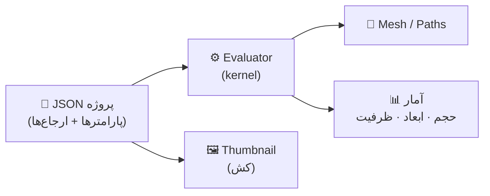

# 🗄️ فایل ۰۴ — مدل داده، اسکیما و قراردادهای ذخیره‌سازی

> قاعدهٔ طلایی: **آنچه ذخیره می‌شود پارامتر است، نه هندسه.** هندسه همیشه بازتولیدپذیر است.

---

## ۱. 🧬 فلسفهٔ مدل



| چرا پارامتر؟ | فایده |
|--------------|-------|
| 📦 حجم کم | پروژه ≈ ۵–۵۰ KB به‌جای ده‌ها MB STL |
| 🔁 بازتولید | تغییر کیفیت مش بدون از دست دادن داده |
| 🧩 ترکیب‌پذیری | الگو/قالب می‌توانند به یک فرم «ارجاع» بدهند |
| 🔍 دیف و نسخه | git-like history و همکاری آینده |
| 🌐 چند‌پلتفرمه | همان JSON در وب/دسکتاپ/اپ |

---

## ۲. 📐 اسکیمای هستهٔ پروژه (Zod)

```ts
import { z } from 'zod';

export const SCHEMA_VERSION = 3;

const Vec2 = z.object({ x: z.number(), y: z.number() });
const Unit = z.enum(['mm','in']);

/* ---------- Curves ---------- */
export const HandleSchema = z.object({
  hIn:  z.tuple([z.number(), z.number()]).optional(), // Bézier control in
  hOut: z.tuple([z.number(), z.number()]).optional(),
});

export const ProfileNodeSchema = z.object({
  id: z.string(),
  p: Vec2,                                   // mm (x = radius, y = height)
  handle: HandleSchema.default({ hIn: undefined, hOut: undefined }),
  locked: z.boolean().default(false),
  smooth: z.boolean().default(true),
});

export const ProfileSchema = z.object({
  nodes: z.array(ProfileNodeSchema).min(3),
  closed: z.boolean().default(false),
  interpolation: z.enum(['bezier','catmull-rom']).default('bezier'),
  symmetry: z.object({ mirrorX: z.boolean().default(false), mirrorY: z.boolean().default(false) }),
});

/* ---------- FORM ---------- */
export const FormSchema = z.object({
  profile: ProfileSchema,
  segments: z.number().int().min(24).max(512).default(96),
  fillLevel: z.number().min(0).max(1).default(0.8),
  wallThickness: z.number().min(1).max(20).default(4),
  shrink: z.number().min(0).max(0.2).default(0.12),
  footRing: z.object({
    enabled: z.boolean().default(false),
    width: z.number().default(8),     // عرض حلقه
    depth: z.number().default(6),     // ارتفاع
    edge: z.enum(['square','round','chamfer']).default('round'),
  }).default({}),
  metadata: z.object({ name: z.string().default('Untitled form') }).default({}),
});

/* ---------- PATTERN ---------- */
export const PatternSchema = z.object({
  baseId: z.string(),                        // 'dot-grid' | 'chevron' | … | 'custom'
  params: z.record(z.union([z.number(), z.string(), z.boolean()])).default({}),
  canvas: z.object({ widthMm: z.number().default(300), heightMm: z.number().default(300) }),
  tile: z.object({
    widthMm: z.number().default(40), heightMm: z.number().default(40),
    seamlessX: z.boolean().default(true), seamlessY: z.boolean().default(true),
    offsetX: z.number().default(0), offsetY: z.number().default(0),
  }),
  cell: z.enum(['circular','elliptical','square','disc']).default('circular'),
  grid: z.object({ size: z.number().default(11), spacing: z.number().default(14),
                   scaleRatio: z.number().default(1.5), rotation: z.number().default(0) }),
  mapping: z.object({
    mode: z.enum(['none','cylindrical','curvature']).default('none'),
    seamAngle: z.number().default(0),
    repeatAround: z.boolean().default(true),
    verticalStretch: z.number().default(1),
  }).default({}),
  customPaths: z.string().optional(),        // SVG path data برای الگوی دستی
});

/* ---------- MOLD ---------- */
export const KeySchema = z.object({
  type: z.enum(['tapered-cylinder','hemisphere']).default('tapered-cylinder'),
  diameterMm: z.number().default(16),
  heightMm: z.number().default(10),
  taperDeg: z.number().default(4),
  clearanceMm: z.number().default(0.2),
  count: z.number().int().default(4),
  insetMm: z.number().default(10),
});

export const MoldSchema = z.object({
  mode: z.enum(['single','multi','auto']).default('auto'),
  parts: z.number().int().min(1).max(6).default(2),
  wallThicknessMm: z.number().default(25),
  baseThicknessMm: z.number().default(20),
  draftDeg: z.number().default(1.5),
  shrink: z.number().default(0.12),
  keys: KeySchema,
  parting: z.object({
    planes: z.array(z.object({ type: z.enum(['vertical','horizontal']),
                               positionDeg: z.number().optional(),
                               heightMm: z.number().optional() })).default([]),
    auto: z.boolean().default(true),
  }).default({}),
  mother: z.object({
    enabled: z.boolean().default(false),
    kind: z.enum(['print','silicone']).default('silicone'),
    wallMm: z.number().default(10),
    flangeMm: z.number().default(15),
    barrierMm: z.number().default(2),
  }).default({}),
  plasterRatio: z.number().default(0.70),   // آب : گچ
});

/* ---------- PROJECT ---------- */
export const ProjectSchema = z.object({
  id: z.string().uuid(),
  ownerId: z.string(),
  name: z.string().min(1).max(120),
  schemaVersion: z.number().int(),
  form: FormSchema.optional(),
  pattern: PatternSchema.optional(),
  mold: MoldSchema.optional(),
  links: z.object({ formId: z.string().optional(), patternId: z.string().optional() }).default({}),
  unit: Unit.default('mm'),
  tags: z.array(z.string()).default([]),
  thumbnailKey: z.string().optional(),
  visibility: z.enum(['private','unlisted','public']).default('private'),
  license: z.enum(['all-rights','cc-by','cc-by-sa','cc0']).default('all-rights'),
  createdAt: z.string().datetime(),
  updatedAt: z.string().datetime(),
});
```

---

## ۳. 🗃️ اسکیمای دیتابیس (Drizzle — SQLite محلی پیش‌فرض، Postgres برای sync)

> 🪟 **نسخهٔ دسکتاپ (اصلی):** همین جدول‌ها با `drizzle-orm/sqlite-core` روی فایل `patturn.db` کنار فایل برنامه.
> ☁️ نسخهٔ وب (اختیاری): همان اسکیمای `pg-core` زیر روی Postgres. ساختار ستون‌ها یکسان است تا sync ساده شود.

```ts
// packages/schema/db.ts
import { pgTable, uuid, text, jsonb, timestamp, integer, boolean, index } from 'drizzle-orm/pg-core';

export const users = pgTable('users', {
  id: text('id').primaryKey(),               // Clerk/Auth.js id
  email: text('email').notNull().unique(),
  name: text('name'),
  plan: text('plan').$type<'free'|'maker'|'studio'>().default('free').notNull(),
  locale: text('locale').default('fa').notNull(),
  stripeCustomerId: text('stripe_customer_id'),
  createdAt: timestamp('created_at', { withTimezone: true }).defaultNow().notNull(),
});

export const projects = pgTable('projects', {
  id: uuid('id').primaryKey().defaultRandom(),
  ownerId: text('owner_id').references(() => users.id, { onDelete: 'cascade' }).notNull(),
  name: text('name').notNull(),
  schemaVersion: integer('schema_version').notNull().default(3),
  data: jsonb('data').$type<ProjectDoc>().notNull(),
  thumbnailKey: text('thumbnail_key'),
  visibility: text('visibility').$type<'private'|'unlisted'|'public'>().default('private').notNull(),
  license: text('license').default('all-rights').notNull(),
  forkedFrom: uuid('forked_from'),
  createdAt: timestamp('created_at', { withTimezone: true }).defaultNow().notNull(),
  updatedAt: timestamp('updated_at', { withTimezone: true }).defaultNow().notNull(),
}, (t) => ({ ownerIdx: index('projects_owner_idx').on(t.ownerId, t.updatedAt) }));

export const projectRevisions = pgTable('project_revisions', {
  id: uuid('id').primaryKey().defaultRandom(),
  projectId: uuid('project_id').references(() => projects.id, { onDelete: 'cascade' }).notNull(),
  revision: integer('revision').notNull(),
  data: jsonb('data').$type<ProjectDoc>().notNull(),
  createdAt: timestamp('created_at', { withTimezone: true }).defaultNow().notNull(),
});

export const patternsLibrary = pgTable('patterns_library', {
  id: text('id').primaryKey(),          // 'chevron', 'seigaiha', …
  nameFa: text('name_fa').notNull(), nameEn: text('name_en').notNull(),
  category: text('category').notNull(),
  defaults: jsonb('defaults').notNull(),
  previewKey: text('preview_key'),
  isBuiltin: boolean('is_builtin').default(true).notNull(),
});

export const featureRequests = pgTable('feature_requests', {
  id: uuid('id').primaryKey().defaultRandom(),
  authorId: text('author_id').references(() => users.id, { onDelete: 'set null' }),
  title: text('title').notNull(),
  body: text('body').notNull(),
  status: text('status').$type<'new'|'planned'|'in-progress'|'done'|'declined'>().default('new').notNull(),
  voteCount: integer('vote_count').default(0).notNull(),
  createdAt: timestamp('created_at', { withTimezone: true }).defaultNow().notNull(),
});

export const featureVotes = pgTable('feature_votes', {
  requestId: uuid('request_id').references(() => featureRequests.id, { onDelete: 'cascade' }).notNull(),
  userId: text('user_id').references(() => users.id, { onDelete: 'cascade' }).notNull(),
  createdAt: timestamp('created_at', { withTimezone: true }).defaultNow().notNull(),
}, (t) => ({ pk: primaryKey({ columns: [t.requestId, t.userId] }) }));

export const subscriptions = pgTable('subscriptions', {
  userId: text('user_id').references(() => users.id, { onDelete: 'cascade' }).primaryKey(),
  stripeSubscriptionId: text('stripe_subscription_id'),
  status: text('status').notNull(),
  priceId: text('price_id'),
  currentPeriodEnd: timestamp('current_period_end', { withTimezone: true }),
});

export const subscribers = pgTable('subscribers', {
  email: text('email').primaryKey(),
  source: text('source').default('landing'),
  confirmed: boolean('confirmed').default(false).notNull(),
  createdAt: timestamp('created_at', { withTimezone: true }).defaultNow().notNull(),
});
```

---

## ۴. 🔄 نسخه‌بندی و مهاجرت

### قاعده
- هر پروژه `schemaVersion` دارد.
- در لود، زنجیرهٔ `migrate_3 → 4 → 5` اجرا می‌شود (توابع خالص).
- مهاجرت **فقط افزودنی** است؛ حذف فیلد ممنوع (ابتدا deprecate، بعد دو نسخه بعد حذف).

```ts
type Migration = { from: number; to: number; up: (doc: any) => any };
export const migrations: Migration[] = [
  { from: 1, to: 2, up: d => ({ ...d, form: { ...d.form, shrink: d.form?.shrink ?? 0.12 } }) },
  { from: 2, to: 3, up: d => ({ ...d, mold: { ...d.mold, keys: d.mold?.keys ?? DEFAULT_KEYS } }) },
];
export function migrate(doc: any): ProjectDoc {
  let d = doc;
  for (const m of migrations) if (d.schemaVersion === m.from) d = { ...m.up(d), schemaVersion: m.to };
  return ProjectSchema.parse(d);
}
```

### تست‌های مهاجرت
| تست | انتظار |
|-----|--------|
| فایل v1 قدیمی | بدون خطا لود شود و شیرینک پیش‌فرض بگیرد |
| فایل v3 فعلی | بدون تغییر |
| فایل با نسخهٔ آینده (v9) | پیام «این پروژه با نسخهٔ جدیدتر ساخته شده» + حالت فقط‌خواندنی |

---

## ۵. 💾 قرارداد ذخیره‌سازی (آفلاین‌محور — R-014)

| لایه | چیست | چه‌وقت |
|------|-------|--------|
| 🧠 Zustand (حافظه) | وضعیت زندهٔ ادیتور | همیشه |
| 💽 **SQLite محلی** (`projects.data`) | **منبع حقیقت** — همهٔ پروژه‌ها روی دیسک کاربر | هر ۲ ثانیه بی‌کاری + ذخیرهٔ صریح |
| 🗂️ فایل `.patturn` | Export/Import قابل حمل پروژه (JSON فشرده + schemaVersion) | درخواست کاربر |
| ☁️ Postgres (فقط وب/ابریِ اختیاری) | آینهٔ همگام‌سازی | فقط هنگام اتصال و با اجازهٔ کاربر |
| 🕰️ `project_revisions` | نسخه‌های نام‌دار (محلی) | حداکثر هر ۱۰ دقیقه یا برچسب دستی |
| 🗜️ بکاپ محلی | پوشهٔ `backups/` با چرخش ۱۰ نسخه | روزانه یا دستی |
| 🖼️ thumbnail | webp ۲۵۶×۲۵۶ کنار پروژه در SQLite | پس از هر خروجی/ذخیره |

### استراتژی تعارض (فقط وقتی sync اختیاری فعال است)
```
1) اگر updatedAt محلی > سرور → push محلی (last-write-wins با تأیید کاربر)
2) اگر هر دو تغییر کرده → نمایش «دو نسخه» و انتخاب کاربر
3) ادیت چندنفره (آینده) → CRDT (Yjs) روی ParamGraph
4) آفلاین بودن هرگز مانع ذخیره/باز کردن/خروجی گرفتن نمیشود
```

---

## ۶. 📤 اسکیمای خروجی

```ts
type ExportJob = {
  id: string;
  kinds: ('stl'|'3mf'|'obj'|'svg'|'dxf'|'pdf'|'zip')[];
  targets: ('form'|'mold-parts'|'mother'|'stencil'|'slab-template'|'dimension-sheet')[];
  options: {
    segments: number;          // کیفیت مش
    applyShrink: boolean;
    unit: 'mm'|'in';
    stencilBridges: boolean;
    pdfScale: 1 | 0.5 | 0.25;
  };
  status: 'queued'|'working'|'done'|'failed';
  progress: number;            // 0..1
  files?: { name: string; bytes: number; url: string }[];
};
```

### نام‌گذاری فایل (قابل پیش‌بینی)
```
{projectSlug}_{target}_{part?}_{quality}_{date}.{ext}
مثال:  bud-vase_mold_part1_high_20261120.stl
```

---

## ۷. 📊 پارامترهای پلن (Plan Limits)

| محدودیت | Free | Maker | Studio |
|---------|------|-------|--------|
| پروژهٔ ذخیره‌شده | ۳ | ∞ (منصفانه) | ∞ |
| ابزارها | فرم + ۳ الگو + SVG | همهٔ ابزارها | همه + بتا |
| کیفیت مش | ۴۸ سگمنت | ۹۶ | ۲۵۶ |
| خروجی در ماه | ۱۰ | ۲۰۰ | ∞ |
| قالب چندتکه | ❌ | ✅ | ✅ |
| مادرقالب | ❌ | ✅ | ✅ |
| برند/واترمارک روی PDF | ✅ | ❌ | ❌ |
| کتابخانهٔ تیم | ❌ | ❌ | ✅ |
| پشتیبانی | جامعه | ایمیل | اولویت |

> این جدول باید در `/pricing` و در paywall ها **منبع واحد** داشته باشد (`packages/config/plans.ts`).

---

➡️ ادامه در [`05-MODULE-FORMS.md`](./05-MODULE-FORMS.md)


---

## قرارداد دادهٔ پیشنهادی برای SV-01 و SV-10…SV-46

مرجع جزئیات: [سند ۱۶](16-SOLIDVENTS-SPEC.md). این قرارداد طراحی آینده است و به معنی پشتیبانی فعلی ProjectDoc نیست؛ افزودن آن به کد نیاز migration و تست restore دارد.

- `PatternRecipe`: schemaVersion، algorithmVersion، units=`mm`، seed، canvas، boundaryRef، layout discriminant + params، shapeRef، controllerChannels و assetRefs.
- `VectorShape`: paths با stable anchor/segment IDs، closed/fillRule، layerId/booleanRole، gradientResponse=`group|independent|fixed`، pivot، locks و editableFillets؛ mirror metadata تا Apply حفظ شود.
- `ControllerGeometry`: id، kind=`point|line|curve|polyline|closed` و پارامتر هندسی؛ `ChannelBinding`: geometryId، channel، target/range/falloff/side/extension/steps. Sync هندسه به معنی اشتراک target نیست.
- `MorphTarget`: correspondence anchor IDs و transform decomposition؛ topology edit هدف را با هشدار invalidate کند؛ Fixed از size/spacing/angle معاف است ولی با target morph می‌شود.
- `ImageAsset`: hash، MIME، bytes/pixel bounds، alpha/color policy؛ placement transform و sampling/outside behavior و invert/contrast در binding؛ URL خارجی و دادهٔ اجرایی ممنوع.
- `WrapRecipe`: originalStepAssetHash، unitScale، body/face references، placement، seam، flatten method/tolerance، depth/profile، original coordinates و geometryCheck result. در عدم تطابق topology باید reselect شود، نه انتخاب وجه حدسی.
- `RepositoryManifest`: folder IDs و order، design revision، local/disk/cloud state، content hashes و tombstones؛ ZIP مسیر مطلق/.. و symlink نپذیرد.
- `GeometrySnapshot`: recipeHash، units، tolerance، bounds، canonical paths/solid refs، warnings، open-area method/error bound و digest؛ دادهٔ مشتق‌شده و قابل‌بازتولید.

مهاجرت: قدیمی‌ها با defaultهای ثابت بدون تغییر اندازه باز شوند؛ نسخهٔ آینده رد غیرمخرب و export backup؛ malformed/sparse/nonfinite/oversized و asset مفقود با خطای فارسی. token/password/cloud session در recipe/ZIP ذخیره نشود.
