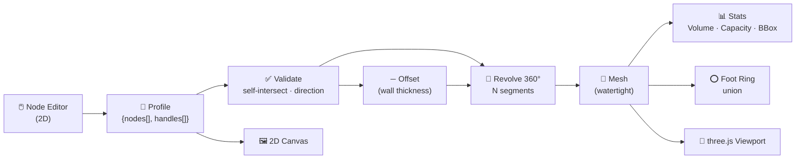

# 🏺 فایل ۰۵ — ماژول فرم‌میکر (Form / Pottery Forms)

> **مأموریت:** تبدیل یک پروفیل دوبعدی کشیده‌شده با نود، به یک فرم سه‌بعدی دقیق، قابل ویرایش، با محاسبهٔ حجم/ظرفیت/شیرینک و فوت‌رینگ.

---

## ۱. 🧭 معماری ماژول



---

## ۲. 📐 مدل پروفیل

### تعریف
پروفیل جانبی در صفحهٔ `(r, y)`:
- `r` = شعاع (mm، همیشه ≥ 0)
- `y` = ارتفاع (mm، از کف)
- نودها با دسته‌های Bézier (`hIn`, `hOut`) یا Catmull-Rom
- پروفیل باز است و با محور `y` بسته می‌شود (سطح دوار)

### قیدهای الزامی
| قید | قانون | پیام خطا |
|-----|-------|-----------|
| 🔢 حداقل نود | ۳ | «حداقل سه نود لازم است» |
| 🚫 خودتقاطعی | نمونه‌گیری ۲۰۰ نقطه‌ای + تست O(n²) سگمنت | «پروفیل خودش را قطع می‌کند» |
| ↗️ جهت | نودها باید `y` صعودی داشته باشند | «نودها را از پایین به بالا مرتب کنید» |
| ⭕ شعاع | `r > 0` برای همهٔ نمونه‌ها | «فرم به محور چسبیده؛ شعاع صفر مجاز نیست» |
| 📏 حداقل دیوار | `r_min > wallThickness` | «دیواره در گلوگاه باریک‌تر از ضخامت است» |
| 🪞 تقارن | اگر `mirrorX` فعال، `x` نودها آینه | — |

### توابع کلیدی (`packages/kernel/profile.ts`)
```ts
fitProfile(nodes: ProfileNode[]): SampledProfile        // → 512 نمونه {r,y, dx,dy, normal}
profileLength(p: SampledProfile): number
profileCurvature(p: SampledProfile): number[]
selfIntersects(p: SampledProfile): boolean
offsetProfile(p: SampledProfile, d: number): SampledProfile   // offset به‌داخل با ترمیم گلوگاه
radiusAt(p: SampledProfile, y: number): number          // درون‌یابی خطی/اسپلاین
interpolateAt(p: SampledProfile, y: number, field: 'r'|'inner'|'outer'): number
```

**الگوریتم offset:** برای هر نمونه، نرمال درونی محاسبه و `p' = p + n·d`. سپس:
1. حذف حلقه‌های خودتقاطعی (loop removal)
2. در **گلوگاه‌ها** (جایی که `r` مینیمم مطلق است) offset متوقف و به سمت بالا/پایین آینه می‌شود تا دیواره نازک نشود
3. نمونه‌برداری مجدد روی طول قوس یکنواخت

---

## ۳. 🔄 الگوریتم Revolve

```ts
function revolve(inner: SampledProfile, outer: SampledProfile, segments: number): Mesh {
  // 1) ساخت حلقه‌های افقی: برای هر نمونه y، دو دایره (inner, outer)
  // 2) اتصال با مثلث بین حلقه‌های متوالی (کمربند بیرونی + کمربند داخلی)
  // 3) بستن کف: فن مثلث از مرکز زیر به حلقهٔ کف
  // 4) بستن رینگ بالا (دهانه): نوار بین inner و outer در y_rim
  // 5) محاسبهٔ نرمال (smooth groups)
  // 6) اعتبارسنجی manifold
}
```

### نکات دقیق
| مورد | جزئیات |
|------|--------|
| 🔢 ترتیب مثلث‌ها | CCW وقتی از بیرون نگاه می‌کنید → نرمال به بیرون |
| 🧩 بستن کف | اگر `r_bottom > 0` مرکز کف اضافه شود؛ اگر `0` نباشد حلقهٔ بسته |
| 🕳️ دهانه | نوار باریک بین دیوارهٔ داخلی و بیرونی (ضخامت `wallThickness`) |
| 📉 کاهش سگمنت | در حین درگ `segments=32`؛ در رها `96`؛ در خروجی `256` |
| 💾 حافظه | `Float32Array` + `Uint32Array`، بدون آبجکت در حلقه |
| ⚠️ نازک‌شدن | اگر `distance(inner,outer) < 1mm` هشدار بده |

---

## ۴. 🧮 محاسبات حجم و ظرفیت

### ۴.۱ ظرفیت اسمی (تا لبه)
روش **مخروط ناقص** (دقیق‌تر از مستطیل):
```
V = (π/3) · Σ_{i=0}^{n-1} Δy_i · (r_i² + r_i·r_{i+1} + r_{i+1}²)
```
که `r_i` شعاع **داخلی** در نمونه `i` است.

> ✅ روش جایگزین (سیмпسون) هم مجاز است، اما مخروط ناقص برای پروفیل چندضلعی‌شده دقیق‌تر است.

### ۴.۲ حجم تا سطح پرشدگی
```
y0 = y_bottom_inner,  y1 = y_rim
y_fill = y0 + fillLevel · (y1 − y0)
V_filled = انتگرال مخروطی از y0 تا y_fill (نمونه‌های جزئی با درون‌یابی)
```

### ۴.۳ اعمال شیرینک
```
ابعاد خشک:   d_dry = d_wet · (1 − s)
حجم خشک:    V_dry = V_wet · (1 − s)³
ظرفیت مصرفی: هنگام ارزیابی «چقدر آب می‌گیرد» از ابعاد **خام (wet)** استفاده کن،
             هنگام نمایش «قطعهٔ نهایی» از ابعاد **خشک** استفاده کن.
```
| نمایش | مقدار |
|--------|-------|
| `wet: w 145 mm, h 148 mm` | ابعاد خام |
| `dry: w 127.6 mm, h 130.2 mm` | ابعاد پس از ۱۲٪ شیرینک |
| `Capacity 1131 ml` | ظرفیت فرم خام (در سایت) |

> 📌 تصمیم محصول: **ظرفیت را هم wet و هم dry نشان بده** (toggle) تا کاربر بداند قطعهٔ نهایی چقدر جا دارد. `V_dry = V_wet·0.88³ ≈ 0.681 V_wet` → برای نمونه: ≈ 771 ml.

### ۴.۴ ابعاد خروجی
```
width = 2·max(r_outer)
height = y_max − y_min
depth = same as width (متقارن)
weight_estimate = V_clay_solid · ρ_clay   (ρ ≈ 1.9 g/cm³ برای بدنهٔ رسی پخته‌نشده)
```

---

## ۵. ⭕ فوت‌رینگ

```ts
type FootRing = { enabled: boolean; width: number; depth: number; edge: 'square'|'round'|'chamfer' };
```

| مرحله | روش |
|-------|-----|
| 1️⃣ موقعیت | حلقه در `y = 0` زیر فرم، هم‌مرکز |
| 2️⃣ پروفیل مقطع | مستطیل `width × depth` با لبهٔ انتخابی (گرد کردن R، پخ ۴۵°) |
| 3️⃣ ساخت | revolve مقطع ۳۶۰° → حلقهٔ توخالی |
| 4️⃣ ادغام | `mesh = union(form, ring)` با manifold |
| 5️⃣ بررسی | ارتفاع کل = `depth + formHeight`؛ ابعاد نهایی به‌روز شود |

> 🎯 لبهٔ گرد (`round`) برای قالب drop-out بهتر است (بدون گیرکردن در گچ).
> ⚠️ اگر `width > 0.6 · diameter` هشدار: «پایه بیش از حد پهن است».

---

## ۶. 🖥️ UI ماژول

```
┌─────────────────────────── 🏺 FORM ────────────────────────────┐
│ [ Profile ] [ 3D ] [ Section ] [ Measurements ]                │
├────────────────────────────────────────────────────────────────┤
│  ▲ y                                                            │
│  │      ●────●         ← نودها قابل کشیدن، Alt = شکستن دسته     │
│  │     /      \                                                 │
│  │    ●        ●                                                │
│  │   /          \                                               │
│  └──●────────────●──► r           Grid [3 ▾]  ☑Mirror X ☐Mirror Y│
├────────────────────────────────────────────────────────────────┤
│ ⚙️ Dimensions                                                   │
│   Height      ●──────────── 148 mm   [ 148 ]                   │
│   Base Ø      ●──────        62 mm   [  62 ]                   │
│   Rim Ø       ●────────      72 mm   [  72 ]                   │
│   Belly Ø     ●─────────     88 mm   [  88 ]                   │
│   Wall        ●─              4 mm   [   4 ]                   │
│   Shrink      ●─────         12 %    [  12 ]                   │
│ ⭕ Foot ring  ☑ on   Width [8]  Depth [6]  Edge [round ▾]        │
│ 📊 Live:  w145 · h148 · Cap 1131 ml · Filled(80%) 958 ml        │
└────────────────────────────────────────────────────────────────┘
```

### حالت‌های نمایش
| حالت | توضیح |
|------|-------|
| `Profile` | ویرایش دو‌بعدی نودها با گرید mm |
| `3D` | orbit + نمای سایه‌دار + برش مقطعی |
| `Section` | نمای برش عمودی با ضخامت دیواره |
| `Measurements` | ابعاد با خط‌کش، زوایا، شعاع گلوگاه |

### تعامل‌ها
- 🖱️ کلیک روی خط → افزودن نود؛ `Delete` → حذف؛ `Alt+درگ` → شکستن دسته
- 🔍 اسکرول → زوم؛ `Space+درگ` → پن؛ `F` → fit
- ⌨️ `Ctrl+Z/Y` → undo/redo؛ `1..4` → تغییر تب
- 📌 نودها می‌توانند «قفل» و «قید افقی/عمودی» داشته باشند

---

## ۷. 📚 پریست‌های آماده (کتابخانهٔ فرم)

| پریست | ویژگی | پارامترهای کلید |
|-------|-------|------------------|
| 🥣 کاسه (Bowl) | دهانهٔ باز، کف گرد | h90 d160 wall6 shrink12 |
| 🌷 گلدان بلند (Bud vase) | گردن باریک | h180 d70 belly 95 neck 22 |
| ☕ فنجان (Mug) | دیوارهٔ راست، دسته‌گیر | h95 d85 wall5 |
| 🍶 بطری (Bottle) | شکم + گردن + لبه | h240 d110 neck 26 |
| 🫙 ظرف درپوش‌دار | لبهٔ تخت، شیار درپوش | h120 d100 |
| 🏺 کوزهٔ شکم‌دار | `Rim 32 · Belly 64 · Foot 46 · Height 78` | همان دموی مرجع |
| ⚪ دیسک تخت (Plate) | کم‌ارتفاع، لبهٔ برگشته | h25 d220 |
| 🕯️ جاشمعی | کف سنگین | h70 d80 |

> 🎯 هر پریست = یک `ProfileNode[]` آماده + تنظیمات؛ کاربر می‌تواند از آن شروع کند (کاهش ترس صفحهٔ خالی).

---

## ۸. ✅ تست‌های این ماژول

| # | تست | معیار |
|---|-----|-------|
| F1 | استوانهٔ ساده h100 r50 wall0 | `V = π·50²·100 = 785,398 mm³ = 785.4 ml` |
| F2 | مخروط ناقص | مقایسه با فرمول تحلیلی `πh(r1²+r1r2+r2²)/3` |
| F3 | فرم مرجع سایت | Cap `1131 ml ±1%`, Filled80 `958 ml ±1%` |
| F4 | شیرینک ۱۲٪ روی `145mm` | `127.6mm ±0.1` |
| F5 | offset دیواره | فاصلهٔ نمونه‌های inner/outer = `wall ±0.05mm` |
| F6 | گلوگاه | فرم با گلوگاه ۶mm و wall ۸mm → خطای «دیواره باریک» |
| F7 | watertight | هیچ لبهٔ باز؛ Euler = 2 |
| F8 | فوت‌رینگ | ارتفاع کل = `formH + depth`؛ union بدون خطا |
| F9 | self-intersect | پروفیل ضربدری → خطا |
| F10 | worktime | revolve ۹۶ سگمنت < ۳۰۰ms |

---

## ۹. 🧨 لبه‌های حساس (Edge Cases)

| مورد | رفتار درست |
|------|-------------|
| `r = 0` در کف | مرکز کف به‌صورت vertex واحد (fan) نه حلقهٔ منحط |
| `r = 0` در دهانه | فرم بستهٔ کامل (بطری درپوش‌دار) — دیوارهٔ بالایی ضخامت داشته باشد |
| نود تکراری | حذف خودکار با هشدار |
| `wall > r_min` | خطا + پیشنهاد کاهش دیوار |
| `fillLevel = 0` | حجم پرشده = 0؛ بدون تقسیم بر صفر |
| `fillLevel = 1` | برابر ظرفیت اسمی |
| پروفیل با حلقهٔ برگشتی (rim برگشته) | مجاز است، اما offset باید تشخیص دهد (نه offset منفی خالص) |
| شیرینک ۰ | مجاز و نمایان («بدون شیرینک») |
| سگمنت ۲۴ | کیفیت پایین ولی مجاز برای پیش‌نمایش |

---

➡️ ادامه در [`06-MODULE-PATTERNS.md`](./06-MODULE-PATTERNS.md)


---

## اتصال فرم‌های فعلی به پنل و Wrap جدید

نیازهای [SV-35…SV-39 و SV-50](16-SOLIDVENTS-SPEC.md) به فرم افزوده می‌شوند، نه جایگزین فرم سفالی. پیش‌نمایش UV موجود معادل بازکردن STEP دلخواه یا flatten کم‌اعوجاج نیست.

پنل تخت پارامتریک با مرز دلخواه و ضخامت/offset ابتدا در canonical vector و سپس B-rep ساخته شود. گزینهٔ Shapes Only از Panel with Holes جدا باشد؛ دومی قابلیت مستقل ما با validity gate است چون در مرجع حذف شده است. برای wrapped pattern، normal direction و units و مختصات اصلی و seam حفظ شوند؛ برجستگی/فرورفتگی/cut با جزایر و حداقل ضخامت باقیمانده اعتبارسنجی شود.

فرم revolve قبلی، shrinkage، ظرفیت و ضخامت رس همان معیارهای قبلی را دارند. آزمون تطبیق pattern روی cylinder/cone تحلیلی است؛ sphere/freeform باید heatmap و سقف اعوجاج داشته باشد. مدرک mesh watertight، جایگزین B-rep validity یا ساخت فیزیکی نیست.
