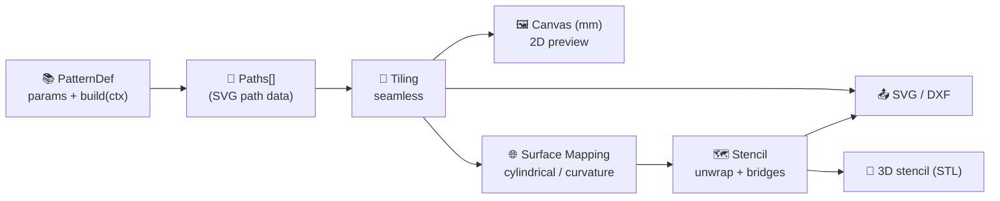

# 🔷 فایل ۰۶ — ماژول الگو و استنسیل (Pattern + Stencil)

> **مأموریت:** ساخت الگوهای پارامتریک وکتوری، کاشی بی‌درز، نگاشت روی سطح سه‌بعدی، و تولید فایل استنسیل/برش با ابعاد واقعی.

---

## ۱. 🧭 معماری



### قرارداد موتور الگو
```ts
export type PatternContext = {
  widthMm: number;
  heightMm: number;
  params: Record<string, number | string | boolean>;
  seed: number;                     // برای الگوهای تصادفی (قطعی)
  helpers: {
    circle(cx,cy,r): string;  rect(x,y,w,h,rx?): string;
    line(x1,y1,x2,y2): string; polygon(pts): string;
    arc(...): string; bezier(...): string;
    rotate(deg, cx?, cy?): Transform;
    mirrorX(): Transform; mirrorY(): Transform;
  };
};
export type PatternDef = {
  id: string;
  name: { fa: string; en: string };
  category: 'geometric' | 'organic' | 'traditional' | 'lettering' | 'custom';
  params: ParamSpec[];              // اسلایدرها، انتخاب‌ها، رنگ‌ها
  preview: string;                  // فایل SVG کوچک
  build(ctx: PatternContext): PathSpec[];
};
```

---

## ۲. 📚 کتابخانهٔ ۱۲ الگوی پایه (حداقل)

| # | 🆔 شناسه | نام | پارامترهای اصلی | دسته |
|---|---------|-----|-------------------|------|
| 1 | `dot-grid` | شبکهٔ نقطه‌ای | size, spacing, shape(circle/square), roundness | geometric |
| 2 | `chevron` | شِوران | width, height, thickness, angle, offset | geometric |
| 3 | `herringbone` | استخوان‌ماهی | brickW, brickH, gap, rotation | geometric |
| 4 | `wave` | موج | amplitude, wavelength, thickness, count | organic |
| 5 | `hex` | لانه‌زنبور | radius, gap, rotation, innerCut | geometric |
| 6 | `diamond` | لوزی | size, ratio, gap, doubleLine | geometric |
| 7 | `spiral` | مارپیچ | turns, growth, thickness, direction | organic |
| 8 | `stripe` | خطوط | width, gap, angle, dash | geometric |
| 9 | `scale` | فلس‌ماهی | scaleR, overlap, rows, offset | organic |
| 10 | `grid` | شبکهٔ ساده | cols, rows, lineW, radius | geometric |
| 11 | `kumiko` | کومیکو (چوبی ژاپنی) | cellSize, barW, pattern | traditional |
| 12 | `seigaiha` | سیگایها (موج ژاپنی) | radius, spacing, rings | traditional |
| 13 | `puzzle` | پازل (از درخواست جامعه 🗳️) | cellSize, tabR, jitter | geometric |
| 14 | `text` | متن/امضا | text, font, size, spacing, extrude | lettering |
| 15 | `custom` | طراحی آزاد | — (مسیرهای کاربر) | custom |

> 📌 **قاعدهٔ افزودنی:** افزودن الگوی جدید = یک فایل `patterns/defs/<id>.ts` + ثبت در `index.ts`. هیچ تغییری در هسته لازم نیست.

---

## ۳. 🔁 کاشی بی‌درز (Seamless Tiling)

### ریاضیات
```
تعداد تکرار افقی: nx = ceil(canvasW / tileW) + 1
تعداد تکرار عمودی: ny = ceil(canvasH / tileH) + 1
برای هر (i,j):  transform = translate(i·tileW + offsetX, j·tileH + offsetY)
پس از رندر:    clip به مستطیل بوم
```

### شرط بی‌درز بودن
- عناصری که از لبهٔ راست بیرون می‌زنند باید در لبهٔ چپ **تکرار** شوند → `ghost copies` با `translate(-tileW, 0)`.
- برای آرایش‌های آجری (`brick` / `herringbone`) با `rowOffset = tileW/2`، لازم است **دو ردیف ghost** (بالا و پایین) هم رندر شود.
- تست خودکار: رستر کردن نوار لبهٔ چپ (`x ∈ [0,2]`) و راست (`x ∈ [W-2,W]`)، مقایسهٔ پروفایل رنگ → اختلاف باید ~۰ باشد.

### پیاده‌سازی
```ts
function tilePattern(paths: PathSpec[], tile: Tile, canvas: {w:number;h:number}) {
  const out: PathSpec[] = [];
  const nx = Math.ceil(canvas.w / tile.widthMm) + 2;
  const ny = Math.ceil(canvas.h / tile.heightMm) + 2;
  for (let j = -1; j < ny; j++)
    for (let i = -1; i < nx; i++)
      out.push(...paths.map(p => translatePath(p, i*tile.widthMm + tile.offsetX,
                                                    j*tile.heightMm + tile.offsetY)));
  return out;
}
```

---

## ۴. 🌐 نگاشت الگو روی فرم سه‌بعدی

### ۴.۱ نگاشت استوانه‌ای (پیش‌فرض)
```
برای نقطهٔ روی فرم با (θ, y):
  u = (θ / 2π) · circumferenceScale     ← افقی
  v = (y - yMin) / (yMax - yMin)        ← عمودی
  نقطهٔ الگو = (u · canvasW · repeatU, v · canvasH)
```
| پارامتر | معنی |
|----------|-------|
| `repeatAround` | تکرار افقی بر اساس محیط |
| `seamAngle` | زاویهٔ درز (پشت فرم) |
| `verticalStretch` | کشش عمودی برای هم‌راستایی با ارتفاع |

### ۴.۲ نگاشت منحنی-آگاه (Curvature-aware) ⭐
برای فرم‌های شکم‌دار که انحنا در دو جهت تغییر می‌کند:
```
1) طول قوس افقی:  s(θ) = ∫ r(θ) dθ   →  برای تقارن محوری: s = r(y)·θ
2) طول قوس عمودی: t(y) = ∫ sqrt(1 + (dr/dy)²) dy
3) مقیاس محلی:   k(y) = t'(y) = sqrt(1 + (dr/dy)²)
4) نقطهٔ الگو:   (u,v) = (r(y)·θ, t(y)) / (sMax, tMax)
5) اصلاح کشش:    اگر k(y) زیاد تغییر کند، الگو در ناحیهٔ شیب‌دار کشیده می‌شود →
                  آنالیز distortion:  ratio = k(y)/k̄ ؛ اگر > 1.35 هشدار «کشیدگی زیاد»
```
> 💡 این همان قابلیت «Patturn Curvature mapping» است که در صفحهٔ Vision ذکر شده. **باید** پیاده شود.

### ۴.۳ پیش‌نمایش سه‌بعدی
- مسیرهای الگو به سطح فرم **project** می‌شوند (raycast از محور مرکزی به بیرون).
- رسم با `LineBasicMaterial` با `polygonOffset` تا روی سطح زد نزند.
- گزینهٔ «extrude»: مسیرها با ضخامت ۰.۴mm از سطح بیرون آمده (پیش‌نمایش حکاکی).

---

## ۵. 🗺️ استنسیل (Stencil) — از سطح به تخت

### ۵.۱ Unwrap
```
برای مقطع‌های y_i (n مقطع):
  طول کل افقی  L(y_i) = 2π·r_outer(y_i)
  ارتفاع کل   H = Σ طول قوس بین مقاطع
  در تخت: x ∈ [0, max L],  y ∈ [0, H]
  هر نقطهٔ سطح (θ, y) → ( (θ/2π)·L(y), t(y) )
```
> ⚠️ در فرم‌های شکم‌دار، عرض تخت **غیرمستطیلی** می‌شود (مثل ساعت شنی). این درست است؛ کاربر باید ببیند و بتواند «تقسیم به نوارهای عمودی» را انتخاب کند.

### ۵.۲ گزینه‌های استنسیل
| گزینه | توضیح |
|-------|-------|
| 🧩 `bridges` | پل‌های نگه‌دارنده برای جزیره‌های جدا (عرض قابل‌تنظیم، تعداد خودکار) |
| 📏 `bleed` | حاشیهٔ اضافی برای چسباندن |
| ✂️ `cut lines` | خط برش محیطی (استنسیل واقعی) |
| 🎨 `spray thickness` | ضخامت خط برای پاشش رنگ |
| 🔢 `registration marks` | علائم تراز برای چند‌تکه‌ای |

### ۵.۳ تشخیص جزیره
```
1) رستر کردن مسیرها روی گرید بولی
2) flood-fill از لبهٔ بوم → ناحیه‌های «پس‌زمینه»
3) هر ناحیهٔ بسته که با لبه‌ها ارتباط ندارد = جزیره
4) اتصال جزیره به نزدیک‌ترین دیوار با پل مستطیلی (BFS روی فاصله)
```

---

## ۶. 🧩 ویرایشگر وکتور آزاد

| ابزار | رفتار |
|-------|-------|
| ✏️ قلم (Pen) | افزودن نود، دستهٔ Bézier، بستن مسیر |
| 🔲 شکل پایه | مستطیل، دایره، بیضی، چندضلعی، ستاره، خط |
| 🖱️ انتخاب | کلیک، کشیدن جعبه، `Shift` افزودنی |
| ↔️ ترنسفورم | جابجایی، چرخش، مقیاس، آینه |
| 🔗 Boolean 2D | union / subtract / intersect / xor (کتابخانهٔ `polygon-clipping` یا `paper.js`) |
| ➖ آفست | inward/outward با `offset-polygon` |
| 🔤 متن | تبدیل فونت به مسیر (`opentype.js`)، پشتیبانی فارسی (شکل‌دهی حروف نیاز به `arabic-persian-reshaper`) |
| 📥 ایمپورت | SVG (پارس امن)، DXF (خطوط) |
| 🖼️ ترِیس تصویر | PNG/JPG → ماسک → marching squares → ساده‌سازی RDP |

### الگوریتم ردیابی تصویر
```
1) decode → grayscale → گاوسی بلور
2) آستانه‌گذاری خودکار (Otsu) یا دستی
3) optional: erode/dilate برای تمیزکاری
4) marching squares → چندضلعی‌های تو در تو
5) ساده‌سازی Ramer–Douglas–Peucker (تلورانس ۰.۵mm)
6) حذف نویز: مساحت < ۲mm²
7) خروجی: paths آماده برای استنسیل یا کاتر کوکی
```

---

## ۷. 📤 خروجی‌ها

### SVG
```xml
<svg xmlns="http://www.w3.org/2000/svg" width="300mm" height="300mm" viewBox="0 0 300 300">
  <!-- fill="none" stroke="#000" stroke-width="0.5" -->
</svg>
```
| قاعده | دلیل |
|-------|------|
| ✅ واحد `mm` در `width/height` | ابعاد واقعی در LightBurn/Illustrator |
| ✅ `viewBox` برابر mm | مقیاس ۱:۱ |
| ✅ لاگ‌ها جدا (`<g inkscape:label>`) | انتخاب در نرم‌افزار برش |
| ❌ بدون تبدیل به px | خطای مقیاس |

### DXF
- فرمت `R12` (سازگارترین) یا `AC1015`
- لایه‌ها: `CUT`, `ENGRAVE`, `SCORE`
- فقط `LINE`, `ARC`, `LWPOLYLINE`, `CIRCLE` (بدون spline در R12)

### 3D Stencil (اختیاری)
- extrude مسیرها با ضخامت `t` (۱–۳mm)
- پل‌ها در همان سطح
- خروجی STL برای برش/پرینت

---

## ۸. 🖥️ UI ماژول

```
┌─────────────────────────── 🔷 PATTERN ──────────────────────────┐
│ [ Library ] [ Editor ] [ On 3D ] [ Stencil ]                    │
├─────────────────────────────────────────────────────────────────┤
│  کتابخانه:  ● ● ● ● ● ● ● ● ● ● ● ●  (کارت‌های پیش‌نمایش)      │
├─────────────────────────────────────────────────────────────────┤
│ ⚙️ Parameters                                                   │
│   Cell shape  [ Circular ▾ ]                                    │
│   Grid size      ●───────── 11       [ 11 ]                     │
│   Grid spacing   ●───────── 14 mm    [ 14 ]                     │
│   Scale ratio    ●───────── 1.50     [ 1.50 ]                   │
│   Cell rotation  ●───────── 0°       [  0 ]                     │
│   Roundness      ●───────── 100 %    [100 ]                     │
│   ☑ Mirror X   ☑ Mirror Y                                      │
├─────────────────────────────────────────────────────────────────┤
│ 🧵 Tiling:  Tile [40]×[40]mm  ☑Seamless X ☑Seamless Y           │
│ 🌐 Mapping:  [ Cylindrical ▾ ]  Seam [180°]  ☑Repeat around      │
│ 🗺️ Stencil:  ☑Bridges (1.2mm)  Bleed [3mm]  ☑Registration marks  │
├─────────────────────────────────────────────────────────────────┤
│ 📤 Export: [ SVG ] [ DXF ] [ 3D stencil ] [ PDF 1:1 ]           │
└─────────────────────────────────────────────────────────────────┘
```

### تجربهٔ کاربری کلیدی
- 🎞️ **کارت الگو = پیش‌نمایش زنده** با پارامترهای پیش‌فرض (نه آیکون ثابت).
- 👁️ **Toggle «روی فرم ببین»** که بوم دو‌بعدی را به پیش‌نمایش سه‌بعدی بچرخاند.
- 📏 **خط‌کش mm** روی بوم.
- 🎯 **حالت grid snap** با فاصلهٔ قابل‌تنظیم.
- ⚡ رندر تفکیکی: پیش‌نمایش کم‌کیفیت در حین کشیدن، کامل پس از رها.

---

## ۹. ✅ تست‌های ماژول

| # | تست | معیار |
|---|-----|-------|
| P1 | کاشی بی‌درز `dot-grid` | اختلاف لبهٔ چپ/راست < ۱٪ پیکسل |
| P2 | ابعاد SVG | خط ۱۰۰mm در فایل ۱۰۰ واحد mm |
| P3 | تعداد عناصر | `dot-grid` ۱۰mm در بوم ۱۰۰mm → ۱۰۰ نقطه |
| P4 | نگاشت استوانه | نقطهٔ `θ=۰` و `θ=۲π` روی هم بیفتند (درز پنهان) |
| P5 | نگاشت منحنی | distortion در فرم شکم‌دار محاسبه و هشدار داده شود |
| P6 | جزیرهٔ استنسیل | حرف «O» → ۱ جزیره و ۱ پل |
| P7 | ردیابی تصویر | مربع ۵۰×۵۰px → مسیر ۴ نودی ±۰.۵mm |
| P8 | Boolean 2D | دو دایرهٔ همپوشان → intersect مساحت درست |
| P9 | متن فارسی | «سلام» بدون حروف جدا رسم شود |
| P10 | performance | ۵۰۰۰ عنصر در < ۱۰۰ms |

---

## ۱۰. 🧨 لبه‌های حساس

| مورد | رفتار |
|------|-------|
| الگو بزرگ‌تر از بوم | `clip` + هشدار «بخشی از الگو خارج از بوم است» |
| `tile` صفر | خطا + حداقل ۱mm |
| نگاشت روی فرم بدون الگو | غیرفعال با راهنما |
| SVG ایمپورت با `<script>` | حذف همهٔ عناصر غیرمجاز (sanitize) |
| ردیابی عکس پرنویز | پیش‌فیلتر blur + حذف مساحت کوچک |
| مسیر با ۱۰۰هزار نود | ساده‌سازی خودکار + هشدار |

---

➡️ ادامه در [`07-MODULE-MOLDS.md`](./07-MODULE-MOLDS.md)


---

## توسعهٔ الزامی SolidVents: layout، کنترلر و شکل مستقل

قرارداد کامل و پذیرش هر قابلیت در [SV-01…SV-31](16-SOLIDVENTS-SPEC.md) است. کتابخانهٔ pattern آمادهٔ فعلی معادل موتور layout/controller نیست و با افزودن یک preset نمی‌توان ID را بست.

- ۹ layout: scatter، grid/hex و cross-row spin، path، spiral، concentric، Fibonacci، cross-hatch، Voronoi stone و flow lines. AI Custom یک حالت دهم مستقل با DSL محدود است.
- واحد: circle/rectangle/polygon/star/custom؛ path/shape/boundary و controller را از هم جدا نگه دار. تغییر layout recipe مشترک را پاک نکند.
- ۴ کانال: size/spacing/angle/shape با point/line/curve/polyline/closed، target/range، sync هندسه، unify value/range و advancedهای سازگار.
- تصویر محلی با opacity/scale/position؛ luminance/invert/contrast برای چهار کانال و خروجی vector واقعی. sampling، alpha و خارج کادر قرارداد صریح دارند.
- Flow: width/density/bend، direction تک‌کنترلر و fillet و caps و invert gaps؛ گزینهٔ hard-edge یا single-side ناسازگار در spacing/bend غیرفعال. Voronoi فقط کانال‌های معنی‌دار را فعال کند.
- Custom editor: primitive dimensions، pen/select/direct select، layers و boolean، pivot/locks، editable fillet، mirror ۲–۱۲، snap، base/target topology و rigid rotation morph.
- خروجی و preview از canonical geometry؛ boundary complete-area و clip براساس تمام منحنی؛ overlap union قبل DXF/STEP. JSON/SVG recipe roundtrip بدون اجرای کد.

گیت‌های کلیدی: deterministic seed، فاصلهٔ طول‌قوس، controller distance oracle، دوران 180° بدون collapse، fixed+target، donut و cross-face، cancel/stale و local-only audit. CSV/تصویر تزئینی جای بردار/CAD واقعی نیست.
