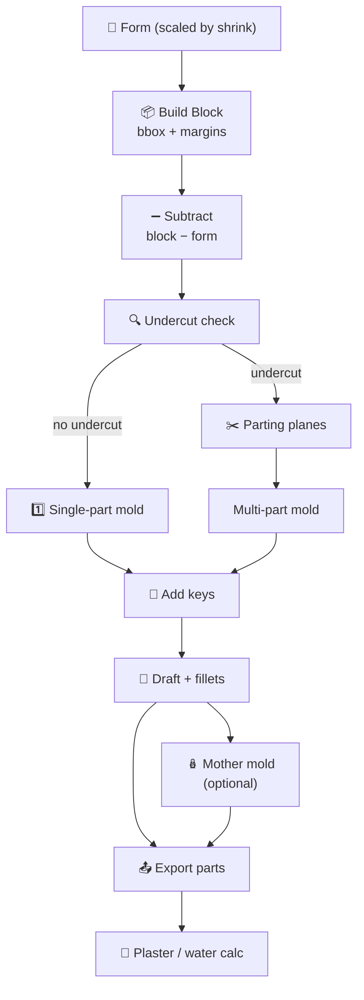

# 🧱 فایل ۰۷ — ماژول قالب‌سازی (Mold Maker)

> **مأموریت:** تبدیل فرم به یک **سیستم قالب گچی قابل‌ساخت** — تک‌تکه یا چندتکه، با کلیدهای ثبت، مادرقالب، و محاسبهٔ دقیق گچ و آب. این بزرگ‌ترین تمایز محصول است.

---

## ۱. 🧭 معماری



---

## ۲. 📦 ساخت بلوک قالب

```
W = 2·max(r_outer) + 2·wall       (wall = ضخامت گچ، پیش‌فرض 25mm)
D = 2·max(r_outer) + 2·wall
H = height + base + topMargin      (base = 20mm، topMargin = 10mm)
block = Box(W, D, H)  با مرکز روی محور فرم، کف در y = −base
```

### پارامترها
| پارامتر | پیش‌فرض | بازه | اثر |
|---------|---------|------|------|
| `wallThicknessMm` | 25 | 15–60 | استحکام و مصرف گچ |
| `baseThicknessMm` | 20 | 10–40 | کف قالب |
| `draftDeg` | 1.5 | 0–5 | خروج راحت‌تر |
| `filletMm` | 3 | 0–10 | گوشه‌های نرم |
| `shrink` | 0.12 | 0–0.20 | مقیاس فرم پیش از تفریق |

### قانون شیرینک (بسیار مهم)
```
فرم در قالب باید بزرگ‌تر باشد تا پس از خشک‌شدن و پخت به اندازهٔ نهایی برسد:
  form_for_mold = form × 1 / (1 − s)
مثال: هدف 145mm با s = 0.12  →  form_for_mold = 145 / 0.88 = 164.8mm
```

---

## ۳. ➖ عملگر Boolean

```ts
const moldSolid = csg.subtract(block, formSolid);
```
| مرحله | بررسی |
|-------|-------|
| 1️⃣ آماده‌سازی | هر دو مش باید manifold باشند |
| 2️⃣ تفریق | manifold-3d |
| 3️⃣ حذف قطعات شناور | بزرگ‌ترین بدنه را نگه دار (بقیه noise) |
| 4️⃣ اعتبارسنجی | Euler, بدون لبهٔ باز |
| 5️⃣ ترمیم | در صورت خطا → voxel remesh با دقت ۰.۴mm |

> ⚠️ **دشواری واقعی:** اگر فرم به دیوارهٔ بلوک بچسبد، قالب باز می‌شود. حاشیهٔ `wall` باید همیشه حداقل `wallThicknessMm` باشد و در محاسبه لحاظ شود.

---

## ۴. 🔍 تحلیل Undercut (قلب تصمیم‌گیری)

### برای فرم‌های دوّار (محوری)
```
برای هر مقطع y از پایین به بالا:
   r(y) = شعاع بیرونی
   شیب  = dr/dy
Drop-out تک‌تکه مجاز است اگر:  dr/dy ≥ 0  برای همهٔ y
(یعنی فرم هرگز از پایین به بالا باریک نشود — مثل مخروط یا استوانه)
```
نمونه:
| فرم | `dr/dy` | نتیجه |
|-----|---------|-------|
| استوانه | 0 | ✅ تک‌تکه |
| مخروط (باریک‌شونده به بالا) | − | ✅ تک‌تکه |
| مخروط (پهن‌شونده به بالا) | + | ❌ نیاز به تقسیم |
| کاسه | منفی تا لبه | ✅ تک‌تکه (لبهٔ باز) |
| گلدان شکم‌دار | منفی سپس مثبت | ❌ دو/سه‌تکه |
| بطری با گردن | منفی-مثبت-منفی | ❌ سه‌تکه |

### برای فرم‌های غیرمحوری (مسیر آینده)
```
1) برای هر جهت خروج d (مجموعهٔ ۱۲–۲۴ جهت) محاسبهٔ «قابلیت دید» با raycast
2) جهت‌هایی که در آن‌ها هیچ نقطهٔ خودپوشانی نیست = جهت خروج معتبر
3) اگر جهت معتبر نیافت → تقسیم بر اساس پوشش
```

### گزارش به کاربر
```
⚠️ این فرم در ارتفاع ۶۴mm یک برآمدگی (شکم) دارد و از قالب تک‌تکه بیرون نمی‌آید.
   پیشنهاد: تقسیم به ۲ قطعه در ارتفاع ۶۴mm (خط درز در بیشترین قطر — دیده نمی‌شود)
   [ اعمال خودکار ]   [ دستی انتخاب کنم ]
```
> 🎯 قاعدهٔ زیبایی‌شناسی: **درز را روی بیشترین قطر یا یک خط طراحی طبیعی** بگذار تا دیده نشود.

---

## ۵. ✂️ صفحهٔ جداایش (Parting)

### تقسیم عمودی (برای undercut افقی)
```
سطح جداایش = صفحهٔ عمودی که از محور می‌گذرد، با زاویهٔ θ_p
برای تقارن محوری، هر صفحه از محور کار می‌کند → انتخاب بر اساس «کمترین تعداد قطعه»
پیش‌فرض: ۲ قطعه با درز پشت (θ = 180°)
```
- 🔑 کلیدها روی سطح جداایش قرار می‌گیرند.
- 📐 سطح جداایش می‌تواند **منحنی** باشد (تبعیت از پروفیل) تا درز پنهان شود.

### تقسیم افقی (از Vision + درخواست جامعه)
```
صفحهٔ افقی در ارتفاع y_s → دو قطعه که از بالا/پایین خارج می‌شوند
مناسب: فرم‌های بلند، کاهش تعداد قطعات، قرار دادن درز روی خط بدنه
```
| حالت | تعداد قطعات | کاربرد |
|------|--------------|--------|
| عمودی فقط | 2–3 | undercut افقی |
| افقی فقط | 2–4 | فرم‌های بلند |
| ترکیبی | 3–6 | فرم پیچیده |

### الگوریتم انتخاب خودکار (auto)
```
candidates = یافتن همهٔ سطوح برش معتبر (افقی/عمودی)
score(combo) = w1·parts + w2·(طول درز قابل‌دیدن) + w3·(پیچیدگی ساخت)
انتخاب کمترین score با قید parts ≤ maxParts
```
| وزن | مقدار پیشنهادی |
|-----|----------------|
| `w1` (تعداد قطعه) | 10 |
| `w2` (درز دیده‌شده) | 5 |
| `w3` (پیچیدگی) | 1 |

---

## ۶. 🔑 کلیدهای ثبت (Registration Keys)

### انواع
| نوع | پارامتر | مزیت |
|-----|---------|------|
| 🔵 استوانهٔ مخروطی (tapered cylinder) | قطر، ارتفاع، `taperDeg` | تراز دقیق، ساخت آسان |
| 🌗 نیم‌کره (hemisphere) | شعاع | ساده، بدون جهت |
| ➕ صلیبی (cross) | طول، عرض | ضد‌چرخش |
| ➖ V-groove | زاویه، عمق | ارزان، برای قالب‌های کوچک |

### محاسبات
```
r_top = r_base + h · tan(taper)
تلورانس (gap) بین نر و ماده: 0.15–0.30mm (بسته به روش ساخت)
  - پرینت FDM: 0.30mm
  - پرینت SLA: 0.15mm
  - CNC: 0.10mm
تعداد کلید: 2 (قالب ۲تکه) · 3 (۳تکه، مثلثی) · 4 (متقارن)
موقعیت: inset از دیواره، روی سطح جداایش، در ارتفاع میانه
```

### قواعد جلوگیری از خطا
| 🔴 خطا | ✅ قاعده |
|--------|----------|
| کلید در گوشهٔ تیز | حداقل `inset = r_key + 3mm` از دیواره |
| کلیدهای هم‌راستا در ۳تکه | آرایش مثلثی (نه خطی) |
| تلورانس صفر | حداقل ۰.۱mm |
| کلید روی سطح منحنی | projection روی سطح + جهت نرمال |

---

## ۷. 🪆 مادرقالب (Mother Mold)

### ۷.۱ حالت «۳D Print» (قالب پرینتی)
```
mother_part = shell(moldPart, offset = barrierMm)
+ قیف ریختن (sprue) در بالاترین نقطه
+ کانال‌های هوا (vent) در بالاترین نقاط محبوس
+ flange برای نگه‌داشتن دیواره‌ها
```
| مؤلفه | اندازهٔ پیش‌فرض |
|--------|-----------------|
| `wallMm` | 10 |
| `flangeMm` | 15 |
| `barrierMm` | 2 (مانع چسبیدن سیلیکون به پرینت) |
| `sprueDia` | 12 |
| `ventDia` | 4 |

### ۷.۲ حالت «Silicone» (مادرقالب سیلیکونی)
```
1) مدل «قطعهٔ نهایی قالب گچی» تولید شود (نه خودِ قالب معکوس)
2) یک پوسته (jacket) اطراف آن با فاصلهٔ ضخامت سیلیکون
3) casting barrier = سطحی که سیلیکون و گچ را جدا می‌کند
4) خروجی: مدل چاپ‌شدنی برای ریختن سیلیکون روی آن
```
> 📌 سایت به‌صراحت می‌گوید: «Patturn automatically generates a model of your final plaster mold parts and a barrier for casting your form in silicone.» → همین باید پیاده شود.

### محاسبهٔ سیلیکون (افزودهٔ ما ✅)
```
V_silicone = V_cavity − V_master
m_silicone = V_silicone · ρ_silicone  (ρ ≈ 1.10–1.20 g/cm³)
زمان پخت و نسبت پایه:ها موردی، در UI قابل‌تنظیم
```

---

## ۸. 🧮 محاسبهٔ گچ و آب

### فرمول دقیق
```
ρ_plaster = 2.75 kg/L   (گچ پاریس/پلاستر)
ρ_water   = 1.00 kg/L
r_w       = نسبت آب به گچ (پیش‌فرض 0.70، بازهٔ 0.60–0.80)

V_mix = P/ρ_p + W/ρ_w = P·(1/2.75 + r_w)
P = V_mix / (1/2.75 + r_w)
W = r_w · P
چگالی مخلوط = (P + W) / V_mix
```

### اعتبارسنجی با نمونهٔ سایت
```
V = 1.84 L
P = 1.84 / (0.3636 + 0.70) = 1.84 / 1.0636 = 1.730 kg   → سایت: 1.72 kg ✅
W = 0.70 × 1.730 = 1.211 kg                              → سایت: 1.20 kg ✅
```

### افزوده‌های ضروری (Gap)
| افزوده | چرا |
|--------|-----|
| 🌡️ ضریب اتلاف ۵٪ | گچ روی دیواره می‌ماند |
| 🧊 حجم واقعی از مش (نه bbox) | دقت بیشتر |
| 🕒 زمان کار (working time) | گچ پاریس ≈ ۱۵–۲۰ دقیقه |
| ⚖️ وزن نهایی قالب (پر) | حمل و نقل |
| 💰 هزینهٔ تقریبی | بر اساس نرخ گچ بازار (قابل تنظیم) |
| 📋 دستور ساخت گام‌به‌گام | «۱۱۳۰ گرم آب بریز، ۱۶۱۵ گرم گچ اضافه کن، ۲ دقیقه هم بزن…» |

---

## ۹. 🧾 خروجی قطعات

```ts
type MoldParts = {
  parts: { id: string; name: string; mesh: Mesh; volumeMm3: number; volumeL: number;
           plasterKg: number; waterKg: number; bbox: [Vec3,Vec3]; keys: KeyReceipt[] }[];
  mother?: { parts: Mesh[]; kind: 'print'|'silicone'; siliconeKg?: number };
  assembly: { explodeView: Mesh[]; order: number[] };
  bom: string;   // Bulk of Materials — جدول
};
```

### نام‌گذاری و سازمان‌دهی ZIP
```
vase_project/
├─ mold/
│  ├─ part-1-left.stl
│  ├─ part-2-right.stl
│  └─ keys-1x4.stl
├─ mother/
│  ├─ jacket-a.stl
│  └─ jacket-b.stl
├─ form/
│  └─ master-original.stl
├─ docs/
│  ├─ assembly-guide.pdf
│  └─ mixing-calculations.txt
└─ README.txt
```

---

## ۱۰. 🖥️ UI ماژول (مطابق سایت)

```
┌────────────────────────── 🧱 MOLD ──────────────────────────────┐
│ Overview │ 1 part molds │ Multi part molds │ Wall thickness      │
├─────────────────────────────────────────────────────────────────┤
│  🎥 نمای سه‌بعدی بلوک با قطعات رنگی و انفجار (explode)          │
├─────────────────────────────────────────────────────────────────┤
│ 🔑 Key registration                                             │
│   Overview │ Key types │ Size │ Position │ Tolerance             │
│   Type: (◉) Tapered cylinder   ( ) Half sphere                   │
│   Size        ●────── 16 mm    Position  ●────── inset 10 mm     │
│   Tolerance   ●─ 0.20 mm       Count     2                       │
├─────────────────────────────────────────────────────────────────┤
│ 🪆 Mother mold:   ☐ 3D printed  ☐ Silicone  Wall [10] Flange [15]│
├─────────────────────────────────────────────────────────────────┤
│ 🧮 Mixing:  Volume 1.84 L · Plaster 1.72 kg · Water 1.20 kg      │
│             +5% waste → 1.81 kg / 1.26 kg   ⏱ work time ~18min  │
├─────────────────────────────────────────────────────────────────┤
│ 📤 Export: [ parts ZIP ] [ mother ] [ guide PDF ]                │
└─────────────────────────────────────────────────────────────────┘
```

### حالت نمایش
| حالت | توضیح |
|------|-------|
| 🧊 Solid | بلوک کامل با فرم داخل |
| 🔪 Cutaway | برش نیمی از بلوک برای دیدن حفره |
| 💥 Explode | جدا کردن قطعات با فاصلهٔ انیمیشنی |
| 🎨 By part | رنگ متفاوت هر قطعه در درخت قطعات |
| 📏 Dimensions | ابعاد بیرونی و ضخامت دیواره |

---

## ۱۱. ✅ تست‌های ماژول

| # | تست | معیار |
|---|-----|-------|
| M1 | استوانه → تک‌تکه | `parts = 1`، بدون خطا |
| M2 | گلدان شکم‌دار → چندتکه | `parts ≥ 2`، هر قطعه بدون undercut |
| M3 | حجم قطعه | با محاسبهٔ داخلی ±۰.۵٪ |
| M4 | گچ `1.84L` | `1.72kg ±2%`, `1.20kg ±2%` |
| M5 | کلید | `r_top − r_base = h·tan(taper) ±0.01` |
| M6 | تلورانس | فاصلهٔ نر/ماده = `clearance ±0.02` |
| M7 | manifold | همهٔ قطعات واترتایت |
| M8 | مادرقالب | پوسته بدون خودتقاطع، ضخامت یکنواخت ±۰.۲ |
| M9 | شیرینک | `145mm` هدف → فرم داخل قالب `164.8mm ±0.1` |
| M10 | باز/بسته | Boolean هیچ سوراخی در دیواره ایجاد نکند (شمارش لبهٔ باز = 0) |
| M11 | worktime | Boolean < ۱.۵s |
| M12 | auto split | روی ۱۰ فرم نمونه، حداقل قطعات ممکن انتخاب شود |

---

## ۱۲. 🧨 لبه‌های حساس و خطاهای رایج صنعت

| 🧨 مشکل | ✅ راه‌حل |
|---------|-----------|
| فرم به دیوارهٔ بلوک می‌چسبد | حاشیهٔ اجباری = `max(wall, wallThickness)` |
| حباب هوا در قالب | vent در بالاترین نقاط + چرخش قالب در راهنما |
| قالب بدون draft گیر می‌کند | حداقل ۱° draft، هشدار اگر صفر |
| کلید بیش از حد نزدیک لبه | `inset ≥ r_key + 3` |
| دیوارهٔ نازک گچ | حداقل ۲۰mm، هشدار اگر < ۱۵ |
| دیوارهٔ نازک رسی | حداقل ۳mm، هشدار |
| قالب بیش از ۱۰kg | پیشنهاد کاهش ضخامت/اندازه |
| درز روی صورت اثر | پیشنهاد صفحهٔ جداایش در بیشترین قطر |
| Boolean نتیجهٔ خالی | تشخیص: فرم بیرون از بلوک → پیام روشن |
| فرم غیر‌محوری | پیاده‌سازی تحت raycast (فاز ۵)؛ فعلاً پیام «به‌زودی» |

---

➡️ ادامه در [`08-MODULE-TOOLS.md`](./08-MODULE-TOOLS.md)


---

## هم‌زیستی قالب‌سازی با STEP و relief/Wrap

طبق [SV-32…SV-39](16-SOLIDVENTS-SPEC.md)، draft و fillet و depth جدید باید به ابزار قالب کمک کنند، اما «STEP export موفق» به معنی رهاسازی قطعه یا ایمنی قالب نیست. offset هر پروفایل برای self-intersection، خروج حلقهٔ داخلی و collapse بررسی و موضع خطا highlight شود.

سطوح raised/recessed/through و پروفایل Square/Peak/V/Rounded/Dome/Smooth ممکن است undercut یا کمبود ضخامت بسازند؛ پس draft، جهت خروج، ضخامت باقیمانده، جزایر و مرزهای چندوجهی وارد گزارش ساخت شوند. mother mold و کلید/راهگاه/تقسیم و محاسبات گچ قبلی حفظ شوند. تغییر واحد STEP و tolerance نباید ابعاد mm یا shrinkage را دوباره اعمال کند.

گیت تکمیل: topology check + بررسی CAD + آزمون فیزیکی مناسب ماده/فرآیند. بند 6.6 مادرقالب تا اثبات فیزیکی باز می‌ماند؛ برچسب beta Wrap مجوز حذف این گیت نیست.
