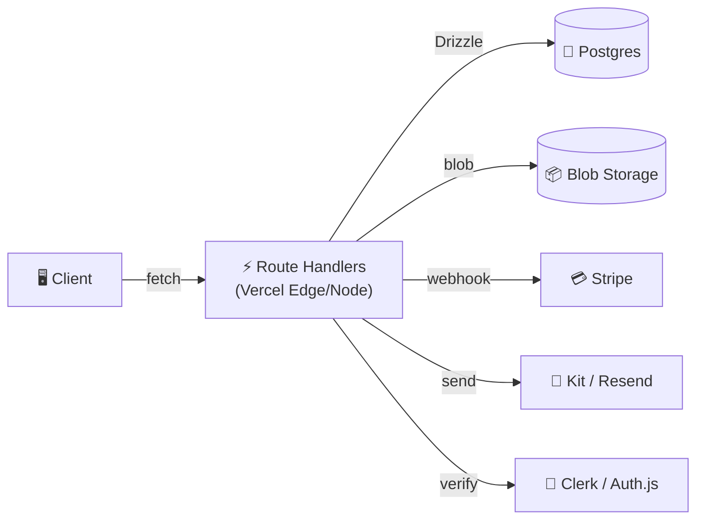

# 🔐 فایل ۱۰ — بک‌اند، احراز هویت، پلن‌ها، جامعه و امنیت

> اصل: **اول آفلاین (R-014)، بعد سرور.** نسخهٔ اصلی دسکتاپ با SQLite محلی کار میکند و به هیچ API‌ای وابسته نیست. این سند لایهٔ **اختیاری** (همگام‌سازی/جامعه/پرداخت وب) را توصیف می‌کند.

---

## ۰. 👤 اطلاعات نویسنده و پشتیبانی (طبق R-013)

> این مقادیر را **فقط** از همین جدول بخوان؛ در صفحات «درباره ما»، «پشتیبانی»، «حمایت» و فوتر استفاده کن:

| فیلد | مقدار |
|------|-------|
| 👤 نام نویسنده | **سعید نجفی** |
| 🏢 شرکت | **سهند سرویس** |
| 📞 موبایل | **09144220430** |
| 📧 ایمیل پشتیبانی | **Pranses2011@GMail.com** |
| 💳 کارت واریزی و حمایت | **6219 8619 1893 4679** (نام دارنده: سعید نجفی) |
| 🌐 سایت | **EA-Fixer.ir** |

**پرداخت حمایتی/دستی (بدون درگاه):** در صفحهٔ «حمایت» شمارهٔ کارت بالا با جداسازی ۴ رقمی نمایش داده شود + دکمهٔ «کپی شماره کارت». تأیید پرداخت دستی توسط ادمین (یا کد پیگیری که کاربر وارد کند) → ارتقای لایسنس.

---

## ۱. 🧭 معماری بک‌اند (فقط نسخهٔ وب ابریِ اختیاری)



| لایه | مسئولیت |
|------|----------|
| Route Handlers | ورودی اعتبارسنجی‌شده با zod، منطق کوتاه، بدون محاسبات سنگین |
| Postgres | کاربر، پروژه، نسخه، رأی، اشتراک |
| Blob | thumbnail، بسته‌های خروجی موقت (TTL ۲۴h) |
| Stripe | اشتراک، فاکتور، وضعیت |
| Redis/KV | rate limit و cache پاسخ‌های عمومی |

---

## ۲. 🔑 احراز هویت

### انتخاب
| گزینه | مزیت | عیب | توصیه |
|-------|------|-----|-------|
| **Clerk** | سریع، UI آماده، OAuth چندگانه | هزینه در مقیاس | ⭐ شروع |
| Auth.js (NextAuth) | رایگان، کنترل کامل | پیکربندی بیشتر | اگر بودجه محدود |

### جریان‌ها
```
1) Continue with Google (OAuth 2.0 + PKCE)
2) ایمیل + کد یک‌بارمصرف (magic code)
3) (اختیاری) Apple / GitHub
```
| مورد | تصمیم |
|------|-------|
| نشست | کوکی httpOnly + secure + sameSite=lax، عمر ۷ روز با sliding |
| مسیرهای محافظت‌شده | middleware روی `/studio`, `/projects`, `/account` |
| ثبت کاربر | در `users` بعد از اولین ورود (webhook) |
| حذف حساب | حذف آبشاری پروژه‌ها + پاک‌سازی blob + ایمیل تأیید |
| زبان | از `locale` کاربر برای ایمیل‌ها |

### اسکیمای مسیر ورود
```
/login?redirect_url=/studio
→ پس از ورود: ریدایرکت امن (فقط مسیرهای داخلی، بدون open redirect)
```

---

## ۳. 🗂️ API (قرارداد)

| متد | مسیر | توضیح | Auth |
|-----|------|-------|------|
| `GET` | `/api/projects` | لیست (صفحه‌بندی، جستجو، تگ) | ✅ |
| `POST` | `/api/projects` | ایجاد | ✅ |
| `GET` | `/api/projects/:id` | خواندن (مالک یا عمومی) | ⚠️ |
| `PATCH` | `/api/projects/:id` | به‌روزرسانی پارامترها (همراه `revision` برای جلوگیری از تعارض) | ✅ owner |
| `DELETE` | `/api/projects/:id` | حذف نرم | ✅ owner |
| `POST` | `/api/projects/:id/duplicate` | دو‌باره‌سازی | ✅ |
| `POST` | `/api/projects/:id/publish` | عمومی‌کردن + لایسنس | ✅ owner |
| `GET` | `/api/projects/:id/revisions` | تاریخچه | ✅ owner |
| `GET` | `/api/community` | فید عمومی (فیلتر/مرتب) | ❌ |
| `POST` | `/api/community/:id/like` | پسند | ✅ |
| `GET` | `/api/patterns` | کتابخانهٔ الگوها | ❌ |
| `POST` | `/api/uploads/image` | آپلود تصویر منبع (۵MB) | ✅ |
| `POST` | `/api/exports` | ثبت سهمیهٔ خروجی | ✅ |
| `GET` | `/api/feature-requests` | لیست + رأی کاربر | ❌ |
| `POST` | `/api/feature-requests` | ایجاد (rate limit ۳/روز) | ✅ |
| `POST` | `/api/feature-requests/:id/vote` | رأی (toggle) | ✅ |
| `POST` | `/api/subscribe` | ایمیل خبرنامه (honeypot) | ❌ |
| `POST` | `/api/contact` | پیام (honeypot + rate limit) | ❌ |
| `POST` | `/api/stripe/checkout` | ساخت جلسهٔ پرداخت | ✅ |
| `POST` | `/api/stripe/portal` | پورتال مدیریت | ✅ |
| `POST` | `/api/stripe/webhook` | رویدادهای Stripe (امضا) | 🔏 |
| `GET` | `/api/me` | پروفایل + پلن + سهمیه | ✅ |

### قواعد عمومی API
| قاعده | پیاده‌سازی |
|-------|------------|
| 📦 پاسخ | `{ data, error, meta }` یکسان |
| 🚫 خطا | کدهای معنادار: `FORM_INVALID`, `QUOTA_EXCEEDED`, `PLAN_REQUIRED`, `NOT_OWNER` |
| 🔢 صفحه‌بندی | cursor-based (`?cursor=&limit=`) |
| 🕒 نسخه | `/api/v1/...` برای آینده (فعلاً بدون نسخه) |
| 🧊 کش | `revalidateTag('community')` بعد از انتشار |
| 🚦 Rate | `429` + `Retry-After` |

---

## ۴. 💳 پلن‌ها، پرداخت و سهمیه

### پلن‌ها (منبع واحد: `packages/config/plans.ts`)
```ts
export const PLANS = {
  free:   { name: 'Free',   priceMonthly: 0,  projects: 3,  segments: 48,  exportsPerMonth: 10, multiPartMold: false, mother: false, tools: 'core' },
  maker:  { name: 'Maker',  priceMonthly: 9,  projects: Infinity, segments: 96,  exportsPerMonth: 200, multiPartMold: true,  mother: true, tools: 'all' },
  studio: { name: 'Studio', priceMonthly: 24, projects: Infinity, segments: 256, exportsPerMonth: Infinity, multiPartMold: true, mother: true, tools: 'all+beta', teamLibrary: true },
} as const;
```

### Stripe
| مورد | جزئیات |
|------|--------|
| Checkout | `mode: subscription`، `client_reference_id = userId` |
| Webhook ها | `checkout.session.completed`, `customer.subscription.updated`, `customer.subscription.deleted`, `invoice.payment_failed` |
| Idempotency | ذخیرهٔ `event.id` پردازش‌شده |
| Trial | ۱۴ روز برای Maker (یک‌بار) |
| تخفیف سالانه | ۲ ماه رایگان (≈۱۷٪) |
| لغو | دسترسی تا `current_period_end` |
| مالیات | Stripe Tax فعال |
| ارز | USD/EUR/GBP با توجه به locale |

### 🔑 لایسنس دسکتاپ (پیش‌فرض، بدون اینترنت)

| مورد | جزئیات |
|------|--------|
| شکل | کلید ۲۵ رقمی مثلاً `PTRN-XXXX-XXXX-XXXX-XXXX-XXXX` |
| فعال‌سازی | آنلاین (ارسال هش دستگاه + کلید) **یا** تأیید دستی ادمین برای پرداخت کارتی |
| اعتبارسنجی محلی | امضای کلید با کلید عمومی داخل اپ؛ **بدون نیاز به شبکه بعد از فعال‌سازی** |
| انتقال | یک فعال‌سازی هم‌زمان روی ۲ دستگاه؛ لغو از پنل حساب |
| پلن رایگان | بدون کلید؛ سهمیهٔ محلی در SQLite شمرده میشود (Free) |
| پرداخت کارتی | واریز به **6219 8619 1893 4679** (سعید نجفی) + ارسال کد پیگیری به `Pranses2011@GMail.com` → صدور کلید ظرف ۲۴ ساعت |

### سهمیه (Quota) — محلی در دسکتاپ، سروری در وب
```
exports:  جدول user_usage {userId, month, count}
  قبل از خروجی: count < plan.exportsPerMonth ? count++ : 402 QUOTA_EXCEEDED
  ریست: اول هر ماه (cron)

پروژه:  count(projects) < plan.projects

سگمنت:  segments ≤ plan.segments  (در export، کیفیت بالاتر = پلن بالاتر)

ابزار:   tool.plan ≤ plan   (paywall نرم با پیش‌نمایش)
```

### Paywall UX
> 🎯 هرگز کاربر را وسط کار متوقف نکن. **پیش‌نمایش بده**، سپس: «برای دانلود با کیفیت ۲۵۶ سگمنت، پلن Maker را فعال کن — ۱۴ روز رایگان». (نمونهٔ واترمارک روی PDF برای Free.)

---

## ۵. 📧 ایمیل

| ایمیل | محرک | محتوا |
|-------|------|-------|
| ✉️ تأیید آدرس | ثبت‌نام | لینک یک‌بارمصرف |
| 🎉 خوش‌آمد | اولین ورود | ۳ نکته شروع + لینک پریست |
| 🧾 رسید | پرداخت | جزئیات + لینک فاکتور |
| 🔔 پایان تریال | ۳ روز قبل | CTA ارتقا |
| 💳 خطای پرداخت | `invoice.payment_failed` | لینک به‌روزرسانی کارت |
| 📣 محصول جدید | دستی/زمان‌بندی‌شده | از Kit |
| 🗑️ حذف حساب | درخواست | تأیید + لینک لغو (۴۸ ساعت) |

**کارگزار:** Resend (تراکنشی، React Email) + Kit (بازاریابی). unsubscribe در همه.

---

## ۶. 👥 جامعه و محتوا

### لایسنس‌ها
| گزینه | معنی | اثر |
|-------|------|-----|
| `all-rights` | همهٔ حقوق محفوظ | فقط مشاهده؛ fork ممنوع |
| `cc-by` | با ذکر منبع | fork و استفاده تجاری با اعتبار |
| `cc-by-sa` | با ذکر + اشتراک مشابه | fork با همان لایسنس |
| `cc0` | مالکیت عمومی | آزاد کامل |

### قواعد انتشار
- ✅ فقط فرم/الگو/قالب — نه فایل خروجی آمادهٔ فروش
- 🚫 محتوای توهین‌آمیز، تجاوز به حق برند
- 🔎 گزارش محتوا → صف ادمین → تصمیم در ۷۲h
- 🔒 بررسی: پروژه‌های `unlisted` (لینک مستقیم) و `private`

### رأی‌گیری قابلیت‌ها
```
POST /api/feature-requests/:id/vote  → toggle
voteCount در جدول feature_requests (denormalized) + trigger یا محاسبهٔ دوره‌ای
ترتیب پیش‌فرض: top = voteCount DESC, createdAt DESC
```

---

## ۷. 🛡️ امنیت

| حوزه | اقدام |
|------|-------|
| 🔑 احراز هویت | مسئولیت ارائه‌دهنده؛ نشست امن |
| 🚪 مجوز | بررسی مالکیت در **هر** route (نه فقط UI) |
| 🧼 ورودی | zod در همهٔ مسیرها، max length، sanitize HTML |
| 🖼️ فایل | بررسی magic bytes (نه فقط پسوند)، decode در sandbox، سقف ۵MB |
| 🧬 SVG | حذف `script`, `foreignObject`, `on*`, `javascript:` |
| 🚦 Rate limit | per-IP و per-user: subscribe ۵/ساعت، contact ۳/روز، feature ۳/روز |
| 🕵️ Spam | honeypot + زمان پر کردن فرم + بررسی کاربر |
| 🔒 هدرها | CSP (self + Stripe + Clerk)، HSTS، `nosniff`، `frame-ancestors 'none'` |
| 🧾 لاگ | بدون PII، شناسه hash، تریس با request-id |
| 🔄 پشتیبان | بکاپ روزانهٔ Postgres، نگه‌داری ۳۰ روز |
| 🔍 وابستگی | `pnpm audit` در CI، Dependabot |
| 🧪 تست امنیتی | OWASP Top 10 checklist قبل از عرضه |

### سیاست حریم خصوصی (برای نوشتن)
1. چه جمع می‌کنیم: ایمیل، متادیتای پروژه، تصاویر آپلودی، رویدادهای بی‌نام
2. زیرپردازنده‌ها: Vercel, Postgres provider, Clerk, Stripe, Resend/Kit, Sentry
3. تا چه مدت: پروژه تا حذف حساب؛ بکاپ ۳۰ روز؛ گزارش خطا ۹۰ روز
4. حقوق: دسترسی/اصلاح/حذف/صادرات (در `/account`)
5. کوکی: فقط لازم برای نشست (بدون تبلیغاتی)
6. کودکان: < 13/16 ممنوع
7. انتقال بین‌المللی: SCC
8. تماس: `privacy@<domain>`

---

## ۸. 🧪 تست‌های این لایه

| # | تست | معیار |
|---|-----|-------|
| B1 | ورود Google | نشست برقرار، ریدایرکت امن |
| B2 | دسترسی غیرمجاز به پروژهٔ دیگری | 403 |
| B3 | Rate limit subscribe | ششمی 429 |
| B4 | Webhook Stripe نامعتبر | 400 بدون پردازش |
| B5 | ارتقای پلن | فوراً `segments=96` |
| B6 | سهمیهٔ خروجی | بیست‌ویکمی در Free → 402 |
| B7 | حذف حساب | همهٔ پروژه‌ها و blob حذف |
| B8 | XSS در نام پروژه | فیلتر/escape |
| B9 | رأی تکراری | toggle نه دو رأی |
| B10 | حذف پروژهٔ عمومی | ۴۰۴ در فید |

---

➡️ ادامه در [`11-QA-ACCEPTANCE.md`](./11-QA-ACCEPTANCE.md)
