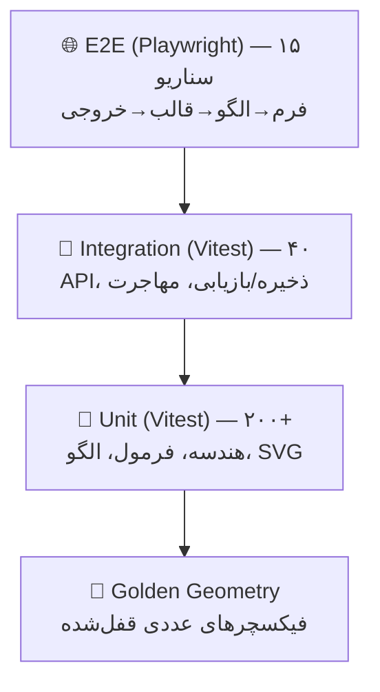

# ✅ فایل ۱۱ — استراتژی تست و چک‌لیست پذیرش

> **قاعده:** هر عدد ادعایی یک تست دارد. هر ماژول قبل از «انجام شد» باید تست‌های خودش را سبز کند.

---

## ۱. 🧪 هرم تست



| لایه | ابزار | چه می‌سنجد |
|------|-------|-------------|
| 🧮 Unit | Vitest | توابع خالص هندسی و پارامتری |
| 🏅 Golden | Vitest + JSON snapshot | هندسه دقیق برای فرم‌های مرجع |
| 🔗 Integration | Vitest + Testcontainers/Supabase local | API + DB |
| 🌐 E2E | Playwright | مسیرهای کاربر واقعی |
| 🎨 Visual | Playwright screenshots | نبود رگرسیون بصری |
| ⚡ Perf | Lighthouse CI | بودجهٔ عملکرد |
| ♿ A11y | axe-core | WCAG AA |

---

## ۲. 🏅 تست‌های طلایی هندسه (قفل‌شده — نباید تغییر کنند)

| # | سناریو | ورودی | انتظار | تلورانس |
|---|--------|-------|--------|----------|
| G1 | استوانه | r=50, h=100, wall=0 | volume = 785,398.16 mm³ | ±0.1% |
| G2 | مخروط ناقص | r1=30, r2=60, h=120 | πh/3·(r1²+r1r2+r2²) = 791,681.35 mm³ | ±0.1% |
| G3 | فرم مرجع سایت | w145 h148 wall4 rim25 fill80 shrink12 | capacity = 1131 ml | ±1% |
| G4 | همان فرم، پرشده | fill = 80% | 958 ml | ±1% |
| G5 | شیرینک | 145mm @ 12% | 127.6 mm | ±0.1 mm |
| G6 | گچ/آب | V = 1.84 L, r_w = 0.70 | P = 1.72 kg, W = 1.20 kg | ±2% |
| G7 | قالب استوانه | form استوانه‌ای | parts = 1 | دقیق |
| G8 | قالب گلدان | belly > foot و belly > rim | parts ≥ 2 | دقیق |
| G9 | کلید مخروطی | r=8, h=10, taper=4° | r_top = 8.699 mm | ±0.01 |
| G10 | manifold | مش revolve ۹۶ سگمنت | لبهٔ باز = 0، Euler = 2 | دقیق |
| G11 | SVG مقیاس | خط 100mm | width = 100mm در فایل | دقیق |
| G12 | کاشی بی‌درز | dot-grid 40mm | اختلاف لبه < 1% پیکسل | دقیق |
| G13 | مهاجرت | پروژهٔ v1 | load بدون خطا | دقیق |
| G14 | رندر مجدد | JSON → build → hash | همان hash مش | دقیق |
| G15 | Undo/Redo | ۵۰ عمل | وضعیت اولیه یکسان | دقیق |

### فرمت فیکسچر
```ts
// packages/kernel/__tests__/golden/G3.test.ts
import { buildForm, computeCapacity } from '../../index';
import fixture from './fixtures/reference-vase.json';

it('reference vase capacity matches published value', () => {
  const form = buildForm(fixture.form);
  const cap = computeCapacity(form);           // ml
  expect(cap).toBeCloseTo(1131, 0);            // ±1 ml در مقیاس 1131
  expect(Math.abs(cap - 1131) / 1131).toBeLessThan(0.01);
});
```

> 📌 اگر تست G3 شکست، **هندسه یا فرمول اشتباه است** — هرگز تست را عوض نکن، کد را درست کن.

---

## ۳. 🧮 تست‌های واحد بر اساس ماژول

### هسته (`kernel`)
| تست | انتظار |
|-----|--------|
| `fitProfile` نمونه‌برداری یکنواخت | فاصلهٔ نمونه‌ها ±۵٪ |
| `selfIntersects` | پروفیل ضربدری → true |
| `offsetProfile` | فاصلهٔ نمونه‌ها = d ±0.05 |
| `revolve` نرمال | حجم علامت‌دار > 0 |
| `volume` vs انتگرال عددی | ±0.5% |
| `radiusAt` درون‌یابی | مقدار بین دو نود |
| `footRing` union | بدون لبهٔ باز |

### الگو (`patterns`)
| تست | انتظار |
|-----|--------|
| تعداد المان `dot-grid` | `(W/spacing)·(H/spacing)` |
| تایلینگ | ظرفیت حافظه < ۵MB برای ۵۰۰۰ المان |
| `mirrorX` | تقارن پیکسلی |
| متن فارسی | حروف متصل |
| SVG sanitize | `<script>` حذف |

### قالب (`molds`)
| تست | انتظار |
|-----|--------|
| undercut detection | فرم با شکم → true |
| parting auto | min parts |
| keys placement | فاصله از لبه ≥ `r+3` |
| mother shell | ضخامت یکنواخت ±۰.۲ |
| plaster calc | مطابق G6 |

### خروجی (`exporters`)
| تست | انتظار |
|-----|--------|
| STL binary | هدر 80B + تعداد مثلث صحیح |
| STL manifold | باز شدن با `stl-validator` |
| DXF R12 | پارس با `dxf-parser` |
| PDF اندازه | A4 210×297mm، مقیاس ۱:۱ |
| ZIP | ساختار درست + README |

---

## ۴. 🌐 سناریوهای E2E (Playwright)

| # | سناریو | مسیر |
|---|--------|------|
| E1 | بازدید لندینگ → ثبت ایمیل | `/` → `/subscribe` → toast موفق |
| E2 | ورود با Google (mock) | `/login` → `/studio` |
| E3 | ساخت فرم از صفر | `/studio` → افزودن نود → تغییر ارتفاع → ذخیره |
| E4 | استفاده از پریست | کتابخانه → «گلدان بلند» → ویرایش |
| E5 | محاسبهٔ ظرفیت | تغییر fill → عدد در status bar عوض شود |
| E6 | ساخت الگو | تب الگو → انتخاب chevron → تغییر پارامتر → کاشی |
| E7 | نگاشت روی فرم | «On 3D» → روشن → ببین روی فرم |
| E8 | استنسیل | خروجی SVG → دانلود → فایل موجود |
| E9 | قالب تک‌تکه | قالب → auto → parts=1 → خروجی |
| E10 | قالب چندتکه | فرم شکم‌دار → auto split → parts≥2 |
| E11 | کلید و تلورانس | تغییر تعداد کلید → تغییر در پریویو |
| E12 | گچ/آب | خواندن عدد و مطابقت با فرمول |
| E13 | ذخیره و بازیابی | reload → همان ابعاد |
| E14 | Undo/Redo | ۵ تغییر → undo ×5 → بازگشت |
| E15 | ارتقای پلن | `/pricing` → Stripe (test) → ویژگی باز شود |

**کیفیت E2E:** هر سناریو < ۳۰s، پایدار (retry 2)، در CI روی PR.

---

## ۵. 📋 Definition of Done (DoD) هر ماژول

هر ماژول وقتی «انجام‌شده» است که **همهٔ** موارد زیر برقرار باشد:

- [ ] 🎯 همهٔ تست‌های واحد مربوطه سبز
- [ ] 🏅 تست‌های طلایی مربوطه سبز
- [ ] 🌐 حداقل یک E2E
- [ ] 📖 مستندات کوتاه در `README` پکیج
- [ ] 🎨 UI با همهٔ حالت‌ها (empty/loading/error)
- [ ] ♿ axe بدون خطای جدی
- [ ] 🌐 متن‌ها در `fa.json` + `en.json`
- [ ] ⚡ در بودجهٔ عملکرد
- [ ] 🔒 ورودی اعتبارسنجی‌شده
- [ ] 🧾 پیام خطای انسانی

---

## ۶. 🚦 معیارهای پذیرش نسخهٔ ۱.۰ (Release Gate)

### عملکرد
| شاخص | هدف |
|------|-----|
| LCP لندینگ | < ۲.۰s |
| TTI ادیتور | < ۲.۵s |
| تغییر پارامتر | < ۱۰۰ms |
| Revolve ۹۶ | < ۳۰۰ms |
| Boolean قالب | < ۱.۵s |
| حجم JS ادیتور | < ۶۰۰KB gzip |
| Lighthouse Performance | ≥ ۸۵ |

### کیفیت هندسی
| شاخص | هدف |
|------|-----|
| تست‌های طلایی | ۱۰۰٪ سبز |
| خروجی غیر‌manifold | < ۰.۵٪ |
| خطای محاسبه | < ۱٪ |

### تجربه
| شاخص | هدف |
|------|-----|
| TTFV (اولین خروجی) | < ۱۰ دقیقه |
| نرخ تکمیل قیف | > ۴۵٪ |
| رضایت تست بتا | ≥ ۸ از ۱۰ |

### دسترس‌پذیری و i18n
- [ ] WCAG 2.2 AA (axe: ۰ خطای serious/critical)
- [ ] کیبورد کامل در ادیتور
- [ ] RTL بدون سرریز
- [ ] همهٔ رشته‌ها ترجمه‌شده

### امنیت
- [ ] OWASP Top 10 بررسی‌شده
- [ ] rate limit فعال
- [ ] هدرها تنظیم
- [ ] `pnpm audit` بدون critical
- [ ] تست دسترسی به پروژهٔ غیرمالک

---

## ۷. 🔍 چک‌لیست تست دستی (قبل از عرضه)

### 🏺 فرم
- [ ] افزودن/حذف/کشیدن نود
- [ ] تقارن Mirror X/Y
- [ ] پروفیل با ۳ نود و با ۳۰ نود
- [ ] تغییر wall و تأثیر روی ظرفیت
- [ ] فوت‌رینگ با ۳ سبک لبه
- [ ] شیرینک ۰٪ و ۲۰٪

### 🔷 الگو
- [ ] ۱۲ الگو همه رندر شوند
- [ ] کاشی روی گوشه‌ها بی‌درز
- [ ] نگاشت روی فرم شکم‌دار
- [ ] SVG در Inkscape با mm
- [ ] متن فارسی

### 🧱 قالب
- [ ] تک‌تکه بدون کلید و با کلید
- [ ] چندتکه با ۲ و ۳ قطعه
- [ ] تقسیم افقی
- [ ] مادرقالب سیلیکون
- [ ] STL در Cura و PrusaSlicer
- [ ] وزن گچ منطقی

### 📤 خروجی
- [ ] ZIP کامل با README
- [ ] PDF مقیاس ۱:۱ (اندازه‌گیری با خط‌کش چاپی)
- [ ] DXF در LightBurn

### 🌐 اپ
- [ ] ورود/خروج
- [ ] ذخیره/بارگذاری
- [ ] پلن و paywall
- [ ] حذف حساب
- [ ] RTL/LTR
- [ ] آفلاین و بازگشت

---

## ۸. 🐞 قالب گزارش باگ

```md
**محیط:** مرورگر/نسخه · OS · پلن
**مراحل بازتولید:**
1. …
**انتظار:** …
**واقعی:** …
**پروژه/JSON پیوست:** (فایل کوچک — بسیار کمک‌کننده)
**اسکرین‌شات/ویدیو:** …
**شدت:** blocker / critical / major / minor
```
> 💡 دکمهٔ «Export debug bundle» در ادیتور: JSON پروژه + نسخهٔ اپ + لاگ worker + پارامترهای مرورگر.

---

## ۹. 📈 پایش تولید (Observability)

| ابزار | چه می‌سنجد |
|-------|-------------|
| Sentry | خطاهای JS + worker + performance |
| Vercel Analytics | بازدید، منابع |
| رویدادهای محصول | قیف: open → create form → pattern → mold → export |
| هشدار | نرخ خطای هندسه > ۲٪ → اعلان |
| هفتگی | گزارش: پروژه‌های جدید، خروجی‌ها، خطاها، زمان‌ها |

---

➡️ ادامه در [`12-PHASE-PROMPTS.md`](./12-PHASE-PROMPTS.md)


---

## دروازه‌های پذیرش SolidVents و برابری مستقل

تمام [SV-01…SV-50 و SV-E01…SV-E09](16-SOLIDVENTS-SPEC.md) باید trace داشته باشند: نیاز→کد→تست→نسخه→artifact/evidence. وضعیت اولیهٔ همهٔ موارد جدید باز/بخشی است. اسناد، stub، API تنها یا شباهت تصویر برای تیک کامل کافی نیستند.

آزمون‌های اجباری: seed و ترتیب پایدار؛ clip منحنی با extrema؛ boolean جزیره و tangent؛ controller distance oracle؛ morph 180° و mirrored target و Fixed؛ image alpha/ramp/invert/contrast؛ roundtrip recipe/SVG/DXF؛ cap مرز چرخیده و flow خارج range؛ SVG script/URL/DTD و DXF malformed و ZIP traversal؛ quota/cancel/worker stale.

CAD/Wrap: STEP حقیقی surface/solid در دو CAD مستقل، unit و coordinate و volume/area، split برابر unsplit، draft offset failure، cylinder/cone analytic unroll، freeform distortion/Jacobian/seam/pole، donut/cross-face و preview/export topology یکسان. Watertight STL آزمون self-intersection فضایی یا B-rep نیست.

کارایی: دستگاه/مرورگر/حافظه و recipe benchmark ثبت شود؛ اندازهٔ wasm/vector/cad lazy budget و interaction latency اندازه‌گیری شود. هدف200k مرجع تعهد عملکرد ما نیست. خطای approximate area همراه bound و دقت/زمان نمونه‌برداری گزارش شود.

QA عملی باقی: keyboard و WCAG و touch/pen واقعی، نصب/حذف/ارتقای ویندوز و آفلاین سیستم‌عامل، امضای ناشر/updater، slicer و نمونهٔ فیزیکی. انتشار آزمایشی بدون امضا این گیت‌ها را نمی‌بندد؛ گیت release نهایی تضعیف نشود.
