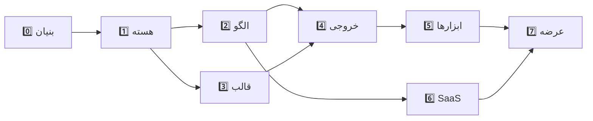

# 🚀 فایل ۱۲ — پرامپت‌های فازی (اجرای مرحله‌به‌مرحله)

> **روش استفاده:** این پرامپت‌ها را **به‌ترتیب** به هوش مصنوعی بدهید. هر پرامپت مستقل و خودبسنده است. بین فازها، فایل‌های مرتبط را ضمیمه کنید.
> 🎯 مزیت این روش: کیفیت بالاتر، از دست رفتن زمینه کمتر، کنترل بیشتر.

---

## 📋 پیش‌نیاز همهٔ پرامپت‌ها (Preface)

> این متن را ابتدای هر پرامپت فازی بگذارید:

```
تو یک تیم مهندسی محصول هستی (معمار نرم‌افزار، مهندس هندسه محاسباتی، فرانت‌اند React/three.js، بک‌اند، UX، QA).
ما در حال ساخت «Patturn Studio» هستیم: یک SaaS پارامتریک برای سفالگران که فرم سه‌بعدی می‌سازد، الگو روی آن می‌نشاند، قالب سیلیپ‌کستینگ تولید می‌کند و STL/SVG/DXF/PDF صادر می‌کند.

قواعد آهنین پروژه:
- واحد داخلی = میلیمتر، عدد خالص.
- پروژه = JSON پارامترها، نه مش. هندسه بازتولیدپذیر و قطعی.
- هر خروجی STL باید manifold و watertight باشد.
- kernel نباید به React/DOM وابسته باشد.
- همه‌چیز با Vitest تست می‌شود؛ هر ادعای عددی یک تست دارد.
- استک: Next.js + TypeScript strict + Tailwind + shadcn/ui + Zustand + three.js + manifold-3d (WASM) + Web Worker + Postgres/Drizzle + Clerk + Stripe + Vercel.
- فارسی (RTL) و انگلیسی؛ کد و کامنت انگلیسی.

کد کامل، قابل اجرا و با مسیر فایل بده. از TODO فقط برای موارد غیرضروری استفاده کن.
```

---

# 🅾️ پرامپت فاز ۰ — بنیان و تصمیم‌های معماری

```
[Preface]

## وظیفه: فاز ۰ — بنیان

۱) یک مونوریپو با pnpm workspaces + Turborepo بساز با این ساختار:
   apps/web (Next.js 14 App Router, TS strict)
   packages/{config,schema,kernel,patterns,mapping,molds,tools,exporters,worker,ui}

۲) برای هر پکیج: package.json، tsconfig با project references، vitest، و entry خالی.
   در ESLint قانون no-restricted-paths اعمال کن: kernel نباید از ui/web import کند.

۳) ADR بنویس (docs/adr/):
   - ADR-001: هستهٔ هندسی = manifold-3d (WASM) + revolve دستی؛ three-bvh-csg به‌عنوان fallback؛ voxel remesh برای ترمیم.
   - ADR-002: State = Zustand + Immer + history stack دستی (snapshot از نودهای input).
   - ADR-003: رندر دوبعدی = SVG منبع حقیقت + Canvas برای پیش‌نمایش.
   - ADR-004: ذخیره = Postgres JSONB + IndexedDB آفلاین.
   هر ADR با: زمینه، گزینه‌ها، تصمیم، پیامدها.

۴) Design tokens را در packages/config/tokens.ts و packages/ui/tokens.css بساز:
   پالت «کارگاه سفال»: bg #F7F3EC, surface #FFFFFF, text #1C1917, brand clay #C4622D,
   secondary plaster #3F6C7A, success #3F7D53, warning #C9902A, danger #B3382C.
   فاصله‌ها 4/8/12/16/24/32/48/64/96، شعاع 6/10/16/24، سایه‌های نرم.

۵) اسکلت Next.js با:
   - next-intl با locale های fa (پیش‌فرض، RTL) و en (LTR)
   - Tailwind با توکن‌ها
   - شِل صفحات: /, /subscribe, /login, /pricing, /privacy, /terms, /contact, /feature-requests, /studio
   - هر صفحه یک placeholder معنادار (نه lorem)
   - metadata، sitemap.ts، robots.ts، OG image با ImageResponse

۶) دادهٔ نمونه: پریست «گلدان بلند» و «کاسه» به‌صورت ProfileNode[] در packages/config/presets.ts

۷) یک Web Worker با Comlink بساز که پیام {kind:'ping'} را echo کند + تست.

۸) CI: pnpm lint, typecheck, test, build. و یک تست smoke که صفحهٔ / را ۲۰۰ برگرداند.

## تحویل
- ساختار کامل فایل‌ها با محتوای واقعی
- دستورهای اجرا
- چک‌لیست معیار خروج فاز ۰ (از نقشه راه)
```

---

# 1️⃣ پرامپت فاز ۱ — هستهٔ هندسی و فرم‌میکر

```
[Preface]

## وظیفه: فاز ۱ — هستهٔ هندسی (مهم‌ترین فاز)

### ۱) ParamGraph (packages/kernel/param-graph.ts)
- نود: {id, type, inputs[], value, deriveKey, unit, constraint, meta}
- DAG با تشخیص چرخه، topological sort، memoization بر اساس هش ورودی‌ها
- set(id, value) → مجموعهٔ dirty
- serialize/hydrate برای ذخیره

### ۲) Profile (packages/kernel/profile.ts)
- ProfileNode {p:{x,y}, handle:{hIn,hOut}, smooth, locked}
- fitProfile: Bézier (پیش‌فرض) و Catmull-Rom، نمونه‌برداری ۵۱۲ نقطه‌ای با طول قوس یکنواخت
- validate: حداقل ۳ نود، y صعودی، r>0، self-intersection با تست O(n²) سگمنت
- offsetProfile(p, d): offset به‌داخل با نرمال‌ها + حذف حلقهٔ خودمتقاطع + توقف در گلوگاه
- radiusAt/interpolateAt

### ۳) Revolve (packages/kernel/revolve.ts)
- revolve(inner, outer, segments) → Mesh {positions: Float32Array, indices: Uint32Array}
- کمربند بیرونی + داخلی + بستن کف (fan از مرکز) + نوار دهانه
- نرمال‌ها smooth
- LOD: 32 (درگ) / 96 (رها) / 256 (خروجی)

### ۴) حجم و ظرفیت (packages/kernel/volume.ts)
فرمول مخروط ناقص:
  V = (π/3)·Σ Δyᵢ·(rᵢ²+rᵢ·rᵢ₊₁+rᵢ₊₁²)
- capacity(form) → ml
- filledVolume(form, fillLevel) → ml  (با درون‌یابی y_fill)
- applyShrink(s) → dims_dry, V_dry = V·(1-s)³
- estimateWeight(V_solid, ρ=1.9 g/cm³)

### ۵) فوت‌رینگ (packages/kernel/foot-ring.ts)
- revolve مقطع (width × depth) با لبهٔ square/round/chamfer
- union با بدنه از طریق manifold

### ۶) اعتبارسنجی مش (packages/kernel/mesh-validate.ts)
- لبهٔ باز، نرمال معکوس (حجم علامت‌دار)، مثلث منحط، Euler، مثلث تکراری
- خروجی: {ok, issues[]}

### ۷) Viewport و ویرایشگر
- packages/ui/domain/ProfileEditor.tsx: بوم 2D با نودها، گرید mm، snap، mirror، افزودن/حذف نود، Alt برای شکستن دسته
- packages/ui/domain/Viewport3D.tsx: three.js، orbit، grid، gizmo، نمایش 3D/2D/Section
- apps/web/app/(app)/studio: شِل ادیتور سه‌ستونی با تب قطعات و پنل پارامتر
- SliderField: اسلایدر + ورودی عددی + واحد + tooltip

### ۸) ذخیره و بازیابی
- schema zod پروژه (schemaVersion=3) در packages/schema
- ذخیره در IndexedDB + دکمهٔ Export/Import JSON
- Undo/Redo با snapshot نودهای input (حداقل ۵۰ مرحله)

### ۹) Export STL
- binary STL writer
- اعتبارسنجی قبل از دانلود، پیام خطای انسانی

## تست‌های الزامی (باید سبز شوند)
  G1 استوانه r50 h100 → 785,398 mm³
  G2 مخروط ناقص r1=30 r2=60 h=120 → 791,681 mm³
  G3 فرم مرجع w145 h148 wall4 rim25 fill80 shrink12 → capacity 1131 ml (±1%)
  G4 همان، fill=80% → 958 ml (±1%)
  G5 شیرینک 145mm @12% → 127.6mm
  G10 revolve → لبهٔ باز=0، Euler=2
  G14 JSON→build→hash یکسان
  G15 Undo/Redo ۵۰ عمل
  + offset: فاصله = d ±0.05
  + گلوگاه: wall > r_min → خطا

## تحویل
کد کامل هر فایل + تست‌ها + نحوهٔ اجرا + اسکرین‌شات توصیفی UI + گزارش اینکه G3 دقیقاً چه عددی داد.
```

---

# 2️⃣ پرامپت فاز ۲ — ادیتور کامل و موتور الگو

```
[Preface]
[ضمیمه: 06-MODULE-PATTERNS.md، 09-UI-DESIGN-SYSTEM.md]

## وظیفه: فاز ۲ — الگو، کاشی، نگاشت، استنسیل

### ۱) موتور الگو (packages/patterns)
- PatternDef {id, name, category, params, preview, build(ctx)}
- PatternContext {widthMm, heightMm, params, seed, helpers}
- helpers: circle, rect, line, polygon, arc, bezier, rotate, mirrorX/Y
- رجیستری: ثبت خودکار همهٔ defs

### ۲) ۱۲+ الگو (هر کدام یک فایل)
dot-grid, chevron, herringbone, wave, hex, diamond, spiral, stripe, scale, grid, kumiko, seigaiha
+ text و custom
هر الگو: params با min/max/step/label(فا/EN)/tooltip، build() با مسیرهای SVG

### ۳) کاشی بی‌درز (tiling.ts)
- تکرار nx×ny با ghost copies
- پشتیبانی offset آجری (نصف تایل)
- تست: اختلاف پروفایل لبهٔ چپ/راست < 1%

### ۴) بوم دو‌بعدی
- PatternCanvas.tsx: SVG با viewBox میلی‌متری، خط‌کش mm، grid snap
- رندر تفکیکی: حین درگ ≥ ۳۰fps، پس از رها کامل
- پیش‌نمایش کارت الگو در کتابخانه (نه آیکون ثابت)

### ۵) نگاشت روی فرم (packages/mapping)
- cylindrical: (u,v) = (θ/2π·repeat, (y-yMin)/(yMax-yMin))
- curvature-aware: t(y)=∫√(1+(dr/dy)²)dy ، distortion ratio و هشدار اگر >1.35
- seamAngle، verticalStretch، repeatAround
- پیش‌نمایش three.js: projection مسیرها روی سطح با polygonOffset
- گزینهٔ extrude 0.4mm برای پیش‌نمایش حکاکی

### ۶) استنسیل (stencil.ts)
- unwrap استوانه‌ای
- تشخیص جزیره با flood-fill رستری
- تولید پل (bridge) با BFS روی فاصله
- bleed، registration marks، cut lines

### ۷) خروجی SVG و DXF
- SVG: width/height با "mm"، viewBox برابر میلی‌متر، لایه‌ها با label
- DXF: R12، فقط LINE/ARC/LWPOLYLINE/CIRCLE، لایه‌های CUT/ENGRAVE/SCORE
- تست G11: خط ۱۰۰mm → ۱۰۰ واحد mm

### ۸) ویرایشگر وکتور آزاد (ابتدایی)
- pen/select/direct، اشکال پایه، boolean 2D با polygon-clipping، offset
- ایمپورت SVG با sanitize

## تست‌ها
P1 کاشی بی‌درز · P2 ابعاد SVG · P3 تعداد المان · P4 درز استوانه · P5 distortion · P6 جزیرهٔ حرف O · P8 boolean 2D · P9 متن فارسی · P10 عملکرد ۵۰۰۰ المان < ۱۰۰ms

## تحویل
کد کامل + تست + یک نمونه SVG خروجی (متن فایل) برای بازبینی
```

---

# 3️⃣ پرامپت فاز ۳ — قالب‌سازی (بزرگ‌ترین تمایز)

```
[Preface]
[ضمیمه: 07-MODULE-MOLDS.md]

## وظیفه: فاز ۳ — Mold Maker

### ۱) ساخت بلوک
block = bbox(form × 1/(1-shrink)) + wall(25) + base(20) + topMargin(10)
گوشه‌ها fillet 3mm، draft 1.5°

### ۲) Boolean
moldSolid = subtract(block, formScaled)
با manifold-3d؛ نگه‌داشتن بزرگ‌ترین بدنه؛ اعتبارسنجی؛ ترمیم voxel در صورت نیاز

### ۳) تحلیل undercut
- برای فرم محوری: بررسی dr/dy ≥ 0
- گزارش ارتفاع و ارتفاع دقیق برآمدگی
- پیام کاربرپسند + پیشنهاد تقسیم خودکار با پیش‌نمایش

### ۴) تقسیم
- vertical parting planes با زاویه، پیش‌فرض درز پشت (180°)
- horizontal splits در ارتفاع (پارامتر + snap به ویژگی)
- الگوریتم auto: candidates + score(w1·parts + w2·visibleSeam + w3·complexity)
- محدودیت maxParts

### ۵) کلیدهای ثبت
- tapered-cylinder و hemisphere
- پارامتر: diameter, height, taperDeg, clearance, count, inset
- قرارگیری روی سطح جداایش با projection نرمال
- آرایش مثلثی برای ۳+ کلید
- هشدار اگر inset < r+3

### ۶) مادرقالب
- print: shell(moldPart, barrier 2mm) + sprue + vents + flange
- silicone: مدل قطعهٔ نهایی گچی + barrier + jacket
- محاسبهٔ سیلیکون (ρ 1.1–1.2)

### ۷) محاسبهٔ گچ/آب
ρ_p=2.75, ρ_w=1.0, r_w=0.70
P = V/(1/2.75 + r_w), W = r_w·P
+ ضریب اتلاف ۵٪ + زمان کار + وزن نهایی + متن دستور ساخت گام‌به‌گام

### ۸) UI ماژول
تب Overview / 1 part / Multi part / Wall thickness / Key (types,size,position,tolerance) / Mother (print,silicone) / Export / Mixing
نمایش Solid/Cutaway/Explode/By part
رنگ‌بندی قطعات، درخت قطعات

### ۹) خروجی
هر قطعه STL جدا + ZIP سازمان‌یافته + BOM + assembly PDF

## تست‌ها (الزامی)
G6 گچ 1.84L → 1.72kg/1.20kg (±2%)
G7 استوانه → parts=1
G8 گلدان → parts≥2 و هر قطعه بدون undercut
G9 کلید r8 h10 taper4° → r_top=8.699 (±0.01)
M3 حجم قطعه ±0.5%
M7 همه واترتایت
M9 شیرینک 145 هدف → 164.8 داخل قالب
M12 auto split روی ۱۰ فرم

## تحویل
کد کامل + تست + جدول نتایج + توضیح تصمیم‌های تقسیم
```

---

# 4️⃣ پرامپت فاز ۴ — خروجی یکپارچه و برگهٔ ساخت

```
[Preface]
[ضمیمه: 04-DATA-MODEL.md بخش Export، 06-MODULE-PATTERNS.md بخش خروجی]

## وظیفه: فاز ۴ — خط لولهٔ خروجی

### ۱) Export Service در Worker
- صف کارها، progress، cancel
- نام‌گذاری: {slug}_{target}_{part}_{quality}_{date}.{ext}

### ۲) فرمت‌ها
- STL binary (mm، شیرینک اعمال‌شده، watertight)
- 3MF (اختیاری، با نام قطعه)
- OBJ (اختیاری)
- SVG / DXF (الگو و استنسیل)
- PDF: برگهٔ ابعاد A4 ۱:۱ با پروفیل، ابعاد کلیدی، جدول پارامترها، QR پروژه
- ZIP: همهٔ قطعات + docs/ + README.txt

### ۳) استنسیل واقعی
- unwrap + bridges + bleed + registration
- گزینهٔ 3D stencil (extrude 1-3mm)

### ۴) الگوی اسلب (3D→2D)
- strip-based flatten نیم‌سطح، خطوط تا زدن، seam allowance، خروجی SVG/PDF ۱:۱

### ۵) اعتبارسنجی پیش از دانلود
- mesh-validate + هشدار + دکمهٔ «ترمیم و دانلود»

### ۶) ExportDialog
- انتخاب target ها، کیفیت (سگمنت)، واحد، گزینه‌ها
- پیش‌نمایش حجم فایل تخمینی
- چک پلن و سهمیه با paywall نرم

## تست
G11 · T-STL header · manifold · DXF parse · PDF A4 210×297 · ZIP ساختار

## تحویل
کد کامل + نمونهٔ PDF (توضیح ساختار) + تست‌ها
```

---

# 5️⃣ پرامپت فاز ۵ — ابزارهای تکمیلی

```
[Preface]
[ضمیمه: 08-MODULE-TOOLS.md]

## وظیفه: فاز ۵ — Tool Makers

چارچوب ToolDefinition را بساز (id, name, icon, category, inputs, build, preview, exports, plan).
سپس به ترتیب اولویت:

P0: cookie-cutter, image-tracer, vector-editor (تکمیل)
P1: handle-maker (sweep + قالب خودکار), rib-maker, stamp-maker
P2: chuck-maker, rim-rounder, extruder-die, loft-form, horizontal-split
P3: slab-template, jigger-jolly, puzzle-pattern

برای هر ابزار:
- پارامترها با min/max/step/label/tooltip
- build() با فرمول‌های فایل ۰۸
- preview() سبک برای رندر آنی
- خروجی‌های مجاز
- سطح پلن
- تست واحد
- آیکون اختصاصی (SVG inline)

الزامات ویژه:
- کاتر: bladeHeight ≥ slab+2، نسبت thickness/height ≥ 0.03، r ≥ thickness
- ردیاب تصویر: Otsu + marching squares + RDP + مقیاس مرجع اجباری
- متن فارسی: arabic-persian-reshaper + opentype.js
- دسته: parallel transport frames بدون twist
- مهر: آینه‌سازی افقی
- چاک: شیب ≥ ۲°
- پازل: تب با seed قطعی

## تحویل
هر ابزار در فایل مستقل + رجیستری + تست + نمایش در کتابخانه
```

---

# 6️⃣ پرامپت فاز ۶ — SaaS: حساب، پلن، پروژه، جامعه

```
[Preface]
[ضمیمه: 10-BACKEND-AUTH-BILLING.md، 04-DATA-MODEL.md]

## وظیفه: فاز ۶ — لایهٔ SaaS

### ۱) Auth
Clerk (یا Auth.js) با Google + ایمیل؛ middleware روی /studio,/projects,/account,/library

### ۲) دیتابیس
Drizzle + Postgres با جداول users, projects, project_revisions, patterns_library, feature_requests, feature_votes, subscriptions, subscribers, user_usage

### ۳) API
پیاده‌سازی همهٔ مسیرهای فایل ۱۰ با zod، پاسخ یکسان {data,error,meta}، cursor pagination، کدهای خطا

### ۴) پروژه‌ها
CRUD + duplicate + publish + revisions + thumbnail (webp 256) + IndexedDB آفلاین + حل تعارض

### ۵) پلن و پرداخت
PLANS در packages/config/plans.ts، Stripe Checkout + Portal + webhook با idempotency، تریال ۱۴ روز، سهمیه، paywall نرم

### ۶) جامعه
فید عمومی، لایسنس ۴گانه، like، fork، گزارش محتوا، صفحهٔ پروژهٔ عمومی با OG image

### ۷) درخواست قابلیت
لیست Top/New، فیلتر وضعیت، رأی toggle، rate limit ۳/روز، پنل ادمین برای تغییر وضعیت

### ۸) ایمیل
Resend + React Email: verify, welcome, receipt, trial-ending, payment-failed, delete-account

### ۹) ادمین
/users, /projects, /reports, /feature-requests, /subscribers با نقش admin

### ۱۰) صفحات
/projects, /library, /community, /account, /pricing, /feature-requests, /changelog

## تست‌ها
B1–B10 از فایل ۱۰ + E2E E13,E14,E15

## تحویل
کد کامل + مایگریشن SQL + .env.example + راهنمای راه‌اندازی Stripe/Clerk
```

---

# 7️⃣ پرامپت فاز ۷ — کیفیت، عملکرد، عرضه

```
[Preface]
[ضمیمه: 11-QA-ACCEPTANCE.md]

## وظیفه: فاز ۷ — آماده‌سازی عرضه

### ۱) تست کامل
- اجرای همهٔ G1–G15, P1–P10, M1–M12, B1–B10, E1–E15
- گزارش وضعیت هر تست با عدد واقعی

### ۲) عملکرد
- LCP < 2s، TTI < 2.5s، پارامتر < 100ms، revolve < 300ms، boolean < 1.5s
- code-split three/manifold، preload WASM، LOD
- اندازه‌گیری و جدول قبل/بعد

### ۳) دسترس‌پذیری
- axe-core: ۰ خطای serious/critical
- ناوبری کیبورد کامل در ادیتور (شامل نودهای پروفیل)
- aria-live برای وضعیت ذخیره و خروجی

### ۴) i18n و RTL
- همهٔ رشته‌ها در fa.json/en.json
- بازبینی RTL همهٔ صفحات
- اعداد و واحدها با Intl

### ۵) امنیت
- CSP، HSTS، rate limits، sanitize SVG، audit
- چک‌لیست OWASP Top 10 با وضعیت هر مورد

### ۶) استقرار
- Vercel + Postgres + env vars
- sitemap, robots, 404, 500, error boundaries
- بکاپ و بازیابی
- Sentry + رویدادهای قیف

### ۷) مستندات
- README (نصب، اجرا، معماری، نقشه راه)
- docs/: محاسبات هندسی، فرمول گچ، راهنمای ساخت قالب، FAQ
- ۵ ویدیوی کوتاه (اسکریپت متنی)

### ۸) گزارش نهایی
جدول کامل معیارهای پذیرش با وضعیت ✅/❌/⚠️ و برنامهٔ رفع

## تحویل
گزارش پذیرش + لیست باگ‌های باقی‌مانده با شدت + توصیهٔ go/no-go
```

---

# 🧭 راهنمای ترتیب اجرا



> 💡 فازهای ۵ و ۶ می‌توانند **موازی** اجرا شوند (ابزارها روی هسته، SaaS روی API).
> ⚠️ فاز ۳ حتماً بعد از ۱؛ فاز ۴ بعد از ۲ و ۳.

---

## 🧩 پرامپت‌های «تعمیر» (وقتی چیزی شکست)

```
[Preface]
تست G3 شکست خورد: عدد واقعی X است، انتظار 1131 ml (±1%).
۱) ابتدا تشخیص بده خطا در کدام لایه است: نمونه‌برداری پروفیل، offset دیواره، درون‌یابی fill، یا فرمول حجم.
۲) با یک تست ایزوله (استوانه با wall=0) صحت هر لایه را بررسی کن.
۳) فقط همان لایه را اصلاح کن. تست را تغییر نده.
۴) توضیح بده چرا عدد درست شد.
```

```
[Preface]
Boolean قالب مش غیر‌manifold می‌دهد در ۲۰٪ فرم‌ها.
۱) مجموعهٔ فرم‌های شکست‌خورده را با ویژگی مشترک پیدا کن (نازک‌شدن، tangency، self-intersection).
۲) راه‌حل: pre-clean (حذف مثلث منحط، snap vertices) + post-repair (voxel remesh 0.4mm) + هشدار.
۳) نرخ شکست را قبل/بعد گزارش کن.
```

```
[Preface]
ادیتور روی موبایل کند است.
۱) پروفایل عملکرد بگیر (worker vs main thread، allocation).
۲) LOD، debounce، OffscreenCanvas، transferable buffer را اعمال کن.
۳) بودجهٔ زمانی قبل/بعد را گزارش کن.
```

---

➡️ ادامه در [`13-GAP-ANALYSIS.md`](./13-GAP-ANALYSIS.md)
