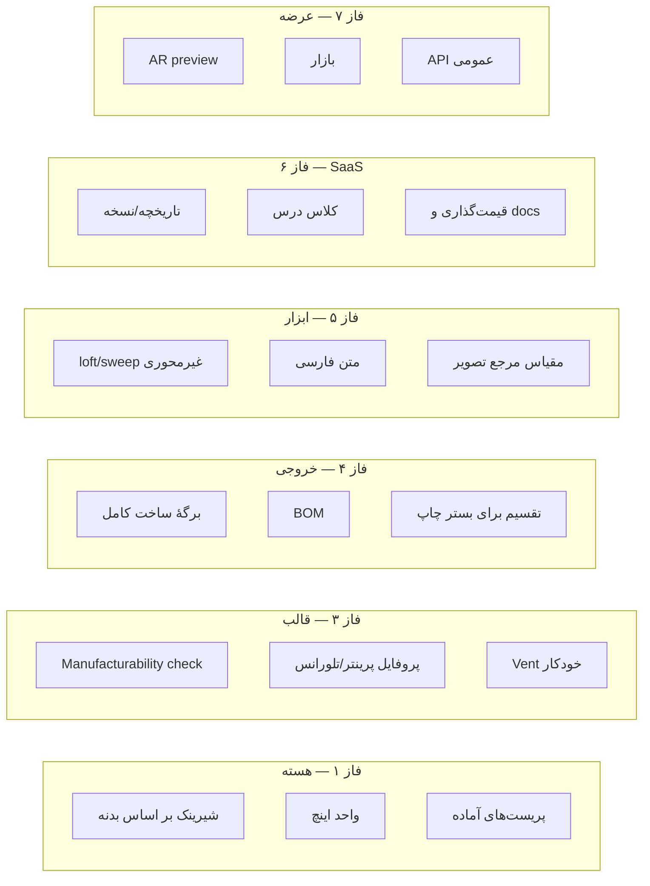

# ➕ فایل ۱۳ — تحلیل شکاف: چه چیزی در سایت نیست و **باید** اضافه شود

> شما خواستید «اگر چیزی ناقص است، اضافه شود». این فایل فهرست کامل شکاف‌های محصول مرجع است، با تفکیک «اعلام‌شده ولی مبهم»، «کاملاً غایب» و «ریسک‌های پنهان».
> هر مورد با 🎯 دلیل، 🔧 راه‌حل و 📊 معیار پذیرش آمده است.

---

## ۱. 🕳️ شکاف‌های بزرگ (Completely Missing)

### 1.1 🎓 آنبوردینگ و آموزش درون‌محصول
| مورد | وضعیت مرجع | افزودهٔ ما |
|------|-------------|------------|
| 🧑‍🏫 راهنمای گام‌به‌گام اولین پروژه | ❓ نامعلوم | **Tour اجباری ۵ مرحله‌ای** با پیشرفت قابل ذخیره |
| 💡 Tooltip آموزشی هر پارامتر | ❓ | هر پارامتر یک توضیح + تصویر کوچک |
| 📚 آکادمی (چرا draft؟ چرا کلید؟) | ❌ | ۱۰ مقالهٔ کوتاه درون‌محصول با لینک زمینه‌ای |
| 🎬 نمونه‌های قابل بازکردن | ❌ | «پروژهٔ نمونهٔ کوزه» با آموزش گام‌به‌گام |
| 📊 چک‌لیست آماده‌بودن ساخت | ❌ | قبل از خروجی: «دیواره ≥ ۳mm؟ draft ≥ ۱°؟ کلید ≥ ۲؟» |

🎯 **چرا:** کاربر بدون تجربه، بزرگ‌ترین ریسک ریزش است. TTFV هدف < ۱۰ دقیقه بدون آموزش ممکن نیست.
📊 **معیار:** ≥ ۸۰٪ کاربران جدید بدون تیکت، اولین خروجی را بگیرند.

### 1.2 🧪 اعتبارسنجی «قابل ساخت بودن» (Manufacturability Check)
| بررسی | حد | پیام |
|-------|-----|------|
| 🧱 ضخامت دیواره | ≥ ۳mm (رس) | «دیواره ۲.۱mm — احتمال ترک در پخت» |
| 📐 شیب دیوارهٔ قالب | ≥ ۱° | «بدون draft، قالب گیر می‌کند» |
| 🔑 فاصلهٔ کلید از لبه | ≥ r+3mm | «کلید بیش از حد نزدیک لبه» |
| 🕳️ گلوگاه | r_min > wall | «دیواره در گلوگاه نازک می‌شود» |
| ⚖️ وزن قالب | < ۱۰kg | «قالب ۱۲.۴kg — سنگین برای جابه‌جایی» |
| 🔪 undercut | بررسی خودکار | «نیاز به تقسیم» |
| 🌡️ حجم گچ | < ۵L | «مخلوط بزرگ — در دو نوبت بریز» |

🎯 **چرا:** خروجی «قابل پرینت» ≠ خروجی «قابل ساخت در کارگاه». این تفاوت، ارزش حرفه‌ای محصول است.
📊 **معیار:** ۱۰۰٪ خروجی‌ها قبل از دانلود چک شوند و گزارش قابل‌خواندن بگیرند.

### 1.3 ↩️ تاریخچه و نسخه‌بندی پروژه (Versioning)
| مورد | افزودهٔ ما |
|------|-------------|
| 🕰️ تاریخچه با اسنپ‌شات نام‌دار | «قبل از تغییر شکل دهانه» |
| 🔀 مقایسهٔ دو نسخه | نمای کنار‌هم + diff پارامترها |
| ♻️ بازگردانی | یک کلیک |
| 💾 خروجی نسخه به JSON | برای آرشیو شخصی |

🎯 بدون این، کاربر حرفه‌ای به محصول اعتماد نمی‌کند.

### 1.4 🧾 «دستور ساخت» (Build Sheet) کامل
> سایت فقط «Print a dimension sheet» را اشاره می‌کند. ما آن را به یک سند کامل تبدیل می‌کنیم:

```
📄 برگهٔ ساخت (A4، ۱:۱)
├─ 🖼️ تصویر سه‌بعدی + نمای مقطعی
├─ 📏 ابعاد کلیدی (wet / dry)
├─ 📊 جدول پارامترها
├─ 🧮 گچ/آب هر قطعه + زمان کار
├─ 🔢 ترتیب مونتاژ قالب (نمودار انفجاری)
├─ 📐 پروفیل با خط‌کش (برای مقایسه روی چرخ)
├─ 🔑 نقشهٔ کلیدها
├─ 📋 چک‌لیست ساخت (چاپ، ریختن، خشک‌کردن)
└─ 🔳 QR به پروژهٔ آنلاین
```

### 1.5 🎨 پیش‌نمایش واقع‌گرایانه (Material Preview)
| مورد | چرا |
|------|-----|
| 🧱 متریال سفال (بدون لعاب) | کاربر نتیجهٔ چاپ‌شده را ببیند |
| ✨ لعاب (مات/براق) | تصمیم‌گیری زیبایی |
| 💡 نور استودیو / نور کارگاه | نمایش بهتر بافت |
| 🎞️ توربین (چرخش ۳۶۰°) | درک فرم |

🎯 سایت تصاویر استاتیک دارد. پیش‌نمایش متریال، تمایز محسوس است.

### 1.6 📱 حالت آفلاین
| مورد | افزوده |
|------|--------|
| 💾 ذخیره در IndexedDB | کار بدون اینترنت |
| 🔄 همگام‌سازی صف | وقتی آنلاین شد |
| 🏷️ نشان «آفلاین» | شفافیت |

🎯 کارگاه سفال často اینترنت ضعیف دارد. این قابلیت یک مزیت واقعی است.

### 1.7 🌍 صادرات داده و مالکیت (Data Portability)
| مورد | افزوده |
|------|--------|
| 📦 Export همهٔ پروژه‌ها (ZIP JSON) | GDPR + اعتماد |
| 🗑️ حذف کامل حساب با تأیید | الزام قانونی |
| 📜 سند مالکیت روشن | «هرچه می‌سازی مال توست» به‌صورت متن حقوقی |

### 1.8 ♿ دسترس‌پذیری ادیتور سه‌بعدی
سایت هیچ اشاره‌ای ندارد. ما الزام می‌کنیم:
- 🎚️ همهٔ پارامترها با کیبورد قابل تغییر (Arrow/PageUp/Home)
- 🔊 اعلام تغییرات با `aria-live`
- 🎯 جایگزین متنی ابعاد (جدول قابل خواندن با screen reader)
- 🚫 بدون وابستگی صرف به رنگ

### 1.9 🧑‍🤝‍🧑 همکاری و اشتراک‌گذاری
| مورد | افزوده |
|------|--------|
| 🔗 لینک مشاهدهٔ فقط‌خواندنی | بدون نیاز به حساب |
| 👥 کتابخانهٔ تیم (پلن Studio) | برای استودیوها/کلاس‌ها |
| 💬 کامنت روی پروژه | بازخورد استاد به دانشجو |
| 🏫 حالت کلاس درس | کلاس + تکلیف + قالب مشترک |

🎯 FAQ سایت به «کلاس درس» اشاره می‌کند اما هیچ قابلیتی برای آن ندارد → **شکاف آشکار**.

### 1.10 🛒 بازار و ساخت سفارشی (Marketplace)
| سطح | توضیح |
|------|-------|
| 🏭 سفارش ساخت | «این STL را برایم چاپ کن» → اتصال به سرویس چاپ محلی |
| 💰 فروش طرح | طراح می‌تواند الگو/فرم بفروشد (کمیسیون) |
| 📦 کیت فیزیکی | قالب چاپ‌شده ارسال شود |

> ⚠️ در نقشه راه فاز ۶+ و بعد از اعتبارسنجی هسته. اما **مدل داده باید از روز اول آماده باشد** (`visibility`, `license`, `price`).

---

## ۲. 🌫️ شکاف‌های «اعلام‌شده ولی مبهم» (Ambiguous)

| قابلیت | ابهام در سایت | تصمیم ما |
|--------|----------------|-----------|
| 🗺️ **Stencil Making** | «Map designs to 3D Forms» — چه نوع استنسیلی؟ | **دو خروجی:** استنسیل تخت (unwrap) + استنسیل سه‌بعدی چاپی. هر دو با پل و علائم تراز |
| 🧱 **Multi-part molds** | «۲ یا بیشتر» — معیار تقسیم؟ | الگوریتم auto با امتیازدهی + نمایش دلیل + اجازهٔ دستی |
| 🪆 **Mother mold** | «barrier» چیست دقیقاً؟ | دو حالت صریح: پرینت (پوسته + barrier ۲mm) و سیلیکون (مدل قطعهٔ نهایی + jacket) |
| 📏 **Shrink rate** | کجا اعمال می‌شود؟ | **سه جا:** نمایش ابعاد خشک، مقیاس فرم داخل قالب، خروجی STL. با توگل روشن/خاموش |
| 💧 **Volume calculator** | با دیواره؟ با fill؟ | هر دو: `Capacity` (تا لبه) و `Filled(x%)` + نسخهٔ خشک |
| 🎯 **Curvature mapping** | «دو جهت» — الگوریتم؟ | منحنی-آگاه با طول قوس + شاخص distortion و هشدار |
| 📤 **Export «print, cut, or mill»** | فرمت‌ها؟ | STL/3MF/OBJ/STEP* + SVG/DXF + PDF. (*STEP در فاز ۶ اگر opencascade اضافه شد) |
| 🍪 **Cookie cutter** | تیغه چطور؟ | ارتفاع و **زاویهٔ تیزی** جدا، با اعتبارسنجی نسبت |

---

## ۳. 🧯 ریسک‌های پنهان محصول (که سایت حل نکرده)

| # | ریسک | چرا مهم | راه‌حل ما |
|---|------|----------|-----------|
| R1 | 🔪 **فرم‌های غیرمحوری** | همهٔ موتور revolve-محور است؛ اما هنر واقعی (مجسمه، اسباب‌بازی) غیرمحوری است | `loft`/`sweep` + قالب مبتنی بر raycast (فاز ۵) |
| R2 | 🧱 **اعتماد به CSG** | Boolean ممکن است در فرم‌های پیچیده شکست بخورد | manifold + ترمیم voxel + هشدار صریح + «ارسال پروژه به تیم» |
| R3 | 🌡️ **داده‌های مواد** | شیرینک بدنهٔ رسی متفاوت است (بسته به بدنه و دمای پخت) | جدول شیرینک بر اساس نوع بدنه (Stoneware 12٪، Porcelain 15٪، Earthenware 7٪) + امکان سفارشی |
| R4 | 🧪 **گچ/آب** | نسبت‌ها متفاوت‌اند و درجهٔ گچ مهم است | انتخاب نوع گچ (پاریس/پوتر/α) با نسبت‌های پیش‌فرض + ضریب اتلاف |
| R5 | 📐 **دقت چاپ سه‌بعدی** | تلورانس کلید به پرینتر بستگی دارد | پروفایل پرینتر (FDM/SLA/CNC) با تلورانس پیش‌فرض |
| R6 | 🕳️ **حبس هوا** | قالب بدون vent، حباب می‌دهد | تولید خودکار vent در مادرقالب + راهنمای چرخش |
| R7 | 📏 **واحد اینچ** | بازار آمریکا | تبدیل نمایشی + ورودی اینچ با دقت ۱/۱۶ |
| R8 | 🖨️ **پرینترهای بزرگ** | قالب بزرگ‌تر از بستر | تقسیم خودکار قطعه برای چاپ (tile & join) + اتصال |
| R9 | 💾 **حجم پروژه با تصاویر** | ترِیس‌ها بزرگ می‌شوند | ذخیرهٔ مسیر وکتور (نه تصویر) + ساده‌سازی |
| R10 | 🧑‍🎨 **مالکیت طرح‌های ترِیس‌شده** | کپی‌رایت | هشدار صریح + تأیید کاربر قبل از ترِیس |

---

## ۴. 🆕 ابزارها و قابلیت‌های پیشنهادی (فراتر از مرجع)

| # | ابزار/قابلیت | ارزش | فاز |
|---|----------------|------|-----|
| A1 | 📐 **Rib set generator** | مجموعهٔ ریب هم‌خانواده برای یک فرم | ۵ |
| A2 | 🧮 **Clay body calculator** | وزن بدنه لازم از حجم فرم | ۵ |
| A3 | 🔥 **Firing schedule helper** | برنامهٔ پخت پیشنهادی بر اساس ضخامت | ۶ |
| A4 | 🎨 **Glaze pattern preview** | شبیه‌سازی لعاب روی الگو | ۶ |
| A5 | 📸 **AR preview** | دیدن قالب روی میز کار با موبایل | ۷ |
| A6 | 🔗 **Recipe sharing** | اشتراک «دستور ساخت» کامل | ۶ |
| A7 | 🧾 **BOM exporter** | لیست خرید گچ/سیلیکون/پرینت | ۴ |
| A8 | 🕹️ **Parametric recipes** | ضبط دنبالهٔ تغییرات به‌عنوان ماکرو | ۶ |
| A9 | 📊 **Batch planner** | چند قطعه در یک ریختن گچ | ۶ |
| A10 | 🌐 **Community challenges** | چالش ماهانه با فرم پایه | ۶ |
| A11 | 🧑‍🏫 **Course mode** | کلاس + تکلیف + نمره‌دهی | ۶ |
| A12 | 🖨️ **Print farm integration** | ارسال مستقیم به سرویس چاپ | ۷ |
| A13 | 🧲 **Snap-to-feature** | چسبیدن پارامتر به ویژگی فرم (بیشترین قطر) | ۳ |
| A14 | 🎯 **Constraint solver** | «دهانه را ۷۲mm نگه دار» با حل خودکار | ۴ |
| A15 | 🧵 **Texture library** | بافت‌های آمادهٔ سطح (برای حکاکی/مهر) | ۵ |

---

## ۵. 📋 شکاف‌های محتوایی و بازاریابی سایت

| صفحه | وضعیت | افزودهٔ لازم |
|------|--------|--------------|
| 💰 `/pricing` | ❌ وجود ندارد (فقط FAQ) | صفحهٔ کامل با جدول مقایسه |
| 📖 `/docs` | ❌ | مستندات محصول + آموزش |
| 🧠 `/learn` | ❌ | آکادمی سفال دیجیتال (SEO قوی) |
| 📰 `/blog` | ❌ | محتوای رشد |
| 📅 `/changelog` | ❌ | اعتماد و شفافیت |
| 🏢 `/about` | ❌ | داستان، تیم |
| ⚖️ `/terms` | ❌ (فقط privacy) | شرایط استفاده + مالکیت IP |
| 🔒 `/security` | ❌ | اعتماد سازمانی |
| ♿ `/accessibility` | ❌ | تعهد |
| 🌐 `/status` | ❌ | وضعیت سرویس |
| 👥 `/community` | فقط feature-requests | گالری پروژه‌ها |
| 🎯 `/use-cases` | ❌ | سفالگر، معلم، سازنده، تولیدکننده |
| 🔍 سئو | sitemap کوچک (۵ صفحه) | صفحات ابزار، الگو، آموزش (long-tail) |
| 🎥 ویدیو | ❌ | ۵ ویدیو ۲دقیقه‌ای |
| 📊 مقایسه | ❌ | «Patturn vs Rhino vs Illustrator» |

### 🎯 محتوای SEO پیشنهادی (long-tail با نیت بالا)
```
/slip-casting-mold-guide
/how-to-make-a-two-part-mold
/ceramic-shrinkage-chart
/plaster-to-water-ratio-calculator
/how-to-make-a-cookie-cutter
/laser-cut-stencil-for-pottery
/3d-print-trimming-chuck
/rib-tools-for-potters-explained
```
> 💡 هر کدام یک صفحهٔ ابزار/محاسبه‌گر رایگان → ورودی قیف.

---

## ۶. 🧩 شکاف‌های فنی سایت مرجع

| مورد | مشاهده | افزودهٔ ما |
|------|--------|-----------|
| 🌐 چند‌زبانه | فقط انگلیسی | fa/en از روز اول + RTL |
| 📱 PWA | ❌ | manifest + آفلاین + نصب |
| ⌨️ میان‌بر | ❓ | Command palette `⌘K` + میان‌برهای کامل |
| 📊 آنالیتیکس محصول | فقط Vercel | قیف رویدادی (بدون PII) |
| 🐞 گزارش خطا | ❓ | Sentry + «Export debug bundle» |
| 🧪 تست | ❓ | Golden tests + E2E |
| 📦 API عمومی | ❌ | REST عمومی برای پروژه‌ها (پلن Studio) |
| 🔌 پلاگین الگو | ❌ | `PatternDef` قابل افزودن توسط جامعه (مرحلهٔ بعد) |
| 🗄️ ذخیرهٔ نسخه | ❓ | revisions |
| 🧾 گزارش ساخت | ❌ | PDF کامل |

---

## ۷. 🎯 نقشهٔ افزودن شکاف‌ها به فازها



---

## ۸. ✅ چک‌لیست «هیچ‌چیز جا نمانده» (Completeness Checklist)

### محصول
- [ ] 🏺 فرم: نود، revolve، wall، foot ring، shrink، fill
- [ ] 📊 محاسبات: capacity، filled، dry، weight
- [ ] 🔷 الگو: ۱۲+ پایه، پارامتر، کاشی بی‌درز، بوم mm
- [ ] 🌐 نگاشت: استوانه‌ای + منحنی-آگاه + distortion
- [ ] 🗺️ استنسیل: unwrap، bridges، bleed، registration، cut lines
- [ ] 🧱 قالب: تک‌تکه، چندتکه (عمودی/افقی)، کلید، draft
- [ ] 🪆 مادرقالب: پرینت + سیلیکون + barrier + vent
- [ ] 🧮 گچ/آب: فرمول + اتلاف + زمان کار + دستور ساخت
- [ ] 🍪 کاتر: تیغه، SVG، ترِیس، ترسیم آزاد
- [ ] 🖼️ ترِیس: Otsu، ساده‌سازی، مقیاس مرجع
- [ ] ✏️ وکتور: pen، boolean، offset، متن فارسی
- [ ] 🫖 دسته، 📐 ریب، 🔖 مهر، 🔩 چاک، ⭕ رینگ، 🎛️ دای، 📦 loft، ✂️ تقسیم افقی
- [ ] 📄 اسلب، 🧩 پازل، ⚙️ jigger
- [ ] 📤 خروجی: STL/3MF/OBJ/SVG/DXF/PDF/ZIP

### اپ
- [ ] 🔐 ورود Google + ایمیل
- [ ] 💾 ذخیره خودکار + آفلاین + تعارض
- [ ] 🕰️ تاریخچه نسخه
- [ ] 📁 پروژه‌ها + جستجو + تگ
- [ ] 💳 پلن + Stripe + سهمیه
- [ ] 👥 جامعه + لایسنس + fork
- [ ] 🗳️ رأی‌گیری قابلیت
- [ ] 🧑‍🏫 آنبوردینگ + آکادمی
- [ ] 🛠️ ادمین
- [ ] 📧 ایمیل تراکنشی

### کیفیت
- [ ] 🏅 تست‌های طلایی
- [ ] 🧪 E2E
- [ ] ♿ WCAG AA
- [ ] 🌐 fa/en + RTL
- [ ] ⚡ بودجه عملکرد
- [ ] 🔒 امنیت و rate limit
- [ ] 📊 پایش خطا

### صفحات
- [ ] `/` `/pricing` `/docs` `/learn` `/blog` `/changelog` `/about` `/terms` `/privacy` `/security` `/status` `/contact` `/feature-requests` `/community` `/use-cases` `/login` `/studio` `/projects` `/library` `/account`

---

## ۹. 🚦 اولویت شکاف‌ها (اگر وقت محدود است)

| اولویت | شکاف | چرا اول |
|--------|------|---------|
| 🥇 **P0 (بدون این‌ها محصول کار نمی‌کند)** | manufacturability check · شیرینک در همه لایه‌ها · manifold validation · آنبوردینگ · ذخیره/بازیابی مطمئن · برگهٔ ساخت | اعتماد و کارکرد |
| 🥈 **P1 (تمایز)** | منحنی-آگاه · مادرقالب · تقسیم خودکار · ترِیس تصویر · تاریخچه | ارزش حرفه‌ای |
| 🥉 **P2 (رشد)** | جامعه · کلاس درس · بازار · AR · SEO | درآمد |
| 🏅 **P3 (آینده)** | API عمومی · پلاگین الگو · همکاری realtime | مقیاس |

---

## ۱۰. ✍️ جملهٔ پایانی برای AI

> «هر چیزی که در این فایل به‌عنوان شکاف آمده، **الزام تکمیلی** است. اگر بین «بازسازی دقیق سایت» و «افزودن شکاف‌های حیاتی» تعارض بود، **شکاف حیاتی را ترجیح بده** — هدف، ساخت محصولی *بهتر* از مرجع است، نه یک کپی.»

---

⬅️ بازگشت به [`README.md`](./README.md)


---

## شکاف‌های جدید پس از مطالعهٔ SolidVents

جدول‌های قدیمی این سند دربارهٔ مرجع قبلی‌اند؛ نماد «غایب» در آن‌ها را به SolidVents تعمیم ندهید. [سند۱۶](16-SOLIDVENTS-SPEC.md) منبع تازه و مبتنی بر مدرک است. **مستندبودن قابلیت در مرجع با وجود آن در Patturn متفاوت است.**

| شکاف Patturn | اقدام و معیار | IDs |
|---|---|---|
| pattern preset به‌جای موتور layout/controller | جداسازی boundary/style/layout/channel، switch بدون ازبین‌رفتن recipe | 01–11,19–23 |
| نبود vector editor جامع | parser امن/لایه/boolean/fillet/mirror/snap و morph topology-aware | 12–18,24–25 |
| نبود B-rep CAD | spike مستقل، STEP واقعی و draft/split و دو CAD، نه triangulation با نام STEP | 32–34 |
| UV محدود به‌جای Wrap | انتخاب face و flatten seam-aware و distortion budget و profile/depth | 35–39 |
| ذخیره/پیشنهاد محلی به‌جای سرویس جامعه | پوشه/ZIP/disk/conflict، cloud اختیاری و marketplace moderated | 40–43 |
| AI بدون قرارداد امن | MCP/REST همان engine و DSL bounded، revoke/TTL و no prompt logging | 44–46 |
| آمار تزئینی/مجموع مساحت | union clipped و error bound، حداقل ligament/edge/process warnings | 49–50 |

افزوده‌هایی فراتر از رفتار مرجع: هندسهٔ قابل‌ردگیری و snapshot hash، آفلاین بدون fingerprint/سهمیهٔ سرور، گزارش distortion با حد خطا، حداقل ضخامت/ligament و فرایند ساخت، تحلیل امنیت فایل/DSL، export reproducibility و accessible workflow. این موارد نیاز مهندسی‌اند؛ ادعای نبود آن‌ها در مرجع بدون مدرک نشود.

ابهام‌ها: فرمول ترکیب کنترلرها، همهٔ گزینه‌های UI/حد منابع، کیفیت عملی CAD و freeform و فروشگاه/پرداخت تعاملی تأیید نشده. تناقض Fixed/morph با آخرین changelog حل قراردادی شده؛ در نخستین تست قابل‌دسترسی بازبینی لازم است.
