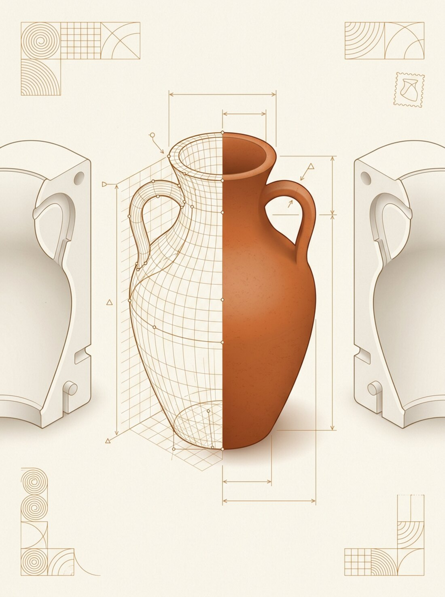
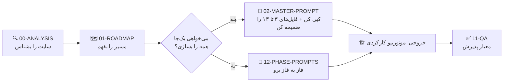

# 🏺 Patturn Studio — بستهٔ کامل تحلیل، نقشه راه و پرامپت پیاده‌سازی

> **هدف این بسته:** بازسازی کامل و حرفه‌ای نرم‌افزار **Patturn Studio** (ابزار طراحی پارامتریک برای سفالگران) به‌صورت سه‌بعدی، دو‌بعدی، قالب‌سازی، و تولید فایل‌های آمادهٔ ساخت — به‌همراه نقشه راه فازبندی‌شده و پرامپت‌های آماده برای دادن به هوش مصنوعی.

> 🖥️ **الزام اصلی محصول:** نرم‌افزار **فقط وب نیست** — باید روی **ویندوز** به‌صورت **نصب‌شدنی و کاملاً آفلاین** هم اجرا شود (نسخهٔ وب در صورت نیاز، اختیاری است). جزئیات در [`15-RULES.md`](./15-RULES.md) (R-014) و [`14-CHECKLIST.md`](./14-CHECKLIST.md) بخش ۹.

---

## 👤 نویسنده و پشتیبانی

| فیلد | مقدار |
|------|-------|
| 👤 نام نویسنده | **سعید نجفی** |
| 🏢 شرکت | **سهند سرویس** |
| 📞 شماره موبایل | **09144220430** |
| 📧 ایمیل پشتیبانی | **Pranses2011@GMail.com** |
| 💳 کارت واریزی و حمایت | **6219 8619 1893 4679** |
| 🌐 سایت | **EA-Fixer.ir** |

---

## 🖼️ نسخهٔ خواندنی (HTML)

اگر ترجیح می‌دهید همه‌چیز را یک‌جا و با قالب‌بندی، فهرست کنار صفحه و نمودار ببینید:

> **➡️ [`index.html`](./index.html)** — آرشیو کامل RTL با پوستهٔ «کارگاه سفال» (۱۸ سند، جدول‌ها و نمودارهای Mermaid)

برای بازسازی آن پس از هر ویرایش مارک‌داون: `python3 build_handbook.py`



---

## 📑 فهرست فایل‌ها

| # | فایل | آیکون | محتوا | برای چه کسی |
|---|------|-------|-------|-------------|
| 0 | [`00-ANALYSIS.md`](./00-ANALYSIS.md) | 🔍 | تحلیل کامل و آینه‌ای سایت patturn.studio (محصول، صفحات، قابلیت‌ها، لحن برند، تکنولوژی حدس‌زده‌شده، شکاف‌ها) | درک محصول |
| 1 | [`01-ROADMAP.md`](./01-ROADMAP.md) | 🗺️ | نقشه راه کامل ۸ فازی با تایم‌لاین، پیش‌نیازها، معیار خروج (Exit Criteria) و ریسک‌ها | مدیریت پروژه |
| 2 | [`02-MASTER-PROMPT.md`](./02-MASTER-PROMPT.md) | 🧠 | **پرامپت اصلی و جامع** — همین را یک‌جا به هوش مصنوعی بدهید | کپی-پیست به AI |
| 3 | [`03-ARCHITECTURE.md`](./03-ARCHITECTURE.md) | 🏗️ | معماری فنی، استک، ساختار پوشه‌ها، مرزهای ماژول، انتخاب هستهٔ هندسه (Geometry Kernel) | مهندس نرم‌افزار |
| 4 | [`04-DATA-MODEL.md`](./04-DATA-MODEL.md) | 🗄️ | مدل داده، JSON Schema پارامترها، قرارداد ذخیره‌سازی، نسخه‌بندی، مهاجرت | بک‌اند |
| 5 | [`05-MODULE-FORMS.md`](./05-MODULE-FORMS.md) | 🏺 | ماژول فرم‌میکر ۳بعدی + محاسبهٔ حجم/شیرینک + فوت‌رینگ | فرانت ۳بعدی |
| 6 | [`06-MODULE-PATTERNS.md`](./06-MODULE-PATTERNS.md) | 🔷 | ماژول تولید الگو، کاشی‌بندی بی‌درز، بُردن روی فرم، استنسیل | فرانت ۲بعدی |
| 7 | [`07-MODULE-MOLDS.md`](./07-MODULE-MOLDS.md) | 🧱 | ماژول قالب‌سازی تک‌تکه/چندتکه، کلیدهای ثبت، مادرقالب، محاسبهٔ گچ | هندسه/CSG |
| 8 | [`08-MODULE-TOOLS.md`](./08-MODULE-TOOLS.md) | 🛠️ | کاتر کوکی، دسته‌ساز، ریب‌ساز، مهر، چاک، رینگ‌روندر، دای اکسترودر | ماژول‌های تکمیلی |
| 9 | [`09-UI-DESIGN-SYSTEM.md`](./09-UI-DESIGN-SYSTEM.md) | 🎨 | سیستم طراحی، رنگ‌ها، تایپوگرافی، کامپوننت‌ها، لایه‌بندی ادیتور، دسترس‌پذیری | UI/UX |
| 10 | [`10-BACKEND-AUTH-BILLING.md`](./10-BACKEND-AUTH-BILLING.md) | 🔐 | احراز هویت، پلن‌ها و پرداخت، سهمیه، ایمیل، آنالیتیکس، امنیت | بک‌اند |
| 11 | [`11-QA-ACCEPTANCE.md`](./11-QA-ACCEPTANCE.md) | ✅ | استراتژی تست، تست‌های طلایی هندسه، DoD هر ماژول، چک‌لیست پذیرش | QA |
| 12 | [`12-PHASE-PROMPTS.md`](./12-PHASE-PROMPTS.md) | 🚀 | پرامپت‌های کوتاه‌تر و اجرایی برای هر فاز (به‌ترتیب به AI بدهید) | اجرای مرحله‌ای |
| 13 | [`13-GAP-ANALYSIS.md`](./13-GAP-ANALYSIS.md) | ➕ | هر چیزی که سایت ندارد/ناقص است و **باید** اضافه شود | تکمیل محصول |
| 14 | [`14-CHECKLIST.md`](./14-CHECKLIST.md) | ✅ | **چک‌لیست کامل وظایف** — ۱۲۲ کار تیک‌خوردنی در ۱۳ بخش با توضیح مختصر و اولویت | پیگیری اجرا |
| 15 | [`15-RULES.md`](./15-RULES.md) | ⚖️ | **قوانین لازم‌الاجرای هوش مصنوعی** — ۱۹ قانون + قالب افزودن قانون جدید؛ افزایش نسخه و انتشار فایل وب/ویندوز پس از هر تغییر | الزام به AI |

| 16 | [`16-SOLIDVENTS-SPEC.md`](./16-SOLIDVENTS-SPEC.md) | 🧩 | تحلیل منابع عمومی، ۵۰ نیاز، ۱۲ فاز وابسته و معیار پذیرش الگو/CAD/Wrap؛ نه ادعای پیاده‌سازی | همهٔ نقش‌ها |

---

## 🧭 چطور از این بسته استفاده کنم؟



### ⚖️ قبل از هر چیز: قوانین را بدهید

در **هر سه روش** اول فایل [`15-RULES.md`](./15-RULES.md) را به هوش مصنوعی بدهید تا پایبندی‌اش را اعلام کند (مخصوصاً R-001 به‌روزرسانی قبل از تغییر و R-002 کامیت و پوش مستقل پس از تغییر هر فایل با توضیح کامل طبق R-003). سپس چک‌لیست [`14-CHECKLIST.md`](./14-CHECKLIST.md) را برای پیگیری وضعیت نگه دارید.

### سه روش پیشنهادی

1. **روش «یک‌جا» (سریع، برای مدل‌های با پنجرهٔ زمینهٔ بزرگ):**
   فایل `02-MASTER-PROMPT.md` را کپی کنید و سپس فایل‌های `03` تا `11` را هم به‌عنوان ضمیمه/پیام دوم بدهید.

2. **روش «فازی» (توصیه‌شده، کیفیت بالاتر):**
   اول `01-ROADMAP.md` را بدهید تا AI نقشه را بپذیرد، بعد به‌ترتیب پرامپت‌های `12-PHASE-PROMPTS.md` (فاز ۰ تا ۷) را یکی‌یکی بفرستید. بعد از هر فاز، تست‌های `11-QA-ACCEPTANCE.md` را اجرا کنید و تیک‌های `14-CHECKLIST.md` را بزنید.

3. **روش «ماژول‌به‌ماژول»:** فایل `03` (معماری) + یک فایل ماژول (`05`…`08`) در هر نشست. برای پروژه‌های بزرگ بهترین کیفیت را می‌دهد.

---

## ⚠️ نکات مهم پیش از شروع

| نکته | توضیح |
|------|-------|
| 🎯 **دقت هندسی مهم‌تر از زیبایی** | هر پارامتر باید یک تابع قطعی (deterministic) به هندسه تولید کند. بدون قطعیت، پروژه‌های ذخیره‌شده در نسخه‌های بعدی می‌شکنند. |
| 📏 **واحد پایه = میلی‌متر** | همهٔ محاسبات داخلی با `number` در میلی‌متر. تبدیل اینچ فقط در لایهٔ نمایش. |
| 🧊 **مش باید watertight باشد** | هر خروجی STL باید بدون سوراخ، بدون نرمال معکوس، بدون بدنهٔ خودمتقاطع باشد. |
| 🔁 **ذخیرهٔ «پارامترها» نه «مش»** | فایل پروژه = JSON پارامترها. هندسه در کلاینت (WASM) بازتولید می‌شود. |
| 🧩 **ماژولار بودن ذاتی** | فرم، الگو، قالب «قطعه»های قابل ترکیب‌اند (مدل Lego). این هستهٔ محصول است، نه یک قابلیت جانبی. |
| 🚫 **از کپی مستقیم برند پرهیز کنید** | لوگو، فونت اختصاصی، تصاویر و متن‌های تبلیغاتی patturn.studio دارایی آن‌هاست. این بسته برای **بازسازی عملکرد و تجربه** است، نه تکثیر دارایی‌های برند. |

---

## 📌 خلاصهٔ یک‌خطی محصول (Elevator Pitch)

> **Patturn Studio** = «Figma + CAD پارامتریک برای سفال». کاربر بدون دانش طراحی، با اسلایدر و نود، فرم چرخشی می‌سازد، الگوی بی‌درز روی آن می‌نشاند، قالب سیلیپ‌کستینگ چندتکه با کلیدهای ثبت و مادرقالب تولید می‌کند و همه را به‌صورت STL/SVG/DXF/PDF آمادهٔ پرینت سه‌بعدی، برش لیزر یا چرخ سفالگری دانلود می‌کند — با محاسبهٔ خودکار شیرینک، حجم، و نسبت گچ/آب.

---

*نسخهٔ بسته: 1.0 — تاریخ تحلیل: 2026-11-20*

## بازتولید و بررسی راهنما

```sh
python3 -m pip install -r patturn-rebuild/requirements.txt
python3 -m unittest discover -s patturn-rebuild -p 'test_*.py'
python3 patturn-rebuild/check_checklist.py
python3 patturn-rebuild/build_handbook.py
```

دستورها از ریشهٔ مخزن اجرا می‌شوند. نسخهٔ Markdown برای بازتولید یکسان قفل شده است.
workflow مستقل `Handbook consistency` در تغییر اسناد، شمارش چک‌لیست و تطابق `index.html` با منابع را بررسی می‌کند؛
پس از تغییر Markdown، HTML را هم بازتولید و همراه آن ثبت کنید. تغییر صرف اسناد، ساخت ویندوز را فعال نمی‌کند.
این بررسی صحت حساب و همگامی فایل تولیدی است، نه تأیید شواهد انجام هر قابلیت یا تست نصب ویندوز.


## دامنهٔ افزودهٔ SolidVents

[سند۱۶](16-SOLIDVENTS-SPEC.md) همراه تمام فایل‌های ۰۰–۱۵ خوانده شود؛ اسناد تخصصی با آن هماهنگ شده‌اند. بررسی مستندات عمومی کاملِ منابع خوانده‌شده است، نه آزمون عملی Pro/CAD/cloud. پیاده‌سازی مستقل و بدون کپی دارایی/کد/preset لازم است. ۵۰ مورد SV در چک‌لیست به‌صورت باز ثبت شده‌اند؛ برنامهٔ ۲۴هفته‌ای اولیه برای دامنهٔ جدید معتبر نیست و S0…S11 برآورد نقش/وابستگی/گیت جدا دارد.

شروع فنی: API آزمایشی createImageField برای نمونه‌برداری روشنایی تصویر با ۴۳ تست هدفمند؛ واردسازی فایل تصویر، UI، کانال‌های گرادیان و ادغام ProjectDoc هنوز کامل نیستند. این API به معنی تکمیل SV-23 نیست.
